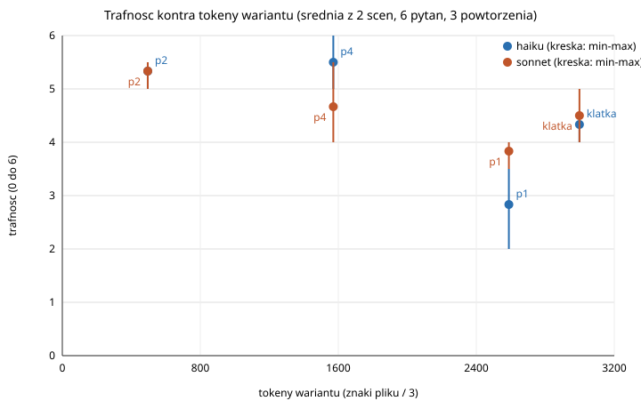
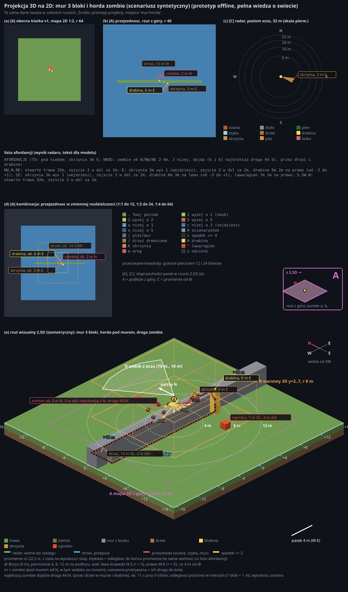
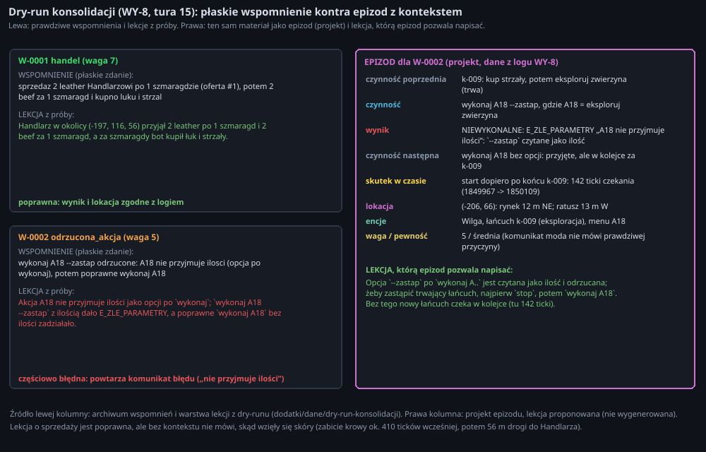
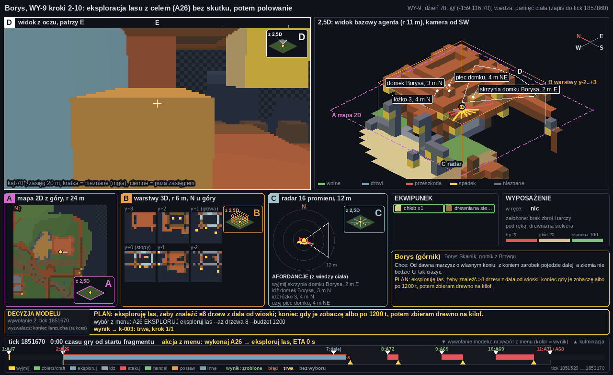
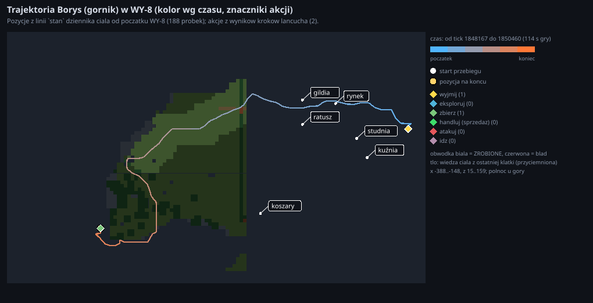
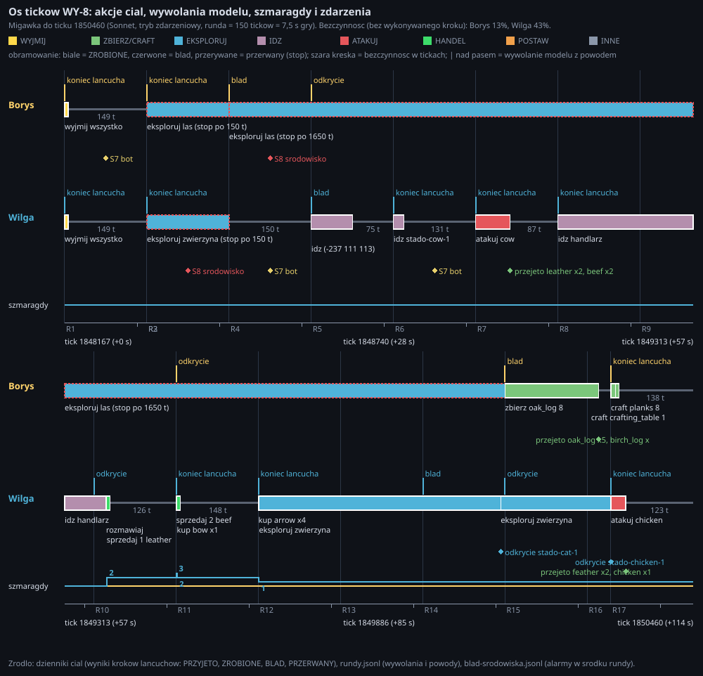

# LLM agents in Minecraft: the environment decides how the agent behaves

*Languages: English (this file) · [Polski](README.pl.md)*

**Repository map:** this article in English and the same article in Polish ([README.pl.md](README.pl.md)) · [figury/](figury/): figures used in the article · [dodatki/](dodatki/README.md): appendices (perception test, glossary, raw frames, videos; in Polish)

*Article v1, November 2026, condensed from a longer engineering essay (in Polish) and rewritten as recommendations; every number comes from the recorded runs or from the [perception test results](dodatki/test-percepcji/wyniki.md) (Polish).*

## Summary

I built a system in which language models (Haiku, Sonnet, Opus) control two Minecraft characters, Borys the miner and Wilga the hunter, purely through text. Each turn they receive a description of their state, maps, memory and an action menu, and they reply with goal-level commands that a server-side mod executes. The first complete "acquire, travel, sell" loop only worked once the environment started handing the model a ready-made frame of the world and a menu containing moves that were actually executable. The most expensive failures (a bot dismantling its own house, dozens of paid model calls spent on impossible actions) were caused by the environment, not by the model. This matters well beyond games, because the same mechanism is at work in every agent system: when we design tools, context and rewards, we are designing the shortest path the agent will take.

## Thesis

LLMs can plan and act in a complex world, but they plan along the path of least resistance: they pick the shortest route to the reward they can see in their context. That is why the environment largely determines how an agent behaves: what the agent sees, which moves it is offered, how rewards are priced, and whether the environment tells the truth about itself.

The shortest example: in one run the miner could not get out of his hut, because the door opened onto a ledge with no way down. The menu offered the action `zbierz oak_log` ("collect oak_log"), "nearest 2 m". The bot started harvesting the logs of its own hut. From the model's point of view this was a reasonable decision: the menu marked the action as executable, and it needed wood. The bug was in the menu.

What follows are five topics, each with 2 or 3 recommendations (the principle, the evidence from a run, how to apply it) and a "What it got us" paragraph with results and failures.

## 1. Environment: the model steers goals, the environment does the rest

The system has four layers: the language model; the harness (a Python script that calls the model, advances world time and records every turn); the server-side mod (an HTTP API with commands and reads, a movement planner, a chain simulator, body reflexes); and the world itself with two bodies. The model never sees an image and never presses keys.

**The model issues goal-level commands; code executes them.**
Evidence: commands look like "go to a place", "collect 4 logs", "attack the nearest sheep", and a chain has up to 5 steps, interrupted by reflexes (drinking, fleeing, lava, falling) and threats. In the first demos, when the model wrote commands "from memory", 35% of game time (out of 871 s) was eaten by unreachable targets: in mid-air, inside a block, beyond a cliff. The cause was not weak model intelligence but the lack of any way to check reachability before issuing a command.
How to apply: give the agent tools at the level of intent ("send the invoice to customer X"), not at the level of clicks. Keep movement, retries and safety reflexes in code that can be tested without the model.

**The world stands still while the model thinks.**
Evidence: turn-based mode is the default, because a model call takes hundreds of game ticks, and the world would change in the meantime. In event-driven mode the world advances in steps of 150 ticks, and the model is only called on a trigger (chain finished, error, discovery, threat). In the run where the hunter made her first sale, the chain that walked her to the trader took 322 ticks without a single new model decision.
How to apply: if your agent works in a system that changes on its own (queues, markets, tickets), freeze or version the state the model decides on, and check at execution time that the state has not changed.

**The environment reports time and uncertainty in units the model understands.**
Evidence: across the logs of both bodies, 78% of 804 walking plans succeeded, 19% were interrupted and 2% got stuck. Walks that needed replanning took a median of 2.26 times longer than planned (p90: 8.9 times). That is why every ETA comes with a p10 to p90 range, a risk and a confidence. The second reason was more painful: in the first run the miner read ticks as seconds, misjudged the time left until dusk, stayed out in the field and was killed by a creeper, losing an iron pickaxe that had taken about 10 minutes to obtain. Since then every time value in the interface is given both in ticks and in seconds.
How to apply: every tool that returns an estimate should also return a range and a confidence. State units explicitly, even when they seem obvious.

### What it got us

The architecture of goal-level commands plus turn-based mode held up across all runs and made it possible to test perception and movement without a model (the frame renderer is a pure "scene to text" function). Body reflexes and ETA ranges worked. The failure was the cost of this layer: the more the code does, the more the model depends on whether the code tells the truth.

## 2. Perception and actions: show what the model needs to decide

The model receives a text "frame": a body status line, a 3D map around its feet (6 layers), a 2D map with a 64-block radius, places from memory, the route of the current chain and a trace of previous steps. Next to it sits the action menu: a list of what the body can do right now, each item with an identifier, duration, risk and confidence. The model replies with something like `wykonaj A5 3 ; wykonaj A9` ("execute A5 3 ; execute A9").

**Measure information per token, and test formats on the model, not by eye.**
Evidence: I first built an offline prototype of four projections of the same world and scored them without a model on 21 control questions ("how do I get out of the hut?", "can the zombies reach the bot on the wall?"). The current frame scored 11.5 points at about 3050 tokens, the combination of walkability and an affordance list scored 16.5 points at about 1550 tokens, and a radar with an affordance list alone scored 13 points at about 470 tokens. Then came a model-in-the-loop test: 2 scenes (inside the hut, and a wall with a zombie horde), 6 questions, Haiku and Sonnet, 3 repetitions, graded by a separate model instance that did not know the variant name.

| variant (what the model gets) | model | accuracy (0 to 6) | spread | tokens (approx.) | accuracy per 1000 tokens |
|---|---|---:|---:|---:|---:|
| current frame | Haiku | 4.33 | 4.0 to 4.5 | 2998 | 1.45 |
| current frame | Sonnet | 4.50 | 4.0 to 5.0 | 2998 | 1.50 |
| 2.5D walkability | Haiku | 2.83 | 2.0 to 3.5 | 2589 | 1.09 |
| 2.5D walkability | Sonnet | 3.83 | 3.5 to 4.0 | 2589 | 1.48 |
| affordance list with radar | Haiku | 5.33 | 5.0 to 5.5 | 495 | 10.77 |
| affordance list with radar | Sonnet | 5.33 | 5.0 to 5.5 | 495 | 10.77 |
| combination (variable-resolution map plus affordances) | Haiku | 5.50 | 5.0 to 6.0 | 1571 | 3.50 |
| combination (variable-resolution map plus affordances) | Sonnet | 4.67 | 4.0 to 5.5 | 1571 | 2.97 |

The affordance list scored higher than the current frame for both models at roughly one sixth of the cost. The combination clearly won only for Haiku; for Sonnet the 0.17 difference is within the spread. 2.5D walkability, which looked good in the model-free prototype (14.5 out of 21), came out weakest with the model in the loop. The caveats are serious: 2 scenes are a signal, not statistical proof; one scene is synthetic; and the affordance list states part of the answer outright, so the model is partly copying rather than reasoning.

*Fig. 1. Accuracy of the four perception variants versus token count in the model-in-the-loop test (2 scenes, 6 questions, 3 repetitions); the dot is the mean, the bar is the min to max spread. Source: [perception test results](dodatki/test-percepcji/wyniki.md) (Polish).*

*Fig. 2. The bot on a wall with 6 zombies below, in four projections: (a) current 2D frame, (b) 2.5D walkability, (c) radar with affordance list, (d) combination; plus (e) an isometric view for the reader showing the zombies' path to the bot (44 blocks, through a door and up a ladder). From (c) the model can read directly that the zombies will get there, but only by that route. Source: projection prototype, synthetic scenario.*

How to apply: before you add yet another document to an agent's context, write a few control questions that context is supposed to answer, and compute accuracy per thousand tokens for two or three formats. A list of "what you can do here and what will happen" usually beats raw data.

**What is in the context acts as truth; what has to be looked up practically does not exist.**
Evidence: the key sentence "the body drinks automatically when thirst drops below 7" lived in a file that, in one run, no bot opened (0 read calls). The miner never once called the `regiony` ("regions") command, even though that read would have shown him a crafting table 38 m to the south. A `ROLA: zakaz polowania` ("ROLE: no hunting") annotation in the menu (left over from an old configuration) beat the role file, which the model never read. Once the harness started inserting a ready-made frame into every call, the frame reached the context in all 17 calls, with a median of 3455 tokens, and the hunter killed a cow, walked to the trader marked with a letter on the map, and sold 2 hides for 2 emeralds.
How to apply: put decision-critical facts into the context of every call, briefly. Treat "read on demand" tools as a supplement, not as the only source. Check in transcripts which files and reads the agent actually opens.

**The menu should contain only allowed and executable moves, computed by one function shared by the generator, the validator and the executor.**
Evidence: in one run the menu always offered `PIJ` ("DRINK") whenever thirst was below 20, but the action only drank from a water source within 4 blocks and refused bottles, while the menu generator checked for water within 12 blocks. Result: 12 chains aborted at step one, about 2.5 USD. The menu also offered attacking a cow inside a protected pen and a sheep outside the line of sight: 11 calls, about 2.3 USD. The positive example is validation at submission time: the simulator walks the chain step by step against the state after each step, and a rejected chain costs neither a tick nor a turn. In strict mode, a command that is not on the menu fails immediately with `E_NIE_Z_MENU` ("not from menu") and suggestions of similar actions.
How to apply: if your agent receives a list of available tools or actions, generate it with the same function that checks feasibility at execution time. An "executable" label without a shared definition is a trap. Validate the whole plan before execution, because an error caught before execution is the cheapest one.

### What it got us

Strict-mode menus eliminated syntax errors and mid-air targets, and putting the frame into the context coincided with the first sale (although that run combined several changes at once, so the effect cannot be attributed to the frame alone). Failures: the menu narrowed the world down to what the generator knew how to propose, and the generator had gaps (no action for taking items out of a chest, placing a crafting table, or selling). An observation: in the 46 model responses from that run I did not find a single reference to the map or the frame legend, so from behavior alone I cannot tell whether the model understands the format or merely acts consistently with it. The frame has a cost: on an Opus call costing 0.16 to 0.22 USD it adds 8 to 15%.

## 3. Memory: short knowledge, body memory with age, episodes instead of sentences

**Starting knowledge should live in one place, be short, and be consistent with what can actually be executed.**
Evidence: for three days the bots' knowledge grew incrementally: every audit appended another paragraph. A systematic review found 24 contradictory or outdated entries (in one file, line 17 said "digging is NOT allowed here" and line 19 said "everyone may dig"), protected-zone rules in 6 places and trader prices in 4. After merging the rules into a single table and adding a table of errors with fixes, the core read on every call shrank from 16,411 to 8869 characters, i.e. by 46%. The impact was mixed: in the first run on the new knowledge, Opus followed the rules best, but earnings did not go up, because the knowledge told the bot to take its starter kit out of a chest, and the menu had no "take out" action.
How to apply: keep the agent's rules in one table that distinguishes "enforced by code" from "the agent must comply on its own". The role says who the agent is and what it wants, not what it should type. Check every rule against the tools: a mismatch between knowledge and interface is worse than no knowledge, because the model burns calls on attempts.

**Body memory records only what the body has seen, with the age of each observation, and is surfaced for decisions by need, not by distance.**
Evidence: memory grew in layers (places, herds, ore deposits, hunting grounds, place events, a "nothing remembered" observation), each with an age and an expiry. It worked well as a record and less well as a source of decisions: the miner's memory held 88 places, but the "go" menu showed only the 8 nearest. The well was 119 m to the west, the market with the trader 165 m further; both were in memory and outside the menu. In that run neither bot reached water or the trader. The miner also knew about eight ore deposits and had no pickaxe, and the ore memory was not connected to the "wood, planks, crafting table, pickaxe" chain.
How to apply: tag every fact in the agent's memory with its source and age. When choosing what to show in the context, rank by goal and need, not by recency or proximity. A richer memory can push the most important thing out of view.

**Draw lessons from episodes with context, not from flat sentences.** This recommendation rests on a design and a single trial; the episode schema and the semantic network are not implemented.
Evidence: consolidation of flat memories works and has been checked in a dry run: while the world is paused, a separate read-only subagent turns memories into lessons, and a write guard admits them into a layer that expires unless confirmed. From two real memories of the hunter (cost 0.0189 USD) it produced two lessons. The lesson about selling was correct. The lesson about action A18 was partly wrong: it repeated the mod's error message ("A18 does not accept a quantity"), while the real cause was that the `--zastap` ("replace") option had been parsed as a quantity. An episode that includes the preceding activity (an exploration chain still running) and 142 ticks spent waiting in the queue makes it possible to write a useful lesson: first `stop`, then `wykonaj A18`.

*Fig. 3. Left column: real memories and lessons from the consolidation trial, with the A18 lesson marked as partly wrong. Right: an episode for the same memory, built from the log, and the lesson the episode makes it possible to write (a proposal, not system output). Source: memory archive and lesson layer from the trial, body log.*

How to apply: before you let an agent learn from its own history, record events with context: what came before, what came after, where, with whom, and with what outcome. A tool's error message is not the cause; a lesson built on it will cement the wrong diagnosis.

### What it got us

A shorter knowledge core improved rule-following, but not earnings, until the menu caught up with the knowledge. Body memory was the most polished layer of the system, and its value depended on whether the menu turned knowledge into action. Consolidation works on flat memories and showed its limit in the very first trial. Episodes (entities, location, a 2.5D projection from the peak moment, the preceding and following activity) and a semantic network linking them into a graph are still a design, illustrated with visualizations of logged data.

## 4. Planning: the model takes the shortest path it can see

**The model picks the cheapest route to the visible reward, so the environment is what designs the shortest path.**
Evidence: three examples from different runs. The miner, locked in his hut, harvested the logs of its walls, because `zbierz oak_log` was in the menu as executable and the chest tool had returned a "target inside block" error four times. The hunter, in the run with the first sale, made only reflexive decisions with no deliberation, and her money-making plan was coherent, because the menu offered a ready-made sell action with a price and a route. In the next run the miner wrote in his plan "done when I see them or after 1200 t, then I collect wood for a pickaxe", and when the forest exploration ended after 796 ticks and 97 m with an `E_NIE_ZNALEZIONO` ("not found") error, he picked the nearest game animal from the menu; the plans in the following calls no longer mentioned wood or a pickaxe, only chickens, sheep and selling.

*Video 1. The miner: a forest exploration with a stop condition ends with `E_NIE_ZNALEZIONO`, then the plan drifts into hunting (a chicken, a sheep twice). Below the frame: a decision bar (plan, chosen menu item, chain result) and the run's decision timeline. Source: body log, turn transcripts, mod log.*

How to apply: before you judge an agent's plan, write down the shortest path to the reward given what the agent has in front of it (tool menu, context, metric). If that path is dangerous or worthless, change the environment: remove the action, protect the resource in code, add a reward for the right outcome. A prohibition in the instructions is not enough.

**Observation: the model avoids risk that nobody named, and does not mention it.**
Evidence (operator observation, a single run, not verified in transcripts): at first the hunter went to the first meadow she knew. After two pillagers were placed to the north of it and added to her knowledge as a location, with a note that they carry very high-quality tools and no word about danger, she started exploring the area around the village instead of going to the meadow. At the same time she set off without hesitation for the ruined Nether portal when she knew there was plenty of iron there and the knowledge said nothing about enemies. Hypothesis: the model prices risk on its own from indirect cues and weighs it against reward, and the description of a location steers the route more strongly than an explicit prohibition. To verify: whether the pillagers or the risk come up even once in the model's reasoning.
How to apply: do not judge an agent only by what it says about its reasons. Compare its routes and choices with what it had in context, and treat descriptions of resources (documents, systems, customers) as steering, even when they contain no instruction.

**Actions and plans must know their own stop condition, and the environment must wake the model when the goal is within reach.**
Evidence: in the run with the first sale, the miner stood next to a forest (77 trunks, nearest 5 m, `zbierz oak_log` in the menu), while the `eksploruj las` ("explore forest") chain kept going for over 1650 ticks and 150 m, all the way to the edge of the play area. Exploration only ended on a new discovery, a time limit, or after 8 segments; known places were by design not targets, and no trigger called the model. In the next run the menu item stated the goal explicitly (`eksploruj las --az drzewa 8 --budzet 1200`, roughly "explore forest --until trees 8 --budget 1200"), and both exploration chains ended with a code and a reason instead of a march to the border. The stop condition worked on the action side; on the plan side it did not yet, as the drift described above shows.

*Fig. 4. The miner's trajectory with actions: taking the kit out in the hut, then long `eksploruj` walks to the west, without harvesting at the forest that was within reach. Source: status lines and chain step results in the body log.*

How to apply: launch every long-running agent task (search, review, migration) with an explicit success criterion, a budget, and a "not found" outcome. After a failure, force a return to the plan, not to the nearest available action.

### What it got us

Where the shortest path made sense, the model planned well and cheaply: the hunt, market, sell, buy-a-bow loop ran in reflexive mode. Where the shortest path led through destruction or an aimless march, the model took it without hesitation. In the early runs the bots got stuck on the exploitation side and in loops (drinking with no water, no sales), and exploration mostly produced worthless discoveries. A daily-plan rule made it into the knowledge, but the bots wrote a `PLAN` line 15 times and `PLAN DNIA` ("DAILY PLAN") not once: the rule exists, the habit does not. I have not yet measured how exploration is priced (the reward for the unknown).

## 5. Monitoring: observe the agent the way a human reads it

**One text record from which every view is generated deterministically.**
Evidence: since the first milestone, every turn goes into a JSONL log, and every perception frame goes into the log byte for byte with a sha256 checksum; a ring buffer of the last 20 frames makes it possible to reproduce exactly what the model saw. From that same record a script generates timelines, trajectories, decision trees and videos. I consider this the most valuable decision, because none of the audits would have been possible without it. The timeline of a single run immediately showed two different problems: the hunter was not executing any step 43% of the time, while the miner was busy almost continuously, except that for 1650 ticks this was one chain with no stop criterion.

*Fig. 5. Tick timeline of the run with the first sale: chain steps for each body, idle time, model calls with their reason, events, detector alarms and emeralds. Time without an executing step: miner 13%, hunter 43%. Source: body, round and alarm logs.*

*Video 2. The hunter kills a cow with two hits (picking up 2 hides and 2 beef), walks 56 m to the market, sells the goods for emeralds and buys a bow. In frame: first-person view, 2.5D projection, 2D map, 3D layers and radar. Frames rendered offline from body memory, the mod log and a copy of the world.*

How to apply: record every agent turn (input, reads, output, tool result) in a single text format, and generate charts, timelines and summaries from it with a script. Then every new view is cheap, and a manual audit can be repeated.

**The environment should detect its own errors before the model does so at your expense.**
Evidence: a detector in the harness compares what the environment promised with what actually happened, and classifies each anomaly as the fault of the environment, the bot or the model (eight signals, including a repeated error, divergence between simulation and outcome, standing still despite a chain, destroying buildings after a tool error, circling). Run retroactively on the records of three runs, it detected 10 out of 10 known cases; of 48 strong entries, 38 were confirmed by an audit or the log, and there were no definite false alarms. With a stop after 3 strong entries, one of the runs would have halted after 8 rounds and 2.44 USD instead of 48 rounds and 8.97 USD. On top of that there is a control track: 8 tool probes (door, ladder, stairs, gap, water, chest, crafting table, fence with gate) run before the scenario. To be fair: I tuned the thresholds on those same runs, and on new data a false alarm appeared right away (a 27.8 m divergence from the simulated position, because the exploration simulation by design only knew the first segment).
How to apply: for every agent tool, record the predicted effect and compare it with the actual one; measure the sequence "tool error, then destructive workaround" separately. The prediction must state how complete it is, otherwise the detector gets the meaning wrong while getting the numbers right.

**Compare what the agent says, what it chooses and what happens, turn by turn.**
Evidence: in the last step of one run the miner wrote "the nearest rabbit has no buyer, so I'm going for a chicken and a sheep", but chose actions of which the second attacked the rabbit and ended with `E_BRAK_CELU` ("no target"); the hunter wrote "exploring in search of a herd" but chose a walk and collecting 8 logs. That is why the decision timeline in the videos has three fields per call: plan, chosen menu item and chain result. Running a session one call at a time with a review after each turn surfaced something the after-the-fact audit had missed: on every resume the harness sent both bodies `stop wszystko` ("stop all") and broke their ongoing chains (in the log the first 4 loops have `OK stop wszystko`, the next 10 do not).
How to apply: in agent reviews, put the stated reasoning, the chosen tool and the result side by side. Every so often, step through the agent with a review after each step, even if it costs human time: that is exactly when harness bugs become visible.

### What it got us

Monitoring changed how I work: every failure in this article was found in the record, not guessed. Decision trees answered three questions (is the plan drifting, is a trigger missing, does the interface set a trap), and the videos show what the body could have known at the moment of choice. Failures: I have only validated the detector retroactively, and the very first new run produced a false alarm; the audit still requires manual work, because the design of a decision record listing the model's reads is only a sketch. The videos do not show that the 2.5D projection in the context improved decisions; they only show that the menu carries the decision.

## Limitations

- **Two bodies, one map.** All runs involve the miner and the hunter in the same village. I do not know how the conclusions transfer to other maps and roles.
- **A few runs, not a controlled experiment.** The analysis is a reconstruction from the change history. Runs combined several changes at once, so the effect behind the first sale cannot be attributed to a single technique.
- **Perception test on 2 scenes.** 6 questions, 3 repetitions, a grader from the same model family as the models under test; tokens are approximate (characters divided by 3). It is a signal, not statistical proof, and a grading step of 0.5 means spreads of up to 1 point are noise.
- **Observations are labeled as observations.** Risk avoidance (the pillagers) is a single operator observation, not checked in transcripts. The absence of map references in model responses is an observation, not a measurement of understanding.
- **Designs are labeled as designs.** Episodes, the semantic network, the decision record, and the experiment on whether the agent understands the frame without an explanation have not been built yet. The memory figures are visualizations of logged data, not output of a working system.

## Further reading

All appendices are in Polish.

- Full model-in-the-loop perception test: [perception test results](dodatki/test-percepcji/wyniki.md).
- Frame symbols and terms: [glossary](dodatki/glosariusz.md).
- Raw frames, i.e. exactly what the model received: [raw frames](dodatki/klatki-surowe/).
- All videos with descriptions: [video archive](dodatki/filmy/README.md).

## Glossary

Terms used consistently in this article, with the Polish original used in figures, appendices and logs.

| English term | Polish original | Meaning |
|---|---|---|
| frame | klatka | The text snapshot the model receives on each call: body status, 3D and 2D maps, places from memory, current chain route, recent steps. |
| action menu | menu akcji | The list of actions the body can perform right now, each with an identifier (A1, A2, ...), duration, risk and confidence. |
| affordance list | lista afordancji | What the body can do with a given place or object (you can enter, you can climb down, you can open, they will reach you), stated directly in text. |
| radar | radar | An angular view: 32 rays from the body (every 11.25 degrees), each cell giving the type of the first obstacle and its distance in meters. |
| 2.5D walkability | przejezdność 2,5D | A top-down map relative to the body's level: how many blocks higher or lower each cell is, plus doors, gates, ladders and impassable cells. |
| goal-level command | polecenie celowe | A command stating an intent ("go to", "collect 4 logs"); the mod plans and executes the movement. |
| chain | łańcuch | A sequence of up to 5 goal-level commands executed without calling the model. |
| reflexes | odruchy | Built-in body reactions (drinking, fleeing, lava, falling) that interrupt a chain. |
| turn-based / event-driven mode | tryb turowy / zdarzeniowy | The world is paused while the model thinks / the world advances in 150-tick steps and the model is called only on triggers. |
| strict mode | tryb ścisły | Only commands from the menu are accepted; anything else fails with `E_NIE_Z_MENU`. |
| body memory | pamięć ciała | What a body has observed (places, herds, ore deposits, hunting grounds), each entry with an age and expiry. |
| consolidation | konsolidacja | Turning memories into lessons while the world is paused, by a separate read-only subagent. |
| episode | epizod | A memory with context: entities, location, 2.5D projection at the peak moment, preceding and following activity (design). |
| semantic network | sieć znaczeń | A graph linking episodes (design). |
| run | przebieg | One session of the bots in the world, recorded in full. |
| tick | tick | Minecraft game time unit (20 ticks per second). |

Polish command and error identifiers that appear verbatim in logs, figures and videos: `zbierz` (collect), `wykonaj` (execute), `eksploruj las` (explore forest), `--az` (until), `--budzet` (budget), `--zastap` (replace), `regiony` (regions), `PIJ` (drink), `stop wszystko` (stop all), `ROLA: zakaz polowania` (role: no hunting), `PLAN DNIA` (daily plan), `E_NIE_Z_MENU` (not from menu), `E_NIE_ZNALEZIONO` (not found), `E_BRAK_CELU` (no target).

## Cite / Contact

Author: Maciej Wrzeszcz. To refer to this work, please cite:

> Maciej Wrzeszcz, *LLM agents in Minecraft: the environment decides how the agent behaves*, article v1, November 2026, https://github.com/Boragn/llm-agents-in-minecraft

Contact: GitHub issues in this repository.

License: text, figures and videos under CC BY 4.0, see [LICENSE](LICENSE).
