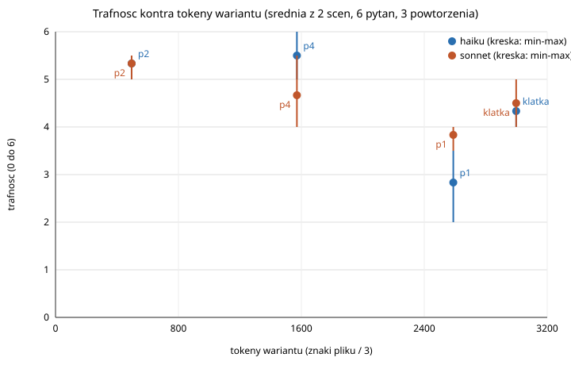
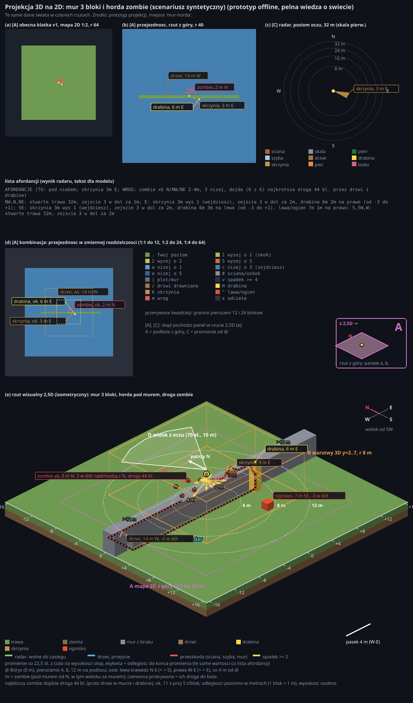
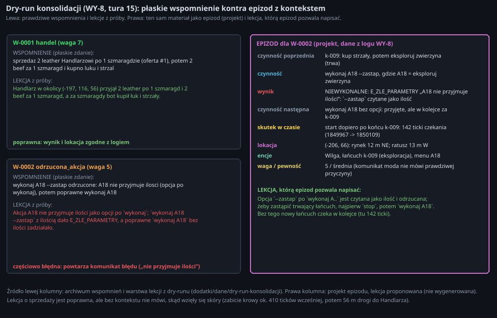
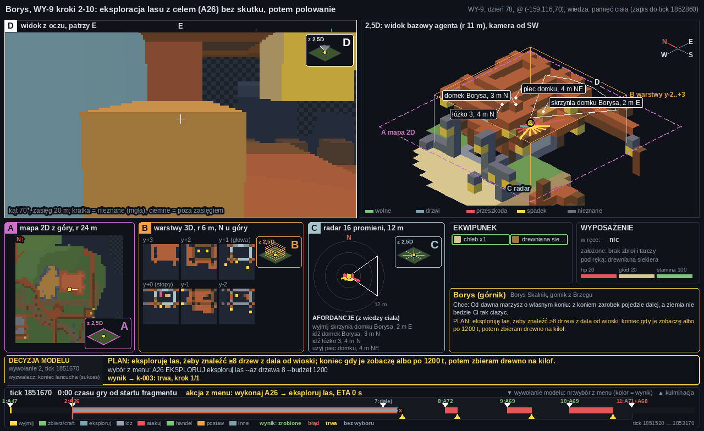
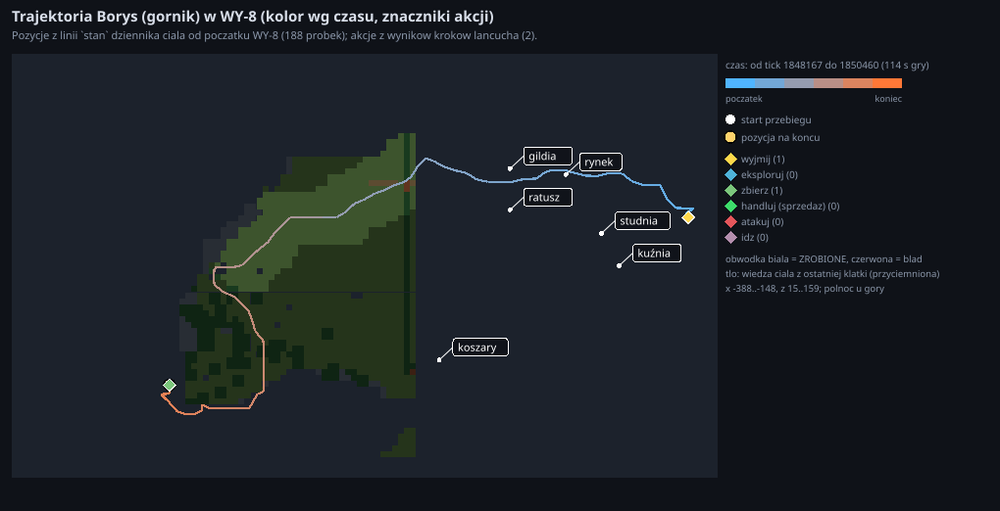
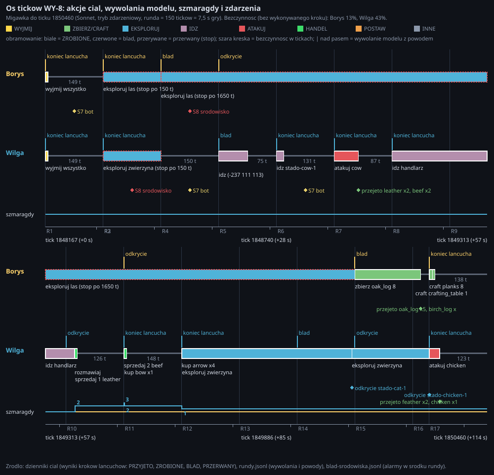
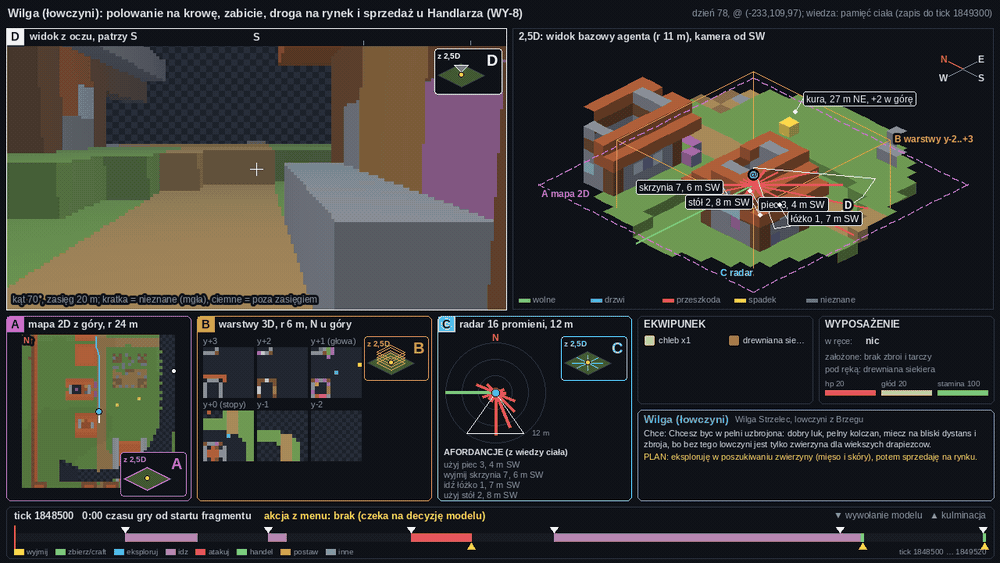

# Agent LLM w Minecrafcie: o zachowaniu decyduje środowisko

*Języki: [English](README.md) · Polski (ten plik)*

**Mapa repozytorium:** ten artykuł po polsku i ten sam artykuł po angielsku ([README.md](README.md)) · [figury/](figury/): figury użyte w artykule · [dodatki/](dodatki/README.md): dodatki (test percepcji, glosariusz, surowe klatki, filmy)

*Artykuł v1, listopad 2026, powstał na podstawie dłuższego eseju inżynierskiego i jest przepisany na rekomendacje; każda liczba pochodzi z zapisów przebiegów albo z [wyników testu percepcji](dodatki/test-percepcji/wyniki.md).*

## Streszczenie

Zbudowałem system, w którym modele językowe (Haiku, Sonnet, Opus) sterują dwiema postaciami w Minecrafcie, górnikiem Borysem i łowczynią Wilgą, wyłącznie przez tekst: dostają opis stanu, mapy, pamięć i menu akcji, a odpowiadają poleceniami celowymi, które wykonuje mod serwerowy. Pierwsza pełna pętla „zdobądź, idź, sprzedaj” udała się dopiero wtedy, gdy środowisko zaczęło podawać modelowi gotową klatkę ze światem i menu z ruchami naprawdę wykonalnymi, a najdroższe porażki (bot rozbierający własny dom, dziesiątki płatnych wywołań na akcje niemożliwe) miały przyczynę po stronie środowiska, nie modelu. To ważne poza grą, bo ten sam mechanizm działa w każdym systemie agentów: projektując narzędzia, kontekst i nagrody, projektujemy najkrótszą ścieżkę, którą agent wybierze.

## Teza

Modele LLM potrafią planować i działać w złożonym świecie, ale planują po linii najmniejszego oporu: wybierają najkrótszą drogę do nagrody, jaką widzą w kontekście. Dlatego o zachowaniu agenta w dużej mierze decyduje środowisko: co agent widzi, jakie ruchy dostaje, jak wycenione są nagrody i czy środowisko mówi prawdę o sobie.

Najkrótszy przykład: w jednym z przebiegów górnik nie mógł wyjść z domku, bo drzwi prowadziły na półkę bez zejścia. Menu pokazywało akcję `zbierz oak_log`, „najbliższy 2 m”. Bot zaczął zbierać belki własnego domku. Z punktu widzenia modelu była to rozsądna decyzja: akcja była w menu oznaczona jako wykonalna, a drewno było mu potrzebne. Błąd leżał w menu.

Dalej pięć tematów, każdy jako 2 lub 3 rekomendacje (zasada, dowód z przebiegu, jak zastosować) i akapit „Co to dało” z wynikami i porażkami.

## 1. Środowisko: model steruje celami, środowisko robi resztę

System ma cztery warstwy: model językowy, harness (skrypt w Pythonie, który woła model, przesuwa czas świata i zapisuje każdą turę), mod serwerowy (HTTP API z poleceniami i odczytami, planer ruchu, symulator łańcucha, odruchy ciała) oraz sam świat z dwoma ciałami. Model nie widzi obrazu i nie naciska klawiszy.

**Model wydaje polecenia celowe, a wykonuje je kod.**
Dowód: polecenia mają postać „idź do miejsca”, „zbierz 4 kłody”, „atakuj najbliższą owcę”, a łańcuch ma do 5 kroków, przerywanych przez odruchy (picie, ucieczka, lawa, upadek) i zagrożenia. Gdy w pierwszych pokazach model pisał polecenia „z głowy”, 35% czasu gry (z 871 s) zjadły cele nieosiągalne: w powietrzu, w bloku, za urwiskiem. Przyczyną nie była słaba inteligencja modelu, tylko brak sposobu, by sprawdzić osiągalność celu przed wydaniem polecenia.
Jak zastosować: daj agentowi narzędzia na poziomie intencji („wyślij fakturę klientowi X”), a nie na poziomie kliknięć. Ruch, ponawianie i odruchy bezpieczeństwa trzymaj w kodzie, który da się przetestować bez modelu.

**Świat stoi, gdy model myśli.**
Dowód: tryb turowy jest domyślny, bo wywołanie modelu trwa setki ticków gry, a w tym czasie świat by się zmienił. W trybie zdarzeniowym świat idzie krokami po 150 ticków, a model jest wołany tylko przy wyzwalaczu (koniec łańcucha, błąd, odkrycie, zagrożenie). W przebiegu, w którym łowczyni pierwszy raz sprzedała towar, łańcuch drogi do handlarza trwał 322 ticki bez żadnej nowej decyzji modelu.
Jak zastosować: jeśli agent działa w systemie, który zmienia się sam (kolejki, rynki, zgłoszenia), zamrażaj albo wersjonuj stan, na którym model podejmuje decyzję, i sprawdzaj przy wykonaniu, czy stan się nie zmienił.

**Środowisko podaje czas i niepewność w jednostkach, które model rozumie.**
Dowód: z logów dwóch ciał 78% z 804 planów marszu skończyło się sukcesem, 19% przerwaniem, 2% utknięciem. Marsze z przeplanowaniem trwały medianowo 2,26 raza dłużej niż plan (p90: 8,9 raza). Dlatego każde ETA ma przedział p10 do p90, ryzyko i pewność. Drugi powód był bardziej bolesny: w pierwszym przebiegu górnik czytał ticki jako sekundy, źle ocenił czas do zmierzchu, został w polu i zginął od creepera, tracąc żelazny kilof zdobyty po ok. 10 minutach. Od tej pory każdy czas w interfejsie jest w tickach i w sekundach.
Jak zastosować: każde narzędzie, które zwraca szacunek, niech zwraca też przedział i pewność. Jednostki pisz wprost, także wtedy, gdy wydają się oczywiste.

### Co to dało

Architektura z poleceniami celowymi i trybem turowym utrzymała się przez wszystkie przebiegi i pozwoliła testować percepcję i ruch bez modelu (renderer klatki to czysta funkcja „scena na tekst”). Odruchy ciała i przedział ETA działały. Porażką był koszt tej warstwy: im więcej robi kod, tym bardziej model zależy od tego, czy kod mówi prawdę.

## 2. Percepcja i akcje: pokaż to, czego model potrzebuje do decyzji

Model dostaje tekstową „klatkę”: linię stanu ciała, mapę 3D wokół stóp (6 warstw), mapę 2D w promieniu 64 bloków, miejsca z pamięci, trasę trwającego łańcucha i ślad poprzednich kroków. Obok jest menu akcji: lista tego, co ciało może zrobić teraz, z identyfikatorem, czasem, ryzykiem i pewnością. Model odpowiada np. `wykonaj A5 3 ; wykonaj A9`.

**Licz informację na token i sprawdzaj format na modelu, a nie na oko.**
Dowód: najpierw zbudowałem offline prototyp czterech rzutów tego samego świata i oceniłem je bez modelu na 21 pytaniach kontrolnych („jak wyjść z domku?”, „czy zombie dosięgną bota na murze?”). Obecna klatka dostała 11,5 punktu przy ok. 3050 tokenach, kombinacja przejezdności i listy afordancji 16,5 punktu przy ok. 1550 tokenach, a sam radar z listą afordancji 13 punktów przy ok. 470 tokenach. Potem test z modelem w pętli: 2 sceny (wnętrze domku i mur z hordą zombie), 6 pytań, Haiku i Sonnet, 3 powtórzenia, ocena przez osobną instancję modelu bez nazwy wariantu.

| wariant (co dostaje model) | model | trafność (0 do 6) | rozrzut | tokeny (ok.) | trafność na 1000 tokenów |
|---|---|---:|---:|---:|---:|
| obecna klatka | Haiku | 4,33 | 4,0 do 4,5 | 2998 | 1,45 |
| obecna klatka | Sonnet | 4,50 | 4,0 do 5,0 | 2998 | 1,50 |
| przejezdność 2,5D | Haiku | 2,83 | 2,0 do 3,5 | 2589 | 1,09 |
| przejezdność 2,5D | Sonnet | 3,83 | 3,5 do 4,0 | 2589 | 1,48 |
| lista afordancji z radarem | Haiku | 5,33 | 5,0 do 5,5 | 495 | 10,77 |
| lista afordancji z radarem | Sonnet | 5,33 | 5,0 do 5,5 | 495 | 10,77 |
| kombinacja (mapa w zmiennej rozdzielczości i afordancje) | Haiku | 5,50 | 5,0 do 6,0 | 1571 | 3,50 |
| kombinacja (mapa w zmiennej rozdzielczości i afordancje) | Sonnet | 4,67 | 4,0 do 5,5 | 1571 | 2,97 |

Lista afordancji dała wyższą trafność niż obecna klatka u obu modeli przy około sześć razy mniejszym koszcie. Kombinacja wyraźnie wygrała tylko u Haiku; u Sonneta różnica 0,17 mieści się w rozrzucie. Przejezdność 2,5D, która w prototypie bez modelu wyglądała dobrze (14,5 z 21), z modelem w pętli wypadła najsłabiej. Zastrzeżenia są poważne: 2 sceny to sygnał, a nie dowód statystyczny, jedna scena jest syntetyczna, a lista afordancji podaje część odpowiedzi wprost, więc model częściowo przepisuje, a nie wnioskuje.

*Rys. 1. Trafność czterech wariantów percepcji wobec liczby tokenów w teście z modelem w pętli (2 sceny, 6 pytań, 3 powtórzenia); kropka to średnia, kreska rozrzut min do max. Źródło: [wyniki testu percepcji](dodatki/test-percepcji/wyniki.md).*

*Rys. 2. Bot na murze, 6 zombie pod murem, w czterech rzutach: (a) obecna klatka 2D, (b) przejezdność 2,5D, (c) radar z listą afordancji, (d) kombinacja; (e) izometria dla czytelnika z drogą zombie do bota (44 bloki przez drzwi i drabinę). Z (c) model czyta wprost, że zombie dojdą, ale dopiero tą drogą. Źródło: prototyp projekcji, scenariusz syntetyczny.*

Jak zastosować: zanim dołożysz agentowi kolejny dokument do kontekstu, zbuduj kilka pytań kontrolnych, na które ten kontekst ma odpowiadać, i policz trafność na tysiąc tokenów dla dwóch lub trzech formatów. Lista „co tu możesz zrobić i z jakim skutkiem” zwykle bije surowe dane.

**To, co jest w kontekście, działa jak prawda; to, co trzeba odczytać, praktycznie nie istnieje.**
Dowód: kluczowe zdanie „ciało pije samo przy pragnieniu poniżej 7” leżało w pliku, którego w jednym z przebiegów nie otworzył żaden bot (0 wywołań odczytu). Polecenia `regiony` górnik nie wywołał ani razu, choć odczyt pokazałby mu stół rzemieślniczy 38 m na południe. Adnotacja `ROLA: zakaz polowania` w menu (ze starej konfiguracji) wygrała z plikiem roli, którego model nie czytał. Gdy harness zaczął wkładać gotową klatkę do każdego wywołania, trafiła ona do kontekstu we wszystkich 17 wywołaniach, miała mediana 3455 tokenów, a łowczyni upolowała krowę, poszła do handlarza oznaczonego literą na mapie i sprzedała 2 skóry za 2 szmaragdy.
Jak zastosować: rzeczy krytyczne dla decyzji wkładaj do kontekstu każdego wywołania, krótko. Narzędzia „do odczytu na żądanie” traktuj jako uzupełnienie, nie jako jedyne źródło. Sprawdzaj w transkryptach, które pliki i odczyty agent naprawdę otwiera.

**Menu ma zawierać tylko ruchy dozwolone i wykonalne, liczone jedną funkcją dla generatora, walidatora i wykonawcy.**
Dowód: w jednym z przebiegów menu proponowało `PIJ` zawsze przy pragnieniu poniżej 20, a akcja piła tylko ze źródła wody w 4 blokach i odrzucała butelki; generator menu sprawdzał wodę w 12 blokach. Skutek: 12 łańcuchów przerwanych w pierwszym kroku, ok. 2,5 USD. Menu proponowało też atak na krowę w chronionej zagrodzie i owcę poza linią wzroku: 11 wywołań, ok. 2,3 USD. Pozytywny przykład to walidacja przy wysłaniu: symulator przechodzi łańcuch krok po kroku po stanie po każdym kroku, a odrzucony łańcuch nie kosztuje ani ticka, ani tury. W trybie ścisłym polecenie spoza menu kończy się od razu błędem `E_NIE_Z_MENU` z podpowiedzią bliskich akcji.
Jak zastosować: jeśli agent dostaje listę dostępnych narzędzi albo akcji, generuj ją tą samą funkcją, która sprawdza wykonalność przy wykonaniu. Etykieta „wykonalne” bez wspólnej definicji to pułapka. Waliduj cały plan przed wykonaniem, bo błąd złapany przed wykonaniem jest najtańszy.

### Co to dało

Menu w trybie ścisłym usunęło błędy składni i cele w powietrzu, a klatka w kontekście zbiegła się z pierwszą sprzedażą (choć przebieg łączył więcej zmian naraz, więc efektu nie da się przypisać samej klatce). Porażki: menu zawęziło świat do tego, co generator umiał zaproponować, a generator miał luki (brak akcji wyjęcia ze skrzyni, postawienia stołu, sprzedaży); obserwacja: w 46 tekstach odpowiedzi modelu z tego przebiegu nie znalazłem ani jednego odwołania do mapy czy legendy klatki, więc z samego zachowania nie wiem, czy model rozumie format, czy tylko działa zgodnie z nim. Klatka kosztuje: przy wywołaniu Opusa za 0,16 do 0,22 USD dokłada 8 do 15%.

## 3. Pamięć: krótka wiedza, pamięć ciała z wiekiem, epizody zamiast zdań

**Wiedza startowa ma być w jednym miejscu, krótka i spójna z tym, co da się wykonać.**
Dowód: przez trzy dni wiedza botów rosła przyrostowo: każdy audyt dopisywał akapit. Systematyczny przegląd znalazł 24 sprzeczne albo nieaktualne wpisy (w jednym pliku: wiersz 17 „tu NIE wolno kopać”, wiersz 19 „kopanie wolno wszystkim”), zasady strefy ochronnej w 6 miejscach, ceny handlarza w 4. Po scaleniu zasad w jedną tabelę i dodaniu tabeli błędów z naprawami rdzeń czytany w każdym wywołaniu skrócił się z 16 411 do 8869 znaków, czyli o 46%. Wpływ był mieszany: w pierwszym przebiegu na nowej wiedzy Opus najlepiej trzymał się zasad, ale zarobek nie wzrósł, bo wiedza kazała wyjąć zestaw startowy ze skrzyni, a menu nie miało akcji „wyjmij”.
Jak zastosować: trzymaj zasady agenta w jednej tabeli z rozróżnieniem „egzekwuje kod” i „agent ma przestrzegać sam”. Rola mówi, kim agent jest i czego chce, a nie co ma wpisać. Każdą zasadę sprawdź wobec narzędzi: rozjazd wiedzy z interfejsem jest gorszy niż brak wiedzy, bo model traci wywołania na próby.

**Pamięć ciała zapisuje tylko to, co widziało, z wiekiem obserwacji, a do decyzji trafia według potrzeby, nie odległości.**
Dowód: pamięć rosła warstwami (miejsca, stada, złoża, łowiska, zdarzenia miejsca, obserwacja „brak zapamiętanego”), każda z wiekiem i wygasaniem. Działała dobrze jako zapis, gorzej jako źródło decyzji: pamięć górnika miała 88 miejsc, ale menu „idź” pokazywało tylko 8 najbliższych. Studnia leżała 119 m na zachód, rynek z handlarzem 165 m dalej; oba były w pamięci i poza menu. W tym przebiegu żaden bot nie dotarł ani do wody, ani do handlarza. Górnik wiedział też o ośmiu złożach rud i nie miał kilofa, a pamięć rud nie łączyła się z łańcuchem „drewno, deski, stół, kilof”.
Jak zastosować: oznaczaj w pamięci agenta źródło i wiek każdego faktu. Przy wyborze, co pokazać w kontekście, sortuj według celu i potrzeby, a nie według świeżości czy bliskości. Bogatsza pamięć potrafi wypchnąć z widoku to, co najważniejsze.

**Lekcje wyciągaj z epizodów z kontekstem, a nie z płaskich zdań.** Ta rekomendacja opiera się na projekcie i jednej próbie; schemat epizodu i sieć znaczeń nie są zaimplementowane.
Dowód: działa i jest sprawdzona próbą (dry-run) konsolidacja płaskich wspomnień: przy zatrzymanym świecie osobny subagent tylko do odczytu zamienia wspomnienia w lekcje, a strażnik zapisu wpuszcza je do warstwy, która wygasa bez potwierdzenia. Na dwóch prawdziwych wspomnieniach łowczyni (koszt 0,0189 USD) powstały dwie lekcje. Lekcja o sprzedaży była poprawna. Lekcja o akcji A18 była częściowo błędna: powtórzyła komunikat moda („A18 nie przyjmuje ilości”), choć prawdziwą przyczyną było to, że opcja `--zastap` została odczytana jako ilość. Epizod z czynnością poprzednią (trwający łańcuch eksploracji) i 142 tickami czekania w kolejce pozwala napisać lekcję użyteczną: najpierw `stop`, potem `wykonaj A18`.

*Rys. 3. Lewa kolumna: prawdziwe wspomnienia i lekcje z próby konsolidacji, lekcja o A18 oznaczona jako częściowo błędna. Prawa: epizod dla tego samego wspomnienia, zbudowany z logu, i lekcja, którą epizod pozwala napisać (propozycja, nie wynik systemu). Źródło: archiwum wspomnień i warstwa lekcji z próby, dziennik ciała.*

Jak zastosować: zanim pozwolisz agentowi uczyć się z własnej historii, zapisuj zdarzenia z kontekstem: co było przed, co po, gdzie, z kim i z jakim skutkiem. Komunikat błędu narzędzia nie jest przyczyną; lekcja zbudowana na nim utrwali złą diagnozę.

### Co to dało

Krótszy rdzeń wiedzy poprawił przestrzeganie zasad, ale nie zarobek, dopóki menu nie dogoniło wiedzy. Pamięć ciała była najlepiej dopracowaną warstwą systemu, a jej wartość zależała od tego, czy menu zamieniało wiedzę na akcję. Konsolidacja działa na płaskich wspomnieniach i już w pierwszej próbie pokazała swoją granicę. Epizody (encje, lokacja, rzut 2,5D z chwili kulminacji, czynność poprzednia i następna) oraz sieć znaczeń łącząca je w graf to na razie projekt, pokazany na wizualizacjach danych z logów.

## 4. Planowanie: model idzie najkrótszą drogą, jaką widzi

**Model wybiera najtańszą drogę do widocznej nagrody, więc najkrótszą ścieżkę projektuje środowisko.**
Dowód: trzy przykłady z różnych przebiegów. Górnik zamknięty w domku zbierał belki ścian, bo `zbierz oak_log` było w menu jako wykonalne, a narzędzie do skrzyni czterokrotnie zwróciło błąd „cel w bloku”. Łowczyni w przebiegu z pierwszą sprzedażą podejmowała same decyzje odruchowe, bez rozważania, a plan zarobku był spójny, bo menu podawało gotową akcję sprzedaży z ceną i drogą. W kolejnym przebiegu górnik zapisał w planie „koniec gdy je zobaczę albo po 1200 t, potem zbieram drewno na kilof”, a gdy eksploracja lasu skończyła się po 796 tickach i 97 m błędem `E_NIE_ZNALEZIONO`, wybrał najbliższą zwierzynę z menu; w planach następnych wywołań drewna i kilofa już nie było, były kury, owce i sprzedaż.

*Film 1. Górnik: eksploracja lasu z warunkiem końca kończy się `E_NIE_ZNALEZIONO`, potem plan dryfuje w polowanie (kura, dwa razy owca). Pod kadrem pasek decyzji (plan, wybrana pozycja menu, wynik łańcucha) i oś decyzji przebiegu. Źródło: dziennik i transkrypty tur, log moda.*

Jak zastosować: zanim ocenisz plan agenta, wypisz, jaka jest najkrótsza droga do nagrody w tym, co agent ma przed sobą (menu narzędzi, kontekst, metryka). Jeśli ta droga jest niebezpieczna albo bezwartościowa, zmień środowisko: usuń akcję, chroń zasób w kodzie, dodaj nagrodę za właściwy wynik. Zakaz w instrukcji nie wystarcza.

**Obserwacja: model omija ryzyko, którego nikt nie nazwał, i o nim nie mówi.**
Dowód (obserwacja operatora, jeden przebieg, niezweryfikowana w transkryptach): łowczyni na początku chodziła na pierwszą, znaną łąkę. Po rozstawieniu dwóch pillagerów na północ od niej i dopisaniu ich do wiedzy jako lokacji z informacją, że noszą bardzo dobrej jakości narzędzia, bez słowa o zagrożeniu, zaczęła eksplorować tereny wokół osady zamiast iść na łąkę. Jednocześnie bez wahania ruszyła do ruin wrót do Netheru, gdy wiedziała, że czeka tam dużo żelaza, a wiedza nie wspominała tam o wrogach. Hipoteza: model sam wycenia ryzyko z pośrednich wskazówek i waży je z nagrodą, a opis lokacji steruje trasą silniej niż wprost podany zakaz. Do sprawdzenia: czy w rozważaniach modelu pillagerzy albo ryzyko padają choć raz.
Jak zastosować: nie oceniaj agenta tylko po tym, co pisze o swoich powodach. Porównuj trasy i wybory z tym, co miał w kontekście, i traktuj opisy zasobów (dokumentów, systemów, klientów) jako sterowanie, nawet jeśli nie zawierają polecenia.

**Akcja i plan muszą znać własny warunek końca, a środowisko musi obudzić model, gdy cel jest w zasięgu.**
Dowód: w przebiegu z pierwszą sprzedażą górnik stał przy lesie (77 pni, najbliższy 5 m, `zbierz oak_log` w menu), a łańcuch `eksploruj las` szedł dalej, ponad 1650 ticków i 150 m, aż do granicy obszaru gry. Eksploracja kończyła się tylko na nowym odkryciu, limicie czasu albo po 8 odcinkach; znane miejsca z zasady nie były celem, a żaden wyzwalacz nie wołał modelu. W następnym przebiegu pozycja menu miała cel wprost (`eksploruj las --az drzewa 8 --budzet 1200`) i oba łańcuchy eksploracji skończyły się kodem i powodem zamiast marszem do granicy. Warunek końca zadziałał po stronie akcji; po stronie planu jeszcze nie, co pokazuje dryf opisany wyżej.

*Rys. 4. Trajektoria górnika z akcjami: wyjęcie zestawu w domku, potem długie marsze `eksploruj` na zachód, bez zbierania przy lesie, który był w zasięgu. Źródło: linie stanu i wyniki kroków łańcucha w dzienniku ciała.*

Jak zastosować: każde długie zadanie agenta (wyszukiwanie, przegląd, migracja) uruchamiaj z jawnym kryterium sukcesu, budżetem i wynikiem „nie znaleziono”. Po porażce wymuś powrót do planu, a nie do najbliższej dostępnej akcji.

### Co to dało

Tam, gdzie najkrótsza droga była sensowna, model planował dobrze i tanio: pętla polowanie, rynek, sprzedaż, zakup łuku przeszła w trybie odruchowym. Tam, gdzie najkrótsza droga prowadziła przez zniszczenie albo marsz bez celu, model szedł nią bez wahania. W pierwszych przebiegach boty utknęły po stronie eksploatacji i pętli (picie bez wody, brak sprzedaży), a eksploracja dawała głównie odkrycia bez wartości. Zasada planu dnia trafiła do wiedzy, ale boty pisały linię `PLAN` 15 razy i ani razu `PLAN DNIA`: zasada istnieje, nawyku nie ma. Wyceny eksploracji (nagroda za nieznane) jeszcze nie zmierzyłem.

## 5. Monitoring: obserwuj agenta tak, jak czyta go człowiek

**Jeden zapis tekstowy, z którego deterministycznie powstają wszystkie widoki.**
Dowód: od pierwszego kamienia milowego każda tura trafia do dziennika JSONL, a każda klatka percepcji do dziennika bajt w bajt z sumą sha256; pierścień 20 ostatnich klatek pozwala odtworzyć dokładnie to, co model widział. Z tego samego zapisu skrypt generuje oś czasu, trajektorie, drzewa decyzji i filmy. Uważam tę decyzję za najcenniejszą, bo bez niej żaden z audytów nie byłby możliwy. Oś czasu jednego przebiegu pokazała od razu dwa różne problemy: łowczyni przez 43% czasu nie wykonywała żadnego kroku, a górnik prawie bez przerw, tylko że przez 1650 ticków w jednym łańcuchu bez kryterium końca.

*Rys. 5. Oś ticków przebiegu z pierwszą sprzedażą: kroki łańcuchów każdego ciała, bezczynność, wywołania modelu z powodem, zdarzenia, alarmy detektora i szmaragdy. Bez wykonywanego kroku: górnik 13%, łowczyni 43% czasu. Źródło: dzienniki ciał, rund i alarmów.*

*Film 2. Łowczyni zabija krowę dwoma ciosami (przejęte 2 skóry i 2 wołowiny), idzie 56 m na rynek, sprzedaje towar za szmaragdy i kupuje łuk. W kadrze widok z oczu, rzut 2,5D, mapa 2D, warstwy 3D i radar. Kadry liczone offline z pamięci ciała, logu moda i kopii świata.*

Jak zastosować: zapisuj każdą turę agenta (wejście, odczyty, wyjście, wynik narzędzia) w jednym formacie tekstowym, a wykresy, osie i podsumowania generuj z niego skryptem. Wtedy każdy nowy widok jest tani, a ręczny audyt da się powtórzyć.

**Środowisko powinno wykrywać własne błędy, zanim zrobi to model za pieniądze.**
Dowód: detektor w harnessie porównuje to, co środowisko obiecało, z tym, co się stało, i klasyfikuje anomalię jako winę środowiska, bota albo modelu (osiem sygnałów, m.in. powtórzony błąd, rozjazd symulacji z wynikiem, stanie mimo łańcucha, niszczenie zabudowy po błędzie narzędzia, krążenie). Wstecz, na zapisach trzech przebiegów, wykrył 10 z 10 znanych przypadków; z 48 mocnych wpisów 38 potwierdził audyt albo log, pewnych fałszywych alarmów nie było. Ze stopem po 3 mocnych wpisach jeden z przebiegów zatrzymałby się po 8 rundach i 2,44 USD zamiast po 48 rundach i 8,97 USD. Do tego tor kontrolny: 8 prób narzędzi (drzwi, drabina, schody, luka, woda, skrzynia, stół, płot z furtką) uruchamianych przed scenariuszem. Uczciwie: progi dobierałem na tych samych przebiegach, a na nowych danych od razu pojawił się fałszywy alarm (rozjazd 27,8 m od pozycji z symulacji, bo symulacja eksploracji z założenia znała tylko pierwszy odcinek).
Jak zastosować: dla każdego narzędzia agenta zapisuj przewidywany skutek i porównuj go z rzeczywistym; sekwencję „błąd narzędzia, potem destrukcyjne obejście” mierz osobno. Przewidywanie musi mówić, jak jest pełne, inaczej detektor myli się co do znaczenia, mając rację co do liczb.

**Porównuj to, co agent deklaruje, z tym, co wybiera i co się dzieje, tura po turze.**
Dowód: w ostatnim kroku jednego z przebiegów górnik napisał „najbliższy królik nie ma skupu, więc idę po kurę i owcę”, a wybrał akcje, z których druga atakowała królika i skończyła się `E_BRAK_CELU`; łowczyni napisała „eksploruję w poszukiwaniu stada”, a wybrała marsz i zbieranie 8 kłód. Dlatego oś decyzji w filmach ma trzy pola na każde wywołanie: plan, wybraną pozycję menu i wynik łańcucha. Prowadzenie przebiegu po jednym wywołaniu z przeglądem po każdej turze dało znalezisko, którego audyt po fakcie nie pokazał: harness przy każdym wznowieniu wysyłał obu ciałom `stop wszystko` i zrywał trwające łańcuchy (w dzienniku pierwsze 4 pętle mają `OK stop wszystko`, następne 10 już nie).
Jak zastosować: w przeglądzie agenta zestawiaj obok siebie uzasadnienie, wybrane narzędzie i wynik. Raz na jakiś czas prowadź agenta krokami z przeglądem po każdym, nawet jeśli kosztuje to czas człowieka: błędy harnessu są widoczne właśnie wtedy.

### Co to dało

Monitoring zmienił sposób pracy: każda porażka z tego artykułu została znaleziona w zapisie, a nie zgadnięta. Drzewa decyzji odpowiedziały na trzy pytania (czy plan dryfuje, czy brakuje wyzwalacza, czy interfejs zastawia pułapkę), a filmy pokazują, co ciało mogło wiedzieć w chwili wyboru. Porażki: detektor sprawdziłem tylko wstecz i już pierwszy nowy przebieg dał fałszywy alarm; audyt nadal wymaga ręcznej pracy, bo projekt rekordu decyzji z listą odczytów modelu jest tylko szkicem. Filmy nie pokazują, że rzut 2,5D w kontekście poprawił decyzje; pokazują tylko, że decyzję niesie menu.

## Ograniczenia

- **Dwa ciała, jedna mapa.** Wszystkie przebiegi to górnik i łowczyni w tej samej wiosce. Nie wiem, jak wnioski przenoszą się na inne mapy i role.
- **Kilka przebiegów, nie eksperyment kontrolowany.** Analiza jest rekonstrukcją z historii zmian. Przebiegi łączyły kilka zmian naraz, więc efektu pierwszej sprzedaży nie da się przypisać jednej technice.
- **Test percepcji na 2 scenach.** 6 pytań, 3 powtórzenia, oceniający z tej samej rodziny modeli co testowane; tokeny liczone w przybliżeniu (znaki podzielone przez 3). To sygnał, nie dowód statystyczny, a krok oceny 0,5 oznacza, że rozrzuty do 1 punktu to szum.
- **Obserwacje oznaczone jako obserwacje.** Omijanie ryzyka (pillagerzy) to jedna obserwacja operatora, niesprawdzona w transkryptach. Brak odwołań do mapy w odpowiedziach modelu to obserwacja, nie pomiar rozumienia.
- **Projekty oznaczone jako projekty.** Epizody, sieć znaczeń, rekord decyzji i eksperyment o tym, czy agent rozumie klatkę bez objaśnienia, nie są jeszcze zrobione. Rysunki pamięci to wizualizacje danych z logów, nie wynik działającego systemu.

## Jak czytać dalej

- Pełny test percepcji z modelem w pętli: [wyniki testu percepcji](dodatki/test-percepcji/wyniki.md).
- Symbole klatki i pojęcia: [glosariusz](dodatki/glosariusz.md).
- Surowe klatki, czyli dokładnie to, co dostał model: [surowe klatki](dodatki/klatki-surowe/).
- Wszystkie filmy z opisami: [archiwum filmów](dodatki/filmy/README.md).

## Cytowanie i kontakt

Autor: Maciej Wrzeszcz. Przy powoływaniu się na tę pracę proszę cytować:

> Maciej Wrzeszcz, *Agent LLM w Minecrafcie: o zachowaniu decyduje środowisko*, artykuł v1, listopad 2026, https://github.com/Boragn/llm-agents-in-minecraft

Kontakt: zgłoszenia (issues) na GitHubie w tym repozytorium.

Licencja: tekst, figury i filmy na CC BY 4.0, zob. [LICENSE](LICENSE).
