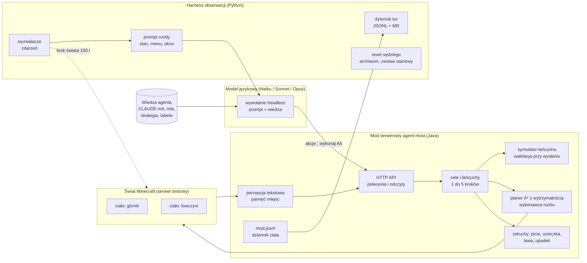

# 2. Środowisko: co zbudowano

> Z czego składa się system (model, harness, mod serwerowy, świat) i które decyzje projektowe zapadły przed pierwszą linią kodu.

[← 1. Pytanie badawcze i metoda](01-pytanie-i-metoda.md) · [indeks](../esej-indeks.md) · [3. Wiedza agentów: budowa i przetwarzanie →](03-wiedza-agentow.md)

---

System ma cztery warstwy. Model nie widzi obrazu, tylko tekst; nie steruje klawiaturą, tylko wydaje polecenia celowe („idź do miejsca”, „zbierz 4 kłody”, „atakuj najbliższą owcę”), które wykonuje kod moda.

Kluczowe decyzje projektowe z planu (przed pierwszą linią kodu):

- **Percepcja tylko tekstowa.** Model dostaje macierz i opis sceny, bez zrzutów ekranu. Tanio i deterministycznie, ale model widzi tylko to, co kod uzna za warte opisania.
- **Tryb turowy jako domyślny.** Świat zamarza, gdy model myśli. To usuwa problem opóźnienia wywołania (setki ticków), ale sprawia, że bezczynność ciała zależy wyłącznie od tego, jak harness wykrywa koniec łańcucha.
- **Łańcuch jako lista kroków z przerwaniami.** Do 5 kroków, przerywany przez odruchy i zagrożenia (`--przerwij zagrozenie`).
- **Audyt od pierwszego kamienia milowego.** Jeden zapis tekstowy (JSONL), z którego deterministycznie generuje się widoki: oś czasu w Mermaid, wykresy, mapę trasy. Ta decyzja okazała się najcenniejsza, bo bez niej żaden z audytów opisanych dalej nie byłby możliwy.

Zakres pracy w liczbach: projekt ma 242 zadania (149 w głównym epiku agenta, 7 w epiku skracania cyklu) i 225 przebiegów agentów programujących, utworzonych między 9 a 12 listopada. Mod przeszedł od wersji 0.1.0 do 0.12.6-dev; ostatnie kopie przechodzą 1170 testów JUnit.

---

[← 1. Pytanie badawcze i metoda](01-pytanie-i-metoda.md) · [indeks](../esej-indeks.md) · [3. Wiedza agentów: budowa i przetwarzanie →](03-wiedza-agentow.md)
