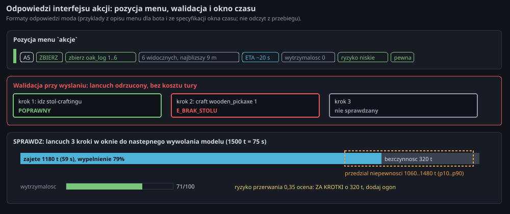

# 4. Interfejs akcji

> Menu akcji, tryb ścisły, walidacja łańcucha przy wysłaniu, ETA z przedziałem oraz luki generatora menu, które zablokowały zarobek.

[← 3. Wiedza agentów: budowa i przetwarzanie](03-wiedza-agentow.md) · [indeks](../esej-indeks.md) · [5. System percepcji: jak ciało widzi świat →](../czesc-2-percepcja-i-metapoznanie/05-system-percepcji.md)

---

## 4.1 Od poleceń swobodnych do menu

W pierwszych przebiegach model pisał polecenia „z głowy”. Research przerw w pokazach 3 i 4 (871 s gry) wykazał, że 35% czasu zjadły cele nieosiągalne (w powietrzu, w bloku, za urwiskiem), 19% decyzje o zmierzchu, 12% czytanie na starcie, a postęp misji to tylko 10% i 17% sesji. Przyczyną nie była słaba inteligencja modelu, tylko to, że model nie ma jak sprawdzić, czy cel jest osiągalny, zanim wyda polecenie.

Odpowiedzią była seria zmian w module ruchu (siatka osiągalności liczona tym samym A* co planer), a potem **menu akcji**: polecenie `akcje` zwraca listę tego, co ciało może zrobić TERAZ, z identyfikatorami, czasem, kosztem wytrzymałości, ryzykiem i pewnością:



*Rys. 4.1. Trzy odpowiedzi interfejsu akcji jako karty: pozycja menu z kategorią, czasem, ryzykiem i pewnością, odrzucenie łańcucha przy wysłaniu z poprawnym prefiksem oraz zajęcie okna czasu z przedziałem niepewności. Źródło: formaty odpowiedzi z opisu menu dla bota i ze specyfikacji okna czasu (przykłady, nie odczyt z przebiegu). Surowy zapis: [opis menu dla bota](../dodatki/glosariusz.md).*

Model odpowiada `wykonaj A5 3 ; wykonaj A9 || --przerwij zagrozenie`. W **trybie ścisłym** działa tylko `wykonaj <id>`, `stop`, `akcje` i odczyty; każde inne polecenie kończy się od razu błędem `E_NIE_Z_MENU` z podpowiedzią bliskich akcji, bez kosztu tury.

Rekord pozycji menu (fragment łatki):

```java
public record AkcjaMenu(String id, String kategoria, String polecenie, String opis,
        double sekundy, double stamina, String ryzyko, String pewnosc,
        int maxIlosc, String uwagaRoli) {
    /** Klucz stabilnosci: ta sama akcja w kolejnych generacjach dostaje ten sam identyfikator. */
    public String klucz() { return kategoria + "|" + polecenie; }
}
```

Stabilny identyfikator był ważny: jeśli akcja `A5` po zmianie stanu znaczy coś innego, model, który zapamiętał listę sprzed jednego kroku, wykona złą rzecz.

## 4.2 Walidacja łańcucha przy wysłaniu

Każdy łańcuch (także swobodny) przechodzi przez symulator, który idzie krok po kroku po **stanie po każdym kroku**: pozycja po `idz`, ekwipunek po `zbierz` i `craft`, stół i piec w zasięgu po przejściu. Wynik to albo `OK ... wykonalny`, albo:

Odrzucony łańcuch nie kosztuje ani ticka, ani tury, a model poprawia go w tej samej fazie planowania. To jest najtańsza możliwa pętla korekcji błędu: błąd wykryty przed wykonaniem zamiast po 150 tickach i kolejnym płatnym wywołaniu.

## 4.3 Klatka decyzyjna, ETA z przedziałem i okno czasu

Kolejna warstwa dotyczy czasu. W trybie zdarzeniowym model jest wołany tylko przy wyzwalaczu, a łańcuch ma „wypełnić okno” do następnego wywołania. Żeby to zaplanować, model musi wiedzieć, ile łańcuch potrwa. Z logów dwóch ciał wyciągnąłem rozrzut czasu marszu:

| podzbiór planów `idz` (zakończonych) | n | rzeczywisty / planowany: mediana | p10 | p90 |
|---|---:|---:|---:|---:|
| wszystkie | 627 | 0,98 | 0,92 | 1,40 |
| bez przeplanowania | 549 | 0,97 | 0,91 | 1,25 |
| z przeplanowaniem | 78 | 2,26 | 1,09 | 8,90 |

Z 804 planów 78% skończyło się sukcesem, 19% przerwaniem (głównie zagrożenia i odruchy), 2% utknięciem. Wniosek projektowy: pojedynczy marsz ma ok. 20% szans na przerwanie, więc ETA musi zawierać ryzyko, a nie tylko czas. Powstał rekord `Szacunek` (p50, przedział p10 do p90, wytrzymałość, ryzyko, pewność), zwracany przez `sprawdz`, menu i walidację, oraz linia okna w odpowiedzi:

Szczegół, który kosztował prawdziwe tury: modele czytały ticki jako sekundy. W WY-1 górnik źle ocenił czas do zmierzchu, został w polu i zginął od creepera, tracąc żelazny kilof zdobyty po ok. 10 minutach. Od tej pory każdy czas w interfejsie jest podawany w tickach **i** sekundach.

Projekt „klatki decyzyjnej” (jeden rekord JSON na decyzję: wyzwalacz, wejście, przebieg namysłu z listą odczytów, wyjście, walidacja, wykonanie do następnej klatki, konflikty z drugim ciałem) jest na razie tylko szkicem zadania. Opisuję go jako kierunek, nie wynik.

## 4.4 Wpływ i porażka interfejsu

Menu w trybie ścisłym zrobiło dokładnie to, co miało: wyeliminowało błędy składni i cele w powietrzu. Ale zawęziło przestrzeń działania do tego, co generator menu umiał zaproponować, a generator miał luki. Audyt WY-6:

- Menu proponowało `PIJ` zawsze przy pragnieniu < 20, a akcja `pij` piła tylko ze źródła wody w 4 blokach i odrzucała butelki. Symulator traktował brak wody jako uwagę, nie błąd, więc walidacja przepuszczała łańcuch. Skutek: 12 łańcuchów przerwanych w pierwszym kroku, ok. 2,5 USD.
- Menu proponowało atak na krowę w zagrodzie wioski, którą kod ataku chronił, i na owcę poza linią wzroku. 11 wywołań, ok. 2,3 USD.
- Menu nie miało akcji `wyjmij`, `postaw`, dalekiego `idz` (pokazywało tylko 8 najbliższych miejsc) ani sprzedaży. Łowczyni od rundy 19 miała towar na szmaragd i nigdy nie doszła na rynek, bo rynek był 165 m dalej, poza listą.

Fragment generatora, który wprowadził błąd (łatka menu):

```java
if (chce.test("PIJ") && st.pragnienie() >= 0 && st.pragnienie() < 20 && dobry(z, "pij")) {
    out.add(new AkcjaMenu("", "PIJ", "pij", "pragnienie " + st.pragnienie() + "/20",
            3, 0, "niskie", "prawdopodobna", 0, null));
}
```

Warunek sprawdza potrzebę, a nie możliwość. To jest ogólna lekcja: **menu akcji jest tak dobre, jak spójność trzech miejsc w kodzie: generatora, symulatora i wykonawcy.** Tu każde z nich miało inny zasięg wody (12 bloków w menu, 4 w akcji) i inną definicję „chronionego zwierzęcia”. Poprawki (akcje wyjmij, postaw, sprzedaj, stałe cele, picie z butelki, jedna funkcja ochrony) są w toku; ich wpływu jeszcze nie zmierzyłem.

## 4.5 Menu jako lista ruchów dozwolonych (WY-10)

Ta sama klasa błędu wróciła po wdrożeniu poprawek, w innej postaci. W kroku 1 przebiegu WY-10 Borys wybrał z menu pozycję:

```
A44 ZBIERZ zbierz oak_log <1..21> | oak_log (21 widocznych, najblizszy 6 m) | ~3s | ryzyko niskie | pewna
```

i zebrał 7 pni ze słupów wioski. Log moda zapisał: `drzewo: brak lisci przy szczycie (to nie drzewo, np. slup pni)`. Reguła „drewno tylko z drzew, co najmniej 50 m od dzwonu” istniała w wiedzy, ale miała w tabeli zasad status `ZASADA` (pilnuje model), a nie `KOD` (pilnuje ciało). Menu mówiło coś przeciwnego: akcja była najtańsza (3 s wobec 42 s dla lasu z pamięci), oznaczona jako „pewna” i z „ryzykiem niskim”. Model wybrał to, co menu oceniło najlepiej. Jego PLAN nie wspomina reguły.

Kilka kroków później menu zaproponowało `zbierz cobblestone 4` jako wykonalne, a krok padł natychmiast: `E_BRAK_CELU ... (ukryte bloki nie licza sie)`. Symulator walidacji uznał łańcuch za wykonalny, więc detektor zapisał rozjazd symulacji (S2).

Wniosek z obu przypadków jest jeden: **lista narzędzi pokazywana modelowi w danej sytuacji powinna zawierać wyłącznie ruchy dozwolone i wykonalne w tej chwili.** Zakaz zapisany w wiedzy nie konkuruje z pozycją w menu: model wykonuje to, co menu wystawia jako gotowy ruch, a „pewna” i „ryzyko niskie” czyta jako zachętę. Z tego wynikają trzy zasady projektowe:

1. **Generator menu pyta o zgodę i możliwość, nie tylko o potrzebę.** Każda pozycja przechodzi przez te same bramki co wykonanie (ochrona zabudowy, cel widoczny, droga istnieje). To rozszerza lekcję z 4.4 o czwarte miejsce w kodzie: oprócz generatora, symulatora i wykonawcy także klasyfikator „czy ten blok jest naturalny, czy to część konstrukcji”.
2. **Zakaz musi mieć status KOD.** Reguła, której złamanie niszczy świat, nie może być tylko zdaniem w prompcie.
3. **Pozycje zabronione i niewykonalne nie pojawiają się w menu wcale.** Gdy pozycji brakuje, klatka mówi dlaczego (`drzewa: brak w zasiegu`, `konstrukcja`), żeby model nie szukał obejścia.

Menu ma przy tym dwie niezależne własności i obie trzeba utrzymać: **poprawność** (każda pozycja jest dozwolona i wykonalna) oraz **kompletność** (żaden dozwolony ruch nie jest ukryty). WY-6 złamał kompletność (brak `wyjmij`, `postaw` i dalekiego `idz`, więc łowczyni nie doszła na rynek), WY-10 złamał poprawność (`zbierz oak_log` ze słupów, `zbierz cobblestone` z ukrytych bloków). Trzecia luka to czas: modele wpisywały w łańcuch `craft wooden_pickaxe`, zanim ta pozycja pojawiła się w menu (po postawieniu stołu), i dostawały `E_NIE_Z_MENU`. Dlatego menu pokazuje też, co będzie dostępne po wykonaniu bieżącego kroku. Obie własności sprawdza test, który wylicza legalne ruchy z wykonawcy i porównuje je z menu: nadmiar jest błędem poprawności, brak błędem kompletności.

To ten sam mechanizm co w WY-7, gdy zawodzące drzwi i drabinka skłoniły bota do niszczenia domku: błąd narzędzia wywołuje u agenta skłonność destrukcyjną, a nie błąd modelu. Status: opis zdarzeń potwierdzony logiem moda; hipoteza, że wdr10 wzmocnił ścieżkę zbierania drewna (nowa linia `NASTEPNY BRAKUJACY PRZEDMIOT` i menu wklejane do promptu), nie została sprawdzona, bo menu z kroku 1 nie zostało zapisane.

---

[← 3. Wiedza agentów: budowa i przetwarzanie](03-wiedza-agentow.md) · [indeks](../esej-indeks.md) · [5. System percepcji: jak ciało widzi świat →](../czesc-2-percepcja-i-metapoznanie/05-system-percepcji.md)
