# 5. System percepcji: jak ciało widzi świat

> Klatka i linia STAN, mapy 2D i 3D, eksploracja, warstwy pamięci, przejęcie dropu i menu, każde jako rysunek wygenerowany z prawdziwego odczytu tego, co zwraca ciało.

[← 4. Interfejs akcji](../czesc-1-wiedza-i-interfejs-akcji/04-interfejs-akcji.md) · [indeks](../esej-indeks.md) · [6. Klatka środowiska w kontekście bota →](06-klatka-srodowiska.md)

---

Menu akcji z [rozdziału 4](../czesc-1-wiedza-i-interfejs-akcji/04-interfejs-akcji.md) jest tylko tak dobre, jak to, co ciało wie o świecie. Percepcja i pamięć powstawały równolegle z menu, od wersji 0.1.0 do 0.12.x, i to one wyznaczają granicę między tym, co model **widzi** (tekst w klatce i odpowiedzi na odczyty), a tym, co dostaje **przygotowane** (gotowe akcje, ETA, sugestie pozycji).

Wszystkie rysunki w tym rozdziale powstały z prawdziwych zapisów skryptem figury.py (skrypt niepublikowany). Część danych pochodzi z odczytów zatrzymanych ciał po przebiegu WY-6 (świat stał na ticku 1845807, wolno było używać tylko poleceń odczytu), część z transkryptów przebiegów WY-5 i WY-6 albo z dziennika ciała, gdy w trybie ścisłym polecenie odczytu było zablokowane. Źródło jest w podpisie każdego rysunku, a surowy tekst odczytu (dokładnie to, co dostał model) jest w [dodatkach](../dodatki/klatki-surowe/odczyty/) z odnośnikiem „surowy zapis” pod rysunkiem.

## 5.1 Klatka percepcji i linia STAN

Podstawą jest tekstowa „klatka”: nagłówek (tick, dzień, pora, pozycja, kierunek patrzenia), linia `STAN`, `STRESZCZENIE` (tu, zagrożenia, zasoby, wyjścia, teren), `DALEKO`, paleta i `SIATKA` w warstwach, `BYTY` (z linią wzroku: widziane albo tylko słyszane) i `ZDARZENIA` od poprzedniej klatki. Renderer jest czystą funkcją „scena -> tekst”, więc da się go testować bez gry: pierwsza wersja w Javie była porównywana znak w znak z prototypem w Pythonie na trzech arenach (hala w nocy, jaskinia z lawą, otwarty teren). Każda klatka trafia do dziennika bajt w bajt z sumą sha256, a pierścień 20 ostatnich klatek pozwala odtworzyć dokładnie to, co model widział w danej chwili.

Dwie decyzje okazały się ważne dla jakości:

- **Brak rentgena.** Domyślny tryb wiedzy uznaje komórkę za widzianą, gdy jest osiągalna przez komórki przezroczyste i oświetlona (albo bliżej niż 3 bloki). Ruda w litej skale zostaje `?`. To uczciwe wobec gry, ale oznacza, że ciało nie „wie” o rudzie, dopóki jej nie odsłoni.
- **Koszt.** Kryterium pierwszego kamienia milowego to p95 kosztu klatki poniżej 2 ms. Zmierzone mediany p95 z trzech serii: 0,994 ms i 0,682 ms; na zimnym JIT p95 2,134 ms, czyli powyżej progu. Przegląd zapisał to jako zastrzeżenie, a nie sukces.

Linia `STAN` zmieniała się po każdym przebiegu. Po WY-1, gdzie górnik czytał ticki jako sekundy i zginął w nocy, dostała pola `do_zmierzchu` i `do_nocy` w obu jednostkach, liczone z zegara doby. Po dodaniu potrzeb ciała pojawiło się w niej pragnienie i temperatura.

Model czyta z tego pragnienie 9/20 i czas do zmierzchu w obu jednostkach. Nie dowie się, że ma w ekwipunku trzy butelki wody, ani że akcja `pij` ich nie obsługuje: `STAN` mówi o potrzebie, nie o sposobie jej zaspokojenia. Linia zawiera też metryki techniczne (`sr`, `p99`, `przekr`), które modelowi nic nie mówią i tylko zajmują kontekst.

*Rys. 5.1. Linia STAN Borysa po WY-6 i pełna klatka percepcji z promptu Borysa w WY-5 (tura 36) jako karty: paski potrzeb, pora, ekwipunek, linie PAMIEC, EKSPLORACJA, POZYCJE, AKCJE w kolorach kategorii, streszczenie i kompas z pniami i zwierzętami w oddali. Źródło: odczyt `stan` i `ekwipunek` zatrzymanego ciała po WY-6; prompt WY-5, tura 36 Borysa. Surowy zapis: [stan](../dodatki/klatki-surowe/odczyty/po-wy6-kupiec-stan.txt), [klatka WY-5](../dodatki/klatki-surowe/odczyty/wy5-t36-kupiec-klatka-percepcji.txt).*

To jest najpełniejszy obraz, jaki model dostaje bez pytania: pamięć (złoże węgla ze stanowiskiem), eksploracja, pozycje, menu i otoczenie. Model widzi węgiel 62 m dalej, ale nie widzi, że do wydobycia potrzebny jest kilof, którego nie ma; w tej samej sesji skończył na `E_BRAK_NARZEDZIA 'coal'`. Widać też granicę heurystyki: „niebo nie (pod dachem/ziemia)” w gęstym lesie, bo korony drzew zasłaniają niebo.

## 5.2 Percepcja 2D i 3D, pokrycie, regiony

Czytelną, kolorową wersję tych samych symboli (paleta przeglądarki przebiegów) pokazują rysunki 1a do 2b w [rozdziale 6](06-klatka-srodowiska.md).

Nad „mapą znanych” (każda komórka, którą ciało kiedykolwiek widziało, z typem bloku i tickiem) powstała warstwa eksploracji (0.12.0-dev): `mapa2d`, `mapa3d`, `pokrycie` i `regiony`. W klatce percepcji pojawia się z tego tylko jedna linia `EKSPLORACJA: ...`; resztę model musi świadomie odczytać.

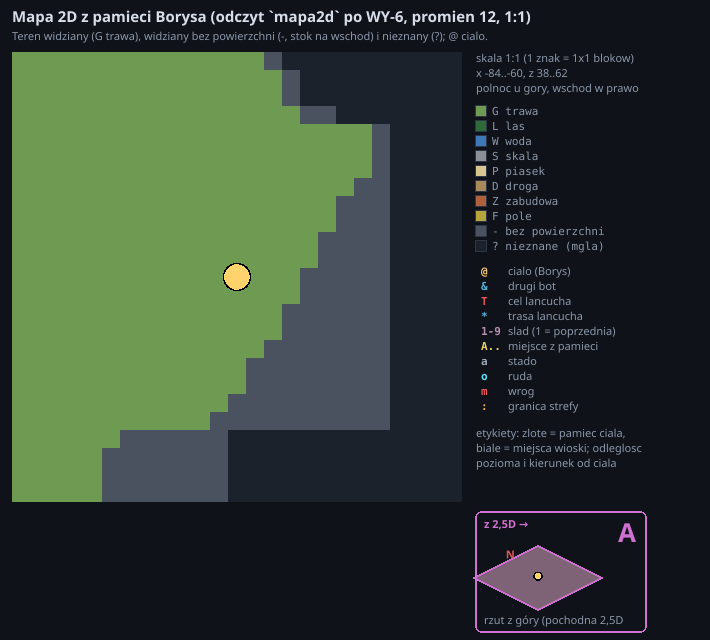

*Rys. 5.2. Mapa 2D z pamięci Borysa w promieniu 12 w skali 1:1: trawa widziana, stok widziany bez powierzchni (-) i nieznane (?), z legendą. Miniatura (A): rzut z góry podłoża widoku 2,5D. Źródło: odczyt `mapa2d` po WY-6. Surowy zapis: [mapa2d](../dodatki/klatki-surowe/odczyty/po-wy6-kupiec-mapa2d.txt).*

Model czyta z mapy, że na zachód jest znana trawa, a na wschód teren widziany tylko z daleka (`-`) i nieznany (`?`). Mapa nie mówi, dlaczego wschód jest nieznany: pas `-` to zbocze opadające w stronę jaskini, co widać dopiero w przekroju.

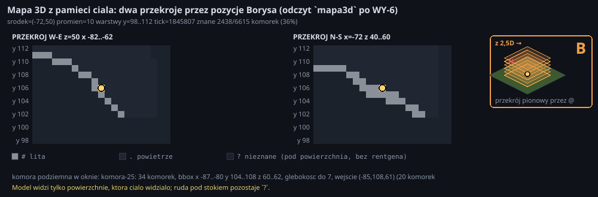

*Rys. 5.3. Dwa przekroje mapy 3D przez pozycję Borysa (W-E i N-S): powierzchnia stoku, powietrze i wszystko pod powierzchnią jako nieznane. Miniatura (B): przekrój pionowy przez ciało w widoku 2,5D. Źródło: odczyt `mapa3d` po WY-6. Surowy zapis: [mapa3d](../dodatki/klatki-surowe/odczyty/po-wy6-kupiec-mapa3d.txt).*

Poniżej to samo miejsce w ruchu: Borys w domku na starcie WY-8, a kamera obraca się wokół niego, więc widać naraz wszystkie przekroje tego, co ciało wie. 
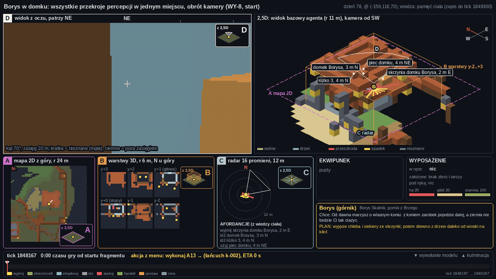

*Film 1. Borys w domku na starcie WY-8 (tick 1848167), pełny obrót kamery; widok z oczu i rzut 2,5D obracają się razem, a mapa 2D, warstwy 3D i radar pokazują ten sam stan. Widoki w kadrze: rzut 2,5D (widok bazowy, prawa góra) i jego pochodne z literami: A mapa 2D z góry, B warstwy 3D wokół stóp, C radar z listą afordancji, D widok z oczu (kratka = nieznane, jasna mgła = poza zasięgiem 20 m). Źródło: WY-8, Borys, tick 1848167 (pamięć ciała, log moda, klatki percepcji; bloki z kopii świata). Wersja MP4: [borys-przekroje-domek.mp4](../dodatki/filmy/wy8/borys-przekroje-domek.mp4). Metoda: [README filmów](../dodatki/filmy/README.md).*

Z filmu widać, czego ciało nie wie: wszystko za ścianami domku i pod podłogą jest kratką (mgłą), a mapa 3D i radar kończą się tam, gdzie kończy się wiedza ciała, a nie świat.

To samo miejsce rozłożone na kolejne widoki: najpierw mapa 2D z góry, potem rzut 2,5D, na końcu warstwy 3D. 
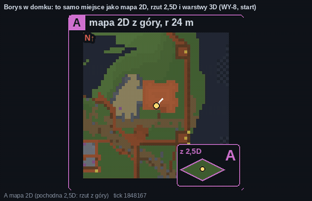

*Film 2. Krótki klip (9 s): domek Borysa kolejno w widoku A (mapa 2D), w rzucie 2,5D i w widoku B (warstwy 3D), w jednej chwili. Widoki w kadrze: rzut 2,5D (widok bazowy, prawa góra) i jego pochodne z literami: A mapa 2D z góry, B warstwy 3D wokół stóp, C radar z listą afordancji, D widok z oczu (kratka = nieznane, jasna mgła = poza zasięgiem 20 m). Źródło: WY-8, Borys, tick 1848167; klip z filmy.py (skrypt niepublikowany). Metoda: [README filmów](../dodatki/filmy/README.md).*

Przejście pokazuje, że A i B są przekrojami tej samej bryły: mapa 2D gubi piętra domku na palach, a warstwy 3D gubią wszystko dalej niż 6 m.

Przekrój pokazuje, że ciało stoi na stoku opadającym na wschód, a wszystko pod powierzchnią jest `?`: bez rentgena ciało zna tylko powierzchnię, którą widziało. Model z tego nie wyczyta, czy pod stokiem jest ruda; dostaje jedynie komorę jaskini z wejściem.

Model dostaje gotowy ranking granic i ich związek ze znanymi miejscami (`przy:`). Brakuje w nim celu: granice są oceniane zainteresowaniem roli, a nie tym, czego ciało teraz potrzebuje (woda, rynek).

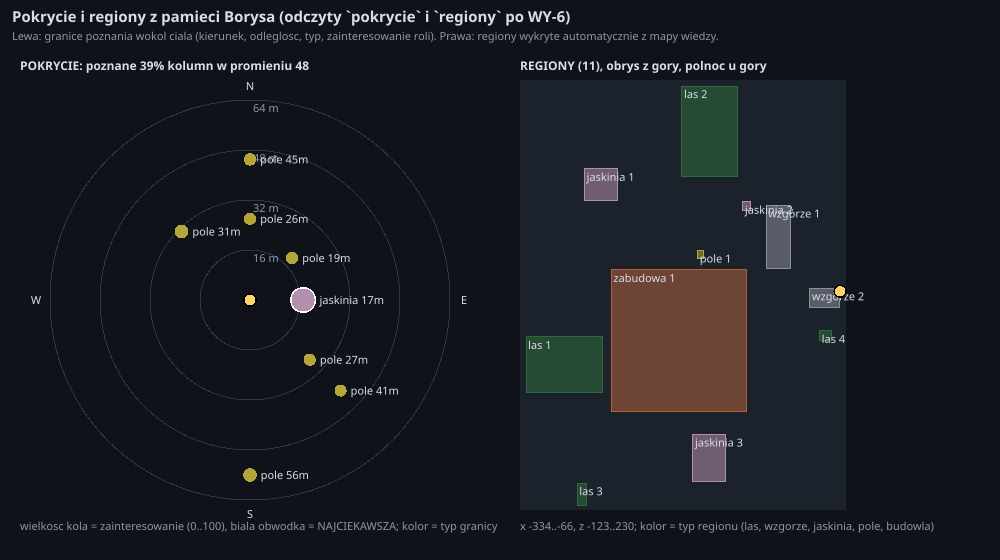

*Rys. 5.4. Pokrycie jako granice poznania wokół ciała (kierunek, odległość, typ, zainteresowanie) i regiony wykryte automatycznie jako obrysy na planie. Regiony podpisane po polsku (las, wzgórze, jaskinia, pole, zabudowa). Źródło: odczyty `pokrycie` i `regiony` po WY-6. Surowy zapis: [pokrycie](../dodatki/klatki-surowe/odczyty/po-wy6-kupiec-pokrycie.txt), [regiony](../dodatki/klatki-surowe/odczyty/po-wy6-kupiec-regiony.txt).*

Regiony są opisane faktami, bez interpretacji (opis sceny liczy kod, nie LLM). Model mógłby z tego wyczytać, że w lesie 38 m na południe stoi stół rzemieślniczy, czyli droga do kilofa bez stawiania własnego stołu. W WY-6 górnik nie wywołał `regiony` ani razu, a menu nie miało akcji „idź do stołu”.

## 5.3 Siatka osiągalności i punktowanie pozycji

Siatka osiągalności (0.12.1-dev) to ten sam A* co planer ruchu, uruchomiony z celem „nigdzie”: zwraca komórki osiągalne w budżecie czasu z kosztem (czas, wytrzymałość, rodzaj ruchu). Na niej działa ocena pozycji 0..100 według sytuacji (walka, zagrożenie, głód, zbieranie, spokój) i filtr celów w menu.

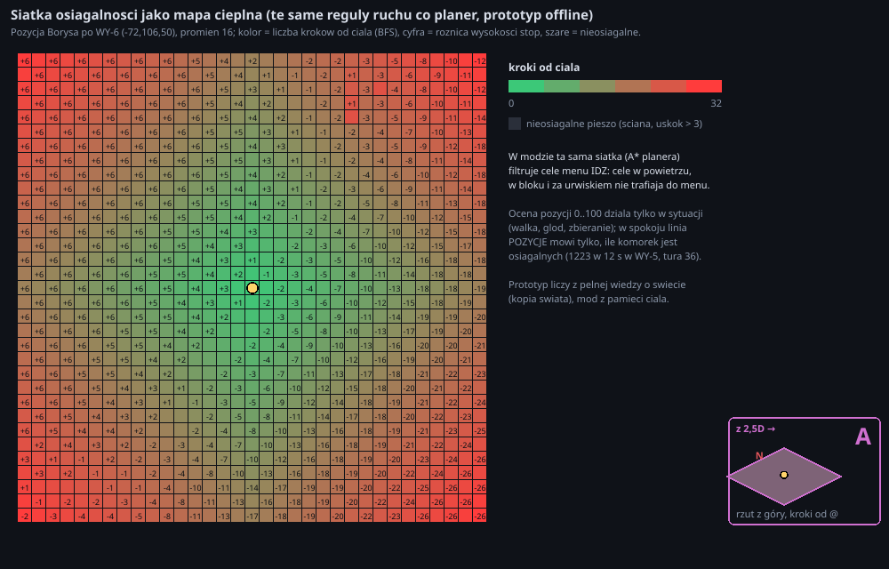

*Rys. 5.5. Siatka osiągalności wokół Borysa jako mapa cieplna liczby kroków (BFS z regułami planera) z różnicą wysokości stóp. Miniatura (A): rzut z góry, kolor = liczba kroków od @. Źródło: prototyp projekcji (te same reguły ruchu co planer) na kopii świata, pozycja z odczytu `stan` po WY-6; linia POZYCJE z WY-5, tura 36. Surowy zapis: [stan](../dodatki/klatki-surowe/odczyty/po-wy6-kupiec-stan.txt), [menu](../dodatki/klatki-surowe/odczyty/po-wy6-kupiec-akcje.txt).*

W spokoju ocena pozycji nic nie podpowiada; model widzi tylko liczbę osiągalnych komórek. Prawdziwa wartość siatki jest ukryta w menu: słowo `pieszo` i czas `~2s` pochodzą z niej, a cele nieosiągalne w ogóle się nie pojawiają. Model nie widzi natomiast, które ważne cele zostały odfiltrowane i dlaczego.

## 5.4 Eksploracja

`eksploruj <typ> [promien] [--do limit]` wybiera najlepszą granicę z `pokrycie` (wynik typu razy waga roli), idzie do niej zwykłym `idz` i kończy na nowym odkryciu, limicie czasu albo po 8 odcinkach. Zasada operatora: eksploracja przeszukuje nieznane; do znanych miejsc służy `idz`. Znane stada i złoża tylko korygują ocenę granic (np. +4 przy znanym złożu), a łowisko oznaczone jako wyczerpane jest omijane (-50).

*Rys. 5.6. Krok `eksploruj ruda` Borysa w WY-6: trasa ciała w czasie, cztery granice wybrane do przeszukania, odkryte złoże węgla i skrót raportu. Źródło: WY-6, dziennik ciała (raport kroku i linie `stan` w czasie łańcucha). Surowy zapis: [raport](../dodatki/klatki-surowe/odczyty/wy6-kupiec-eksploruj-ruda-raport.txt), [pozycje](../dodatki/klatki-surowe/odczyty/wy6-kupiec-eksploruj-ruda-pozycje.csv).*

Poniżej ten sam rodzaj czynności w ruchu: Borys idzie na zachód w poszukiwaniu lasu, ścina drzewo i robi stół. 
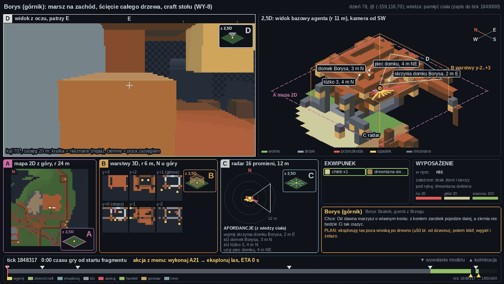

*Film 3. Borys idzie z domku na zachód, schodzi 40 m w dół zbocza, ścina całe drzewo (11 pni) i robi z drewna stół rzemieślniczy; ticki 1848317..1850400. Za oknem pamięci (po ticku 1849300) wiedza ciała jest rekonstruowana ze śladu, a ścięte drzewo w kadrze jeszcze stoi, bo kopia świata jest sprzed przebiegu. Widoki w kadrze: rzut 2,5D (widok bazowy, prawa góra) i jego pochodne z literami: A mapa 2D z góry, B warstwy 3D wokół stóp, C radar z listą afordancji, D widok z oczu (kratka = nieznane, jasna mgła = poza zasięgiem 20 m). Źródło: WY-8, Borys, ticki 1848317..1850400, migawka danych do ticku 1850460. Wersja MP4: [borys-eksploracja-i-drzewo.mp4](../dodatki/filmy/wy8/borys-eksploracja-i-drzewo.mp4). Metoda: [README filmów](../dodatki/filmy/README.md).*

Widać długi marsz `eksploruj las` bez kryterium końca: las jest w zasięgu wzroku dużo wcześniej, niż łańcuch się kończy.

To była najlepiej działająca akcja w WY-6: z ośmiu wywołań produktywnych cztery to odkrycia z `eksploruj`. Raport jest uczciwy (pokazuje, że granic typu ruda nie było i wybrano „najlepszą ogólnie”), ale ma dwie słabości: „poznane 94% -> 33%” myli, bo zmienił się środek okna, a nie wiedza, i nie ma w nim następnego kroku. Odkryte złoże węgla było bezużyteczne bez kilofa.

## 5.5 Pamięć ciała

Pamięć rosła warstwami, każda z osobnym zadaniem i testami:

| warstwa pamięci                     | wersja          | co zapisuje                                                                                                                                | co widzi model                                                          |
| ----------------------------------- | --------------- | ------------------------------------------------------------------------------------------------------------------------------------------ | ----------------------------------------------------------------------- |
| miejsca i notatki                   | 0.1.0 (AM-19)   | nazwa -> pozycja, notatki tekstowe; trwałe po restarcie                                                                                    | `miejsca`, `idz <miejsce>`                                              |
| graf przejść i węzły doświadczenia  | AM-42, AM-54    | przebyte trasy, czynności z efektami, także negatywne (backtracking)                                                                       | polecenia `graf`, `doswiadczenia`                                       |
| auto-odkrycia                       | 0.10.6-dev      | skan co 40 ticków w 16 blokach: skrzynie, piece, stoły, łóżka, NPC, klastry rud, woda, jaskinie, grupy wrogów jako `auto-*`; budżet 0,5 ms | wpisy w `miejsca` z wiekiem                                             |
| brak zapamiętanego                  | 0.10.7-dev      | obiekt, którego nie ma tam, gdzie był: obserwacja `brak`, pewność x0,5, wpis zostaje                                                       | linia `PAMIEC: brak zapamietanego ...`                                  |
| opis sceny                          | 0.10.12-dev     | deterministyczny opis otoczenia w 20 blokach przy odkryciu, bez LLM; `opisz` dopisuje interpretację ciała                                  | `miejsca --scena`, `przypomnij`                                         |
| trwały ekwipunek i stan             | 0.12.1 (trwały) | 36 slotów, pancerz, głód, XP w pliku per ciało                                                                                             | stan po restarcie bez zmian                                             |
| stada, moby, złoża rud              | 0.12.2-dev      | `auto-stado-*` (wygasa po 15 min), `auto-moby-*` (5 min), `auto-ruda-*` ze stanowiskiem do kopania                                         | `zwierzeta`, `moby`, `rudy`, linia `PAMIEC: najblizsze znane stado ...` |
| pamięć zdarzeń miejsca              | 0.12.4-dev      | `auto-lowisko-N`, stan `wyczerpane` i `odnowione`, ruda wykopana, las wycięty                                                              | `lowiska`, `zdarzenia`, linia `PAMIEC`                                  |
| siatka osiągalności i ocena pozycji | 0.12.1-dev      | komórki osiągalne tym samym A* co `idz`, z czasem i wytrzymałością; ocena 0..100 wg sytuacji (walka, głód, zbieranie)                      | `osiagalne`, linia `POZYCJE ...; sugestia, nie polecenie`               |

Ważna zasada przyjęta w pamięci: **ciało zapisuje tylko to, co zobaczyło, z jawnym wiekiem obserwacji i wygasaniem.** Doniesienia spoza zasięgu wzroku (wieże, plotki NPC) mają źródło, promień niepewności i wiarygodność malejącą z czasem. Agent nie dostaje pozycji bytów bez źródła.

**Miejsca.**

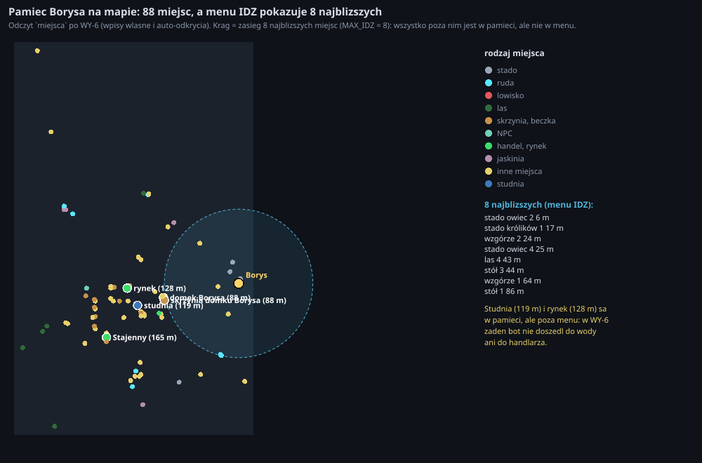

*Rys. 5.7. Pamięć Borysa na mapie: 88 miejsc według rodzaju i krąg 8 najbliższych, które jako jedyne trafiają do menu IDŹ; studnia i rynek leżą poza nim. Ważne miejsca podpisane po polsku (domek Borysa, skrzynia domku Borysa, rynek, studnia, Stajenny). Źródło: odczyt `miejsca` po WY-6. Surowy zapis: [miejsca](../dodatki/klatki-surowe/odczyty/po-wy6-kupiec-miejsca.txt).*

Model może odczytać, gdzie jest studnia i rynek. Ale wpisów jest 88, z czego większość to auto-odkrycia bliżej ciała, a menu IDŹ pokazuje tylko 8 najbliższych. Studnia i rynek są w pamięci, a w menu ich nie ma; w WY-6 to wystarczyło, żeby żaden bot nie dotarł ani do wody, ani do handlarza.

**Notatki** (rys. 5.8). Notatki mieszają wpisy modelu (cennik handlarza) z automatycznymi (`auto:`). Model widzi tylko 10 ostatnich, więc stara, cenna notatka o cenie wypada z widoku szybciej niż kolejne powtórzenia „NPC widziany”.

**Stada** (rys. 5.8). Wiek i pewność są jawne, więc model może odróżnić świeżą obserwację od starej. Brakuje informacji kluczowej dla ataku: czy zwierzę jest widoczne z miejsca, w którym ciało stanie, i czy nie jest chronione (zagroda); stąd 11 nieudanych ataków w WY-6.

**Moby** (rys. 5.8). Pusta lista jest informacją („nic groźnego nie widziałem w ostatnich 5 minutach”), ale nie gwarancją bezpieczeństwa: model nie wie, czy ciało w ogóle patrzyło w stronę, z której przyjdzie zagrożenie. W wiosce bez spawnu wrogów to wystarczało; w polu nocą w WY-1 nie.

**Rudy** (rys. 5.8). Górnik wie o ośmiu złożach, w tym żelaza, ze stanowiskiem do kopania. Wszystkie są bezużyteczne, bo w ekwipunku nie ma kilofa, a pamięć rud nie łączy się z łańcuchem „drewno, deski, stół, kilof”. Wiedza jest kompletna, działanie zerowe.

**Łowiska i zdarzenia miejsca.** W trybie ścisłym polecenia `lowiska` i `zdarzenia` zostały odrzucone, choć są odczytami.

To jest błąd w liście dozwolonych odczytów trybu ścisłego. Ta sama pamięć jest dostępna przez `zwierzeta`.

*Rys. 5.8. Pozostałe warstwy pamięci: notatki (automatyczne i z rozmów), stada i złoża z wiekiem i pewnością, puste moby, łowiska Wilgi ze stanem oraz odczyt `zdarzenia` zablokowany w trybie ścisłym. Źródło: odczyty `miejsca`, `zwierzeta`, `rudy`, `moby`, `zdarzenia` po WY-6. Surowy zapis: [zwierzeta Wilgi](../dodatki/klatki-surowe/odczyty/po-wy6-lucznik-zwierzeta.txt), [rudy](../dodatki/klatki-surowe/odczyty/po-wy6-kupiec-rudy.txt), [zdarzenia](../dodatki/klatki-surowe/odczyty/po-wy6-kupiec-zdarzenia.txt).*

Łowczyni wie, że łowisko obok jest wyczerpane, a dalekie odnowione. To jest dobra, zwięzła pamięć zdarzeń. Model nie dostaje jednak z niej wniosku „czas sprzedać to, co masz”; w WY-6 łowczyni dalej atakowała niewidoczne owce.

## 5.6 Przechwytywanie dropu i trwały ekwipunek

Do 0.12.0-dev łup z zabitego zwierzęcia albo wykopanego bloku spadał na ziemię i ciało musiało go podnieść. Zmiana „przejęcia dropów” kieruje przedmioty z bloku zniszczonego przez ciało i z moba zabitego przez ciało od razu do ekwipunku. Od wersji z trwałym stanem ekwipunek, głód i XP przeżywają restart serwera.

To przykład percepcji „przygotowanej”: model nie musi porównywać ekwipunku przed i po, bo skutek akcji jest w jej wyniku.

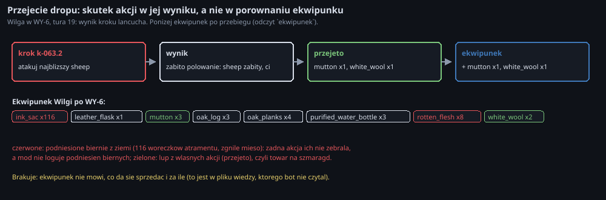

*Rys. 5.9. Przejęcie dropu jako przepływ: krok ataku, wynik, przejęty łup i ekwipunek; pod spodem ekwipunek Wilgi z łupem z własnych akcji i przedmiotami podniesionymi biernie. Źródło: WY-6, tura 19 łowczyni; odczyt `ekwipunek` po WY-6. Surowy zapis: [wynik kroku](../dodatki/klatki-surowe/odczyty/wy6-t19-lucznik-wynik-kroku.txt), [ekwipunek](../dodatki/klatki-surowe/odczyty/po-wy6-lucznik-ekwipunek.txt).*

Poniżej pętla zarobku w ruchu: Wilga zabija krowę, przejmuje łup, idzie na rynek i sprzedaje. 

*Film 4. Wilga podchodzi do krowy, zabija ją dwoma ciosami (przejęte 2 skóry i 2 wołowiny), idzie 56 m na rynek i sprzedaje Handlarzowi skóry i wołowinę za szmaragdy, a za szmaragd kupuje łuk; ticki 1848500..1849520. W kulminacjach (zabicie, sprzedaż, zakup) film staje na 1,5 s i pokazuje rzut z peaku. Widoki w kadrze: rzut 2,5D (widok bazowy, prawa góra) i jego pochodne z literami: A mapa 2D z góry, B warstwy 3D wokół stóp, C radar z listą afordancji, D widok z oczu (kratka = nieznane, jasna mgła = poza zasięgiem 20 m). Źródło: WY-8, Wilga, ticki 1848500..1849520, migawka danych do ticku 1850460. Wersja MP4: [wilga-polowanie-i-sprzedaz.mp4](../dodatki/filmy/wy8/wilga-polowanie-i-sprzedaz.mp4). Metoda: [README filmów](../dodatki/filmy/README.md).*

W kafelku ekwipunku widać przejęcie w chwili zabicia (zielona ramka), a nie po porównaniu ekwipunku; rzut z peaku przy sprzedaży to ten sam moment, z którego epizod w rozdziale 10 bierze swój rzut 2,5D.

Model widzi towar na szmaragd (3 baraniny, 2 wełny) i 116 woreczków atramentu, których żadna akcja nie zebrała: przejęcie działa tylko dla łupu z własnych akcji, a podniesień biernych mod nie loguje. Ekwipunek nie mówi też, co z tego da się sprzedać ani za ile; to jest w pliku wiedzy, którego bot nie czytał.

## 5.7 Menu akcji: percepcja przetworzona w decyzje

Menu jest ostatnią warstwą percepcji: zamienia stan, pamięć i siatkę osiągalności w listę ruchów z czasem, ryzykiem i pewnością.

Na jednej karcie (rys. 5.10) widać trzy błędy opisane w [rozdziale 4](../czesc-1-wiedza-i-interfejs-akcji/04-interfejs-akcji.md): `PIJ` jako „wykonalne TERAZ” przy braku wody, adnotacja `ROLA: zakaz polowania` mimo zniesienia zakazów oraz brak IDŹ do studni, rynku i stołu. Model dostaje gotowe akcje, ale nie dostaje tych, których potrzebuje.

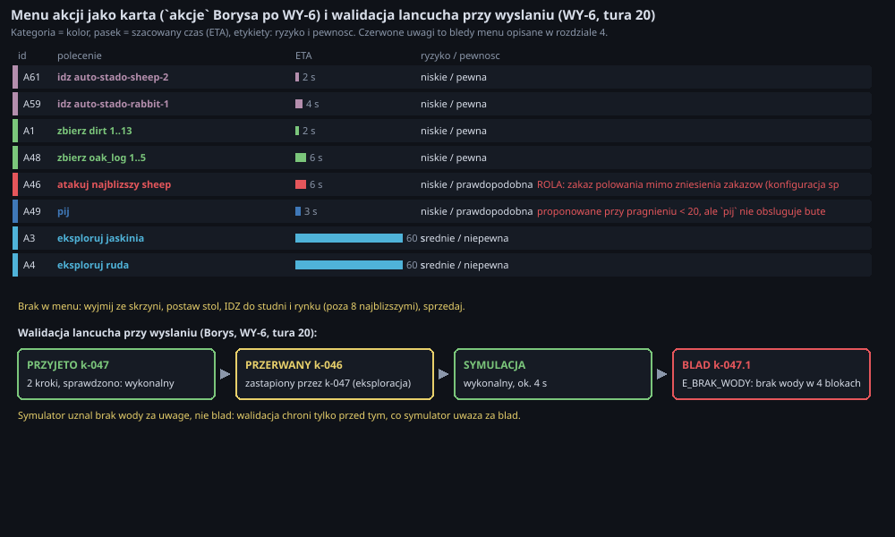

*Rys. 5.10. Menu akcji jako karta z kategoriami, czasem, ryzykiem i pewnością, z zaznaczonymi błędami menu, oraz walidacja łańcucha w WY-6: przyjęty jako wykonalny i przerwany błędem w pierwszym kroku. Źródło: odczyt `akcje` po WY-6; WY-6, tura 20 Borysa. Surowy zapis: [akcje](../dodatki/klatki-surowe/odczyty/po-wy6-kupiec-akcje.txt), [walidacja](../dodatki/klatki-surowe/odczyty/wy6-t20-kupiec-walidacja.txt).*

Symulator uznał łańcuch za wykonalny, zastąpił nim trwającą eksplorację, a pierwszy krok padł na braku wody. To najkrótszy możliwy dowód tezy z [rozdziału 4](../czesc-1-wiedza-i-interfejs-akcji/04-interfejs-akcji.md): walidacja chroni tylko przed tym, co symulator uważa za błąd.

## 5.8 Co model widzi, a co dostaje przygotowane

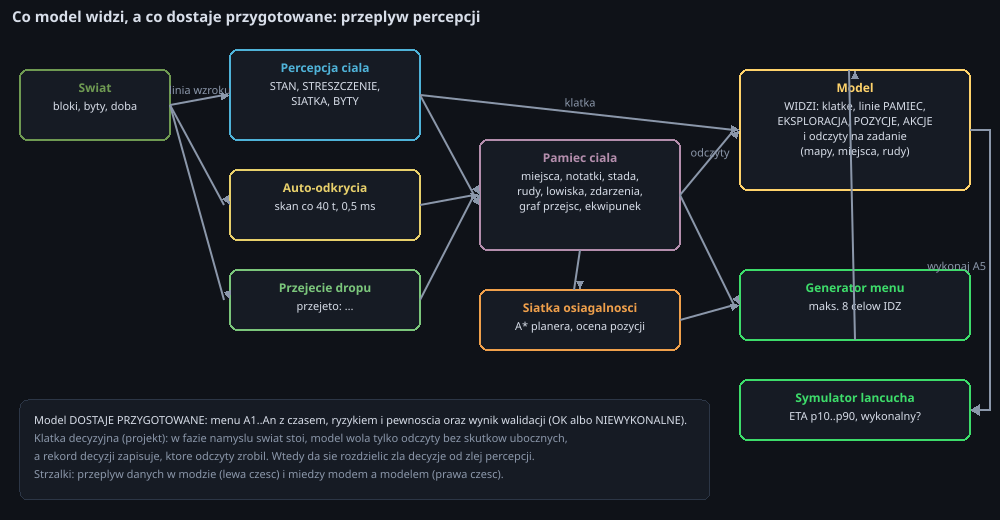

*Rys. 5.11. Przepływ percepcji: świat, ciało, auto-odkrycia, przejęcie dropu, pamięć, siatka osiągalności, generator menu, symulator i model, z podziałem na to, co model widzi, i to, co dostaje przygotowane. Źródło: schemat autora na podstawie kodu moda i harnessu. Surowy zapis: [opis klatki](../dodatki/glosariusz.md).*

Poniżej to, co ciało naprawdę widzi, bez nakładek: sam widok z oczu Wilgi w drodze do krowy. 
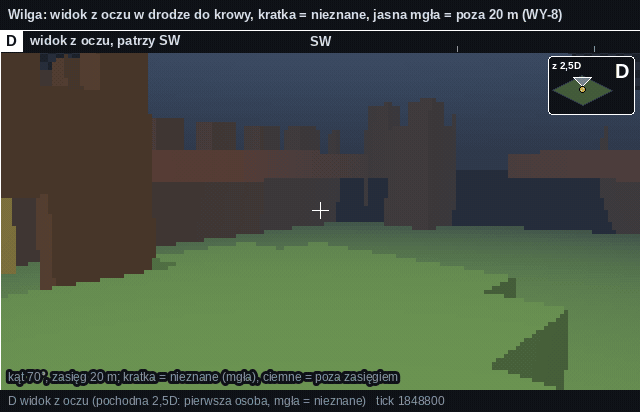

*Film 5. Krótki klip (8 s): widok D z oczu Wilgi, kąt 70 stopni, zasięg 20 m; kratka = komórki, których ciało nie zna, jasna mgła = poza zasięgiem; krowa z nazwą i odległością. Widoki w kadrze: rzut 2,5D (widok bazowy, prawa góra) i jego pochodne z literami: A mapa 2D z góry, B warstwy 3D wokół stóp, C radar z listą afordancji, D widok z oczu (kratka = nieznane, jasna mgła = poza zasięgiem 20 m). Źródło: WY-8, Wilga, ticki 1848800..1848990; klip z filmy.py (skrypt niepublikowany). Metoda: [README filmów](../dodatki/filmy/README.md).*

Model nie dostaje tego obrazu, tylko jego tekstowy odpowiednik z klatki; film pokazuje, ile z tego, co tekst nazywa „widzianym”, jest w rzeczywistości mgłą.

Klatka decyzyjna (szkic, [rozdz. 4.3](../czesc-1-wiedza-i-interfejs-akcji/04-interfejs-akcji.md)) miała to uporządkować: w fazie namysłu świat stoi, a model może wołać tylko odczyty bez skutków ubocznych (`stan`, `percepcja`, `miejsca`, `mapa2d`, `rudy`, `akcje`, `sprawdz`), a rekord decyzji zapisuje, które odczyty zrobił. Dzięki temu dałoby się odpowiedzieć na pytanie, czy model podjął złą decyzję mimo dobrej percepcji, czy z jej powodu. Dziś ta odpowiedź wymaga ręcznego audytu.

## 5.9 Jak percepcja wpływała na jakość działania

Przykłady z historii, w których wiedza ciała była poprawna, a działanie i tak zawiodło:

- **Węgiel znaleziony, ale niewykopany.** W WY-6 `eksploruj ruda` znalazła złoże węgla (`auto-ruda-coal`), a górnik stał obok. Menu nie proponowało wykopania, bo `zbierz coal_ore` wymaga kilofa, kilof wymaga postawionego stołu, a akcji `postaw` w menu nie było. Opus napisał wprost: „w menu akcji nie ma opcji kopania rudy”. W WY-5 Haiku po 36 rundach skończył na `E_BRAK_NARZEDZIA 'coal'`. Percepcja zrobiła swoje; zabrakło ścieżki od wiedzy do akcji.
- **Studnia w pamięci, a nieobecna w menu IDŹ.** Pamięć górnika zawierała studnię 119 m na zachód, a rynek z handlarzem był 165 m dalej. Menu IDŹ pokazywało tylko 8 najbliższych miejsc (`MAX_IDZ = 8`), a pamięć była pełna auto-odkryć bliżej. Skutek: 12 łańcuchów z niewykonalnym `pij` i ani jednej sprzedaży. Bogatsza pamięć wypchnęła z menu miejsca najważniejsze dla celu.
- **Limit pamięci.** Ciało górnika miało na serwerze testowym 57 wpisów przy limicie 64, więc nowe stada i złoża mogły się nie zmieścić. Limit podniesiono do 96, ale problem priorytetu (co jest ważne dla celu, a co tylko blisko) został.
- **Utknięcia i przeplanowania.** 12% zakończonych marszów wymagało przeplanowania, a te trwały medianowo 2,26 raza dłużej niż plan (p90 8,9 raza). W pokazach 3 i 4, przed siatką osiągalności, 35% czasu zjadły cele nieosiągalne. Siatka liczona tym samym A* co planer usunęła cele w powietrzu i w bloku z menu, ale nie usunęła `E_UTKNAL` na zboczach (4 razy z rzędu w WY-5B).
- **Ochrona i widoczność.** Percepcja poprawnie pokazywała owcę 13 bloków wyżej na zboczu i krowę w zagrodzie. Menu brało każde zwierzę w 24 blokach bez sprawdzenia linii wzroku i ochrony, a kod ataku je odrzucał (`E_NIEWIDOCZNY`, `E_CEL_CHRONIONY`). Ta sama informacja o świecie była liczona w dwóch miejscach na dwa sposoby.

Co nie zadziałało w samej percepcji:

- **Podniesienia bierne nie są logowane.** Łowczyni zebrała 116 woreczków atramentu, idąc po ziemi w miejscu wcześniejszych walk. `przejeto:` obejmuje tylko łup z własnych akcji, a mod nie zapisuje podniesień biernych, więc audyt mógł to tylko wywnioskować. Przedmioty zaśmieciły ekwipunek i symulację.
- **`auto-*` to nie zgoda.** Auto-odkryta skrzynia w wiosce nie daje prawa do brania z niej (wymaga ręcznego nazwania). Opus, ostrożny wobec zasad, pomijał także skrzynie, z których mógł brać. Percepcja nie rozróżniała własności wystarczająco jasno.
- **Zimny start klatki** przekraczał próg 2 ms (p95 2,134 ms), a pomiar nie obejmował zapisu klatki i HTTP.
- **Model ufał adnotacjom bardziej niż plikom.** Linia `ROLA: zakaz polowania` w menu (ze starej konfiguracji) wygrała z plikiem roli, którego model nie czytał. To, co jest w klatce i menu, działa jak prawda; to, co trzeba odczytać, praktycznie nie istnieje.

Wniosek z tej części: **percepcja i pamięć ciała były najlepiej dopracowaną warstwą systemu, ale ich wartość zależała od tego, czy menu potrafi zamienić wiedzę na akcję.** Do przyszłych wersji: priorytet celów w menu IDŹ według potrzeby (woda, rynek, własna skrzynia) zamiast odległości i jedna funkcja widoczności i ochrony wspólna dla percepcji, menu i wykonawcy.

---

[← 4. Interfejs akcji](../czesc-1-wiedza-i-interfejs-akcji/04-interfejs-akcji.md) · [indeks](../esej-indeks.md) · [6. Klatka środowiska w kontekście bota →](06-klatka-srodowiska.md)
