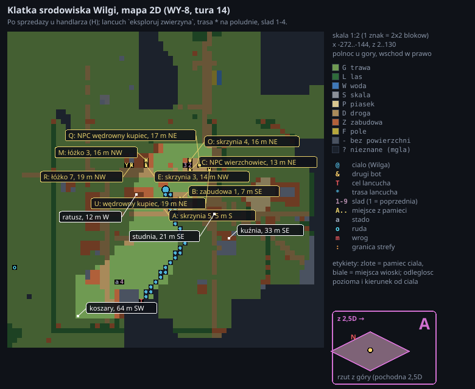
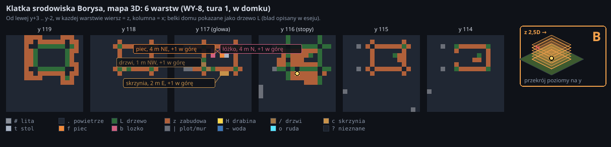
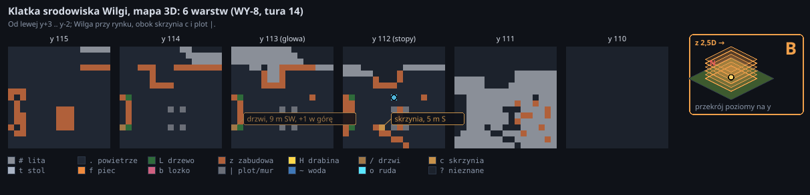
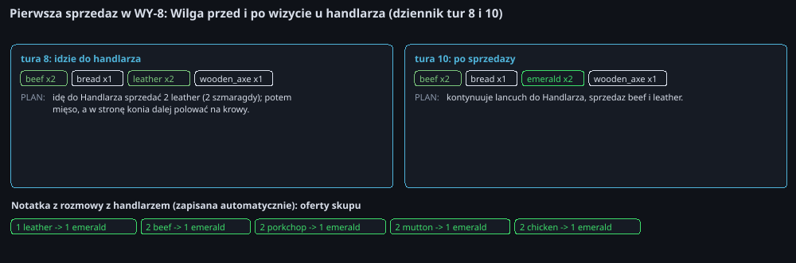
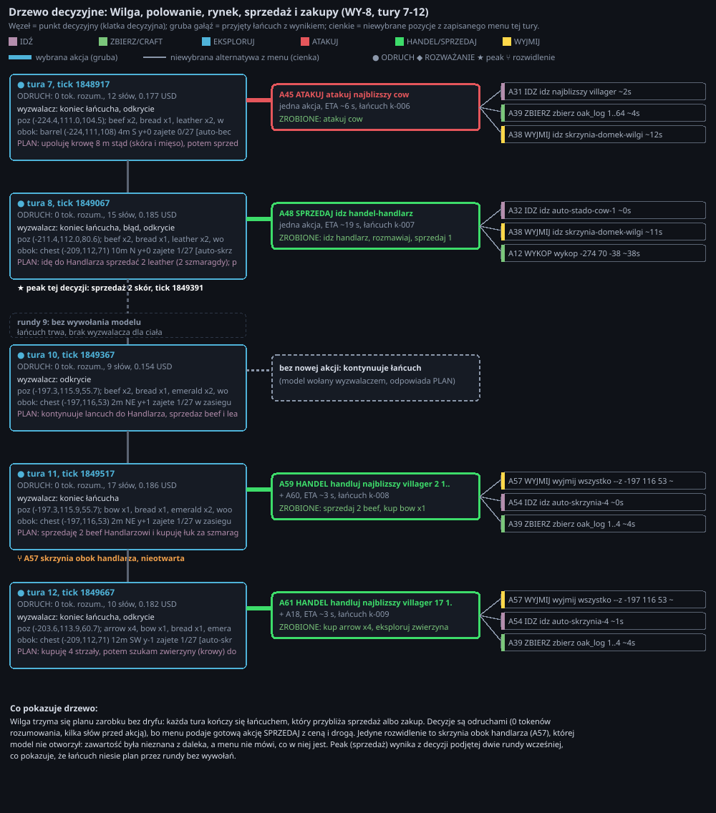
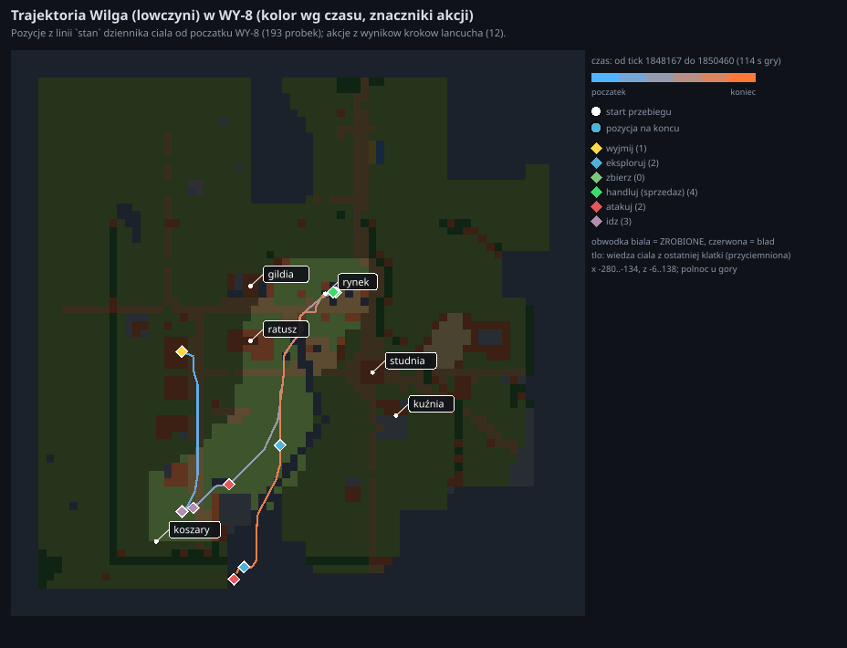

# 6. Klatka środowiska w kontekście bota

> Gotowa klatka w każdym wywołaniu modelu, koszt pamięci klatek wstecz i pierwsze obserwacje z żywego przebiegu WY-8.

[← 5. System percepcji: jak ciało widzi świat](05-system-percepcji.md) · [indeks](../esej-indeks.md) · [7. Projekcja 3D na 2D: prototyp →](07-projekcja-3d-na-2d.md)

---

[Rozdział 5](05-system-percepcji.md) pokazał, że ciało wie dużo, ale model tę wiedzę musi sam odczytać, a w trybie zdarzeniowym prawie tego nie robił (0 wywołań `regiony` w WY-6). Następny krok był prosty w pomyśle: zamiast czekać, aż model zapyta, harness wkłada do każdego wywołania gotową **klatkę środowiska**.

Nowe polecenie moda `klatka [promien3d] [promien2d] [--budzet] [--historia N]` (0.12.9-dev) składa w jeden tekst: linię `STAN`, mapę 3D w promieniu 8 bloków (6 warstw: od y+3 do y-2), mapę 2D w promieniu 64 ze skalą dobieraną do budżetu 5500 tokenów (w praktyce 1:2), litery miejsc z pamięci, rzeźbę terenu, granicę strefy, trasę trwającego łańcucha (`T` = cel, `*` = trasa z nawigacji) i ślad poprzednich klatek (cyfry `1..9` na mapie). Harness dostał flagę `--klatka-srodowiska`, która czyta klatkę, gdy świat stoi, i wkłada ją na początek promptu. Opis znaków dostał też bot, w osobnym pliku wiedzy.

Projekt pamięci klatek wstecz był osobną decyzją kosztową. Pełna klatka t-1 to druga cała mapa, więc starsze klatki są „zmniejszane”: w trybie `slad` t-1 jest pełna, a t-2..t-X to tylko cyfra na bieżącej mapie i linia stanu; w trybie `skale` starsze klatki dostają mapę 1:4. Pomiar przed wdrożeniem (szacunek znaki/3):

| klatki wstecz X | tryb | tokeny razem z klatką | Sonnet USD / wywołanie | Opus USD / wywołanie |
|---:|---|---:|---:|---:|
| 2 | slad-3d | 4 113 | 0,0082 | 0,0165 |
| 4 | slad (domyślny) | 6 279 | 0,0126 | 0,0251 |
| 4 | slad-3d | 4 394 | 0,0088 | 0,0176 |
| 8 | skale | 7 511 | 0,0150 | 0,0300 |

Około 85% kosztu pamięci to pełna klatka t-1, a linia śladu kosztuje ok. 90 tokenów. Przy koszcie wywołania Opusa 0,16 do 0,22 USD (audyt WY-6) klatka dokłada 8 do 15%.

Klatkę łowczyni z tury 14 w czytelnej postaci pokazują rysunki 1b (mapa 2D) i 2b (mapa 3D) niżej. Surowy zapis: [klatka WY-8, tura 14](../dodatki/klatki-surowe/wy8-014-lucznik.txt).

*Rys. 1b. Klatka środowiska Wilgi, mapa 2D: teren w kolorach przeglądarki przebiegów, @ ciało, * trasa łańcucha, cyfry ślad, litery miejsca z pamięci. Etykiety po polsku: złote to miejsca z pamięci ciała (litera, nazwa, odległość i kierunek z klatki), białe to miejsca wioski z konfiguracji (odległość pozioma i kierunek od ciała). Miniatura w rogu (A) pokazuje, że to rzut z góry podłoża widoku 2,5D. Źródło: WY-8, tura 14 łowczyni, `klatki/014-lucznik.txt` (surowy tekst klatki w dodatkach). Figura wygenerowana skryptem figury.py (skrypt niepublikowany) z prawdziwego zapisu.*

*Rys. 1a. Klatka środowiska Borysa, mapa 2D w chwili, gdy łańcuch `eksploruj las` prowadził go dalej mimo lasu obok (cel T 6 m SW). Etykiety po polsku: złote to miejsca z pamięci ciała (litera, nazwa, odległość i kierunek z klatki), białe to miejsca wioski z konfiguracji (odległość pozioma i kierunek od ciała). Miniatura w rogu (A) pokazuje, że to rzut z góry podłoża widoku 2,5D. Źródło: WY-8, tura 11 górnika, `klatki/011-kupiec.txt`. Figura wygenerowana skryptem figury.py (skrypt niepublikowany) z prawdziwego zapisu.*

*Rys. 2a. Mapa 3D klatki Borysa jako 6 warstw (y+3 .. y-2) w domku: drzwi, łóżko, piec, stół, skrzynia; belki domu widać jako drzewo L, czyli błąd opisany w [rozdziale 7](07-projekcja-3d-na-2d.md). Przy obiektach etykieta względem ciała: kierunek, odległość pozioma w metrach i różnica wysokości warstwy. Miniatura (B) pokazuje, że warstwy to poziome przekroje widoku 2,5D. Źródło: WY-8, tura 1 górnika, `klatki/001-kupiec.txt`. Figura wygenerowana skryptem figury.py (skrypt niepublikowany) z prawdziwego zapisu.*

*Rys. 2b. Mapa 3D klatki Wilgi jako 6 warstw przy rynku. Przy obiektach etykieta względem ciała: kierunek, odległość pozioma w metrach i różnica wysokości warstwy. Miniatura (B) pokazuje, że warstwy to poziome przekroje widoku 2,5D. Źródło: WY-8, tura 14 łowczyni, `klatki/014-lucznik.txt`. Figura wygenerowana skryptem figury.py (skrypt niepublikowany) z prawdziwego zapisu.*

Model czyta z tego bez żadnego zapytania, gdzie jest (`@`), dokąd prowadzi łańcuch (`*` na południe), co zrobił w ostatnich czterech klatkach (zabicie krowy, dwie wymiany u handlarza) i że handlarz `H` jest 14 m dalej. Brakuje dostępności: na mapie 2D ściana, stopień i otwarte przejście wyglądają tak samo, a mapa 3D obejmuje tylko 8 bloków i 6 warstw.

Pierwsze obserwacje z WY-8 (przebieg w toku w chwili pisania, Sonnet, oba ciała): klatka trafiła do kontekstu we wszystkich 17 wywołaniach, miała 3302 do 3612 tokenów (mediana 3455) i budowała się w 62 do 1745 ms. Przy 14 wywołaniach koszt wyniósł 2,617 USD. Najważniejsze: łowczyni upolowała krowę, poszła do handlarza i sprzedała 2 skóry za **2 szmaragdy**. To pierwsze szmaragdy w tej historii zdobyte w pętli „zdobądź, idź, sprzedaj”, choć przebieg łączył więcej zmian naraz (klatka, poprawione menu produktywne z akcjami sprzedaży, nowa wiedza), więc nie da się przypisać efektu samej klatce.

*Rys. 6.1. Pierwsza sprzedaż w WY-8: ekwipunek i plan Wilgi przed wizytą u handlarza i po niej oraz oferty skupu zapisane w notatce z rozmowy. Źródło: WY-8, dziennik tur 8 i 10 łowczyni. Surowy zapis: [dziennik](../dodatki/klatki-surowe/odczyty/wy8-dziennik-lucznik-tury-8-10.txt).*

Cała pętla zarobku, która doprowadziła do tej sprzedaży, w ruchu:

*Film 4 (powtórzenie; pierwsze osadzenie: [rozdział 5.6](05-system-percepcji.md)). Klatka środowiska z tego rozdziału jest tekstem, który model dostał w każdej z tych tur; film pokazuje ten sam stan jako obraz: widok z oczu, rzut 2,5D i jego pochodne A do D.*

Między zabiciem krowy a sprzedażą model był wołany kilka razy, ale łańcuch drogi do handlarza trwał 322 ticki bez nowej decyzji: klatka z trasą T i * wystarczyła.

Te same tury jako drzewo decyzji, z tym, co Wilga mogła wybrać zamiast:

*Drzewo 1. Punkty decyzyjne Wilgi (tura, tick, wyzwalacz, sytuacja z klatki, tryb ODRUCH albo ROZWAŻANIE z liczbą tokenów rozumowania i kosztem), przyjęte łańcuchy z wynikiem i niewybrane pozycje menu; peak sprzedaży i nieotwarta skrzynia obok handlarza (A57). Źródło: WY-8, transkrypty tur 7-12 łowczyni, dziennik przebiegu, dziennik ciała. Alternatywy pochodzą z zapisanych list `akcje` w transkryptach tur; jak czytać: [rozdział 9.4](09-planowanie-i-kalibracja.md).*

Wszystkie decyzje Wilgi są odruchami, a mimo to plan zarobku jest spójny: menu podaje gotową akcję SPRZEDAJ z ceną i drogą, więc nie ma czego rozważać.

*Rys. 4b. Trajektoria Wilgi w WY-8: kolor linii od niebieskiego (początek) do pomarańczowego (koniec), romby to akcje (wyjmij, eksploruj, atakuj, handluj); widać drogę od polowania do handlarza i z powrotem w teren. Białe etykiety: miejsca wioski (rynek, studnia, kuźnia, koszary, ratusz, gildia). Źródło: WY-8, linie `stan` i wyniki kroków łańcucha w dzienniku ciała łowczyni od ticku startu przebiegu. Figura wygenerowana skryptem figury.py (skrypt niepublikowany) z prawdziwego zapisu.*

---

[← 5. System percepcji: jak ciało widzi świat](05-system-percepcji.md) · [indeks](../esej-indeks.md) · [7. Projekcja 3D na 2D: prototyp →](07-projekcja-3d-na-2d.md)
