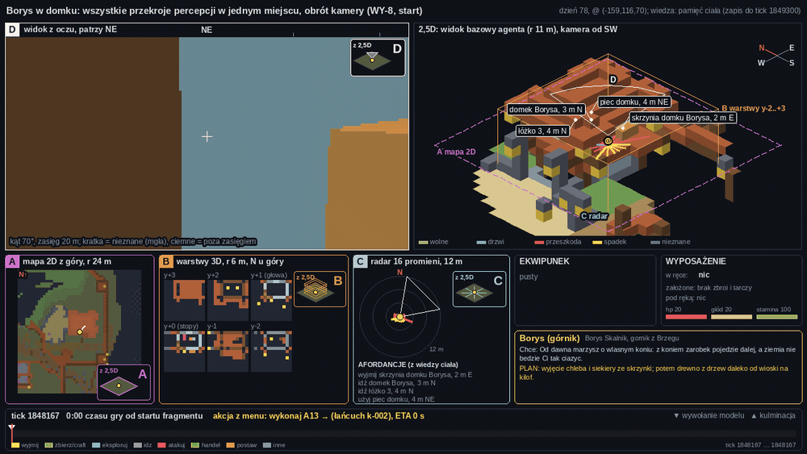
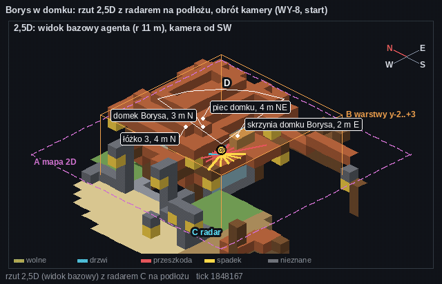
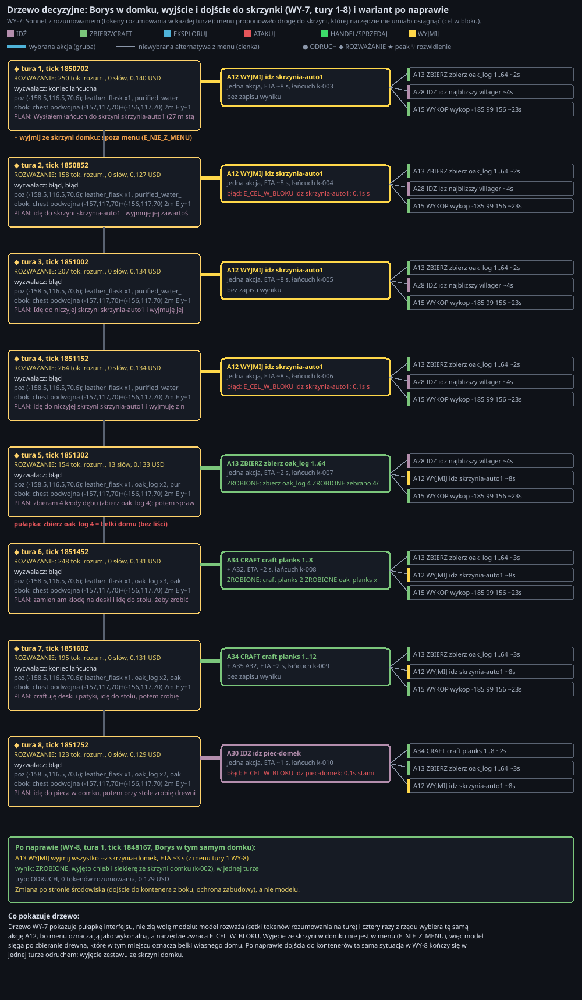

# 7. Projekcja 3D na 2D: prototyp

> Cztery rzuty tego samego świata i ich czytelność na 21 pytaniach kontrolnych przy różnym koszcie tokenów.

[← 6. Klatka środowiska w kontekście bota](06-klatka-srodowiska.md) · [indeks](../esej-indeks.md) · [8. Metapoznanie: system o sobie i agent o systemie →](08-metapoznanie.md)

---

Klatka v1 ma znane wady: belki domów rysuje jako drzewo `L`, warstwy 3D gubią drzwi na innym poziomie, a mapa 2D nie mówi, co jest przejezdne. Zanim zmieniłem format w modzie, zbudowałem prototyp offline: parser plików świata (format 26.3 ma nową postać palety bloków), model ruchu 2,5D z regułami planera (krok, półpłytka, skok, wspinaczka, zejście do 3,5 bloku, drabina, drzwi drewniane przechodnie, żelazne nie) i cztery rzuty liczone z tego samego parsera co obecna klatka, na 7 miejscach świata i jednym syntetycznym scenariuszu (mur 3 bloki, 6 zombie pod murem).

Rzuty: (1) przejezdność 2,5D, jeden znak na kolumnę: wysokość względem stóp tylko dla kolumn, do których ciało dojdzie; (2) radar kątowy z listą **afordancji** (wyjście, skrzynia, wrogowie i czy dojdą, sektory N..NW); (3) zmienna rozdzielczość jak plamka żółta: 1:1 do 12 bloków, 1:2 do 24, 1:4 do 64; (4) kombinacja (1) w zmiennej rozdzielczości z listą afordancji.

Czytelność oceniłem bez wywołania modelu, na 21 pytaniach kontrolnych („jak wyjść z domku?”, „czy zombie dosięgną bota na murze?”): odpowiedź wynika wprost (1 punkt), wymaga składania warstw (0,5) albo jest niemożliwa (0).

| rzut | punkty z 21 | tokeny (ok.) |
|---|---:|---:|
| obecna klatka v1 | 11,5 | 3 050 |
| (1) przejezdność, promień 40 | 14,5 | 2 590 |
| (2) radar z afordancjami | 13 | 470 |
| (3) zmienna rozdzielczość, sam teren | 7,5 | 1 550 |
| (4) kombinacja | **16,5** | **1 550** |

![Rys. 3a. Te same cztery rzuty dla wnętrza domku Borysa: w przejezdności (b) widać, że drzwi prowadzą na półkę nad uskokiem, a radar (c) pokazuje szyby, piec i łóżko tuż obok. Panel (e) to rzut wizualny 2,5D (izometryczny, dach zdjęty nad głową) z tych samych bloków kopii świata: domek na palach, ganek nad ziemią z zaznaczoną wysokością, drzwi, skrzynie, stół, piec, łóżko, Borys (@) i droga wyjścia z listy afordancji (7 kroków przez drzwi). Panele (a) do (d) to rzuty danych dla modelu, (e) jest tylko dla czytelnika.](../figury/f3a-projekcja-domek.svg)

*Rys. 3a. Te same cztery rzuty dla wnętrza domku Borysa: w przejezdności (b) widać, że drzwi prowadzą na półkę nad uskokiem, a radar (c) pokazuje szyby, piec i łóżko tuż obok. Panel (e) to rzut wizualny 2,5D (izometryczny, dach zdjęty nad głową) z tych samych bloków kopii świata: domek na palach, ganek nad ziemią z zaznaczoną wysokością, drzwi, skrzynie, stół, piec, łóżko, Borys (@) i droga wyjścia z listy afordancji (7 kroków przez drzwi). Panele (a) do (d) to rzuty danych dla modelu, (e) jest tylko dla czytelnika. Panel (e) jest widokiem bazowym: kamera od SW (róża kompasu zgodna z kamerą), osie z podziałką co 2 m od ciała (@ = 0), pierścienie 4, 8 i 12 m na podłożu, pasek skali, etykiety obiektów w formie „drzwi, 3 m SW” albo „piec, 1 m NE”, radar jako nakładka (16 promieni z ciała do pierwszej przeszkody: zielony wolne, niebieski drzwi, czerwony przeszkoda, żółty spadek, z odległością przy końcu, tak jak w liście afordancji) i kierunek patrzenia. Kolorowe nakładki z literami pokazują, skąd pochodzą pozostałe panele: A mapa 2D z góry (panele a, b, d), B warstwy i przekrój 3D, C radar (panel c), D widok z oczu. Źródło: prototyp projekcji, miejsce `domek-wnetrze` (kopia świata, pełna wiedza). Figura wygenerowana skryptem figury.py (skrypt niepublikowany) z prawdziwego zapisu.*

Ten sam domek w ruchu, z przekrojami obok siebie:

*Film 1 (powtórzenie; pierwsze osadzenie: [rozdział 5.2](05-system-percepcji.md)). Obrót kamery pokazuje to, co panel (e) rysuje statycznie: domek na palach, drzwi nad uskokiem i to, że rzuty z góry chowają poziomy.*

Sam radar na podłożu rzutu 2,5D, przy obrocie kamery:

*Film 6. Krótki klip (8 s): rzut 2,5D domku Borysa z promieniami radaru C na podłożu (wolne, drzwi, przeszkoda, spadek) i nakładkami A, B, D, kamera obraca się wokół ciała. Widoki w kadrze: rzut 2,5D (widok bazowy, prawa góra) i jego pochodne z literami: A mapa 2D z góry, B warstwy 3D wokół stóp, C radar z listą afordancji, D widok z oczu (kratka = nieznane, jasna mgła = poza zasięgiem 20 m). Źródło: WY-8, Borys, tick 1848167; klip z filmy.py (skrypt niepublikowany). Metoda: [README filmów](../dodatki/filmy/README.md).*

Krótkie promienie kończą się na ścianach i szybach domku; warto porównać je z listą afordancji w panelu (c) rysunku 3a, gdzie wyjście prowadzi 7 kroków przez drzwi SW.

Ten sam domek w WY-7, zanim naprawiono dojście do kontenerów, jako drzewo decyzji:

*Drzewo 3. WY-7: cztery razy A12 do skrzyni, której narzędzie nie osiąga (E_CEL_W_BLOKU), wyjęcie ze skrzyni domku spoza menu, zbieranie drewna, które jest belkami domu; na dole ta sama sytuacja w WY-8 po naprawie, rozwiązana w jednej turze akcją A13. Źródło: WY-7, transkrypty tur 1-8 górnika i dziennik przebiegu (log moda z WY-7 przepadł, wyniki z odpowiedzi w turach); WY-8, tura 1. Alternatywy pochodzą z zapisanych list `akcje` w transkryptach tur; jak czytać: [rozdział 9.4](09-planowanie-i-kalibracja.md).*

To drzewo jest graficzną wersją wniosku z [rozdziału 8.1.2](08-metapoznanie.md): błąd narzędzia przy akcji oznaczonej jako wykonalna zamienia rozważanie modelu w pętlę, a potem w niszczenie świata.

Listę afordancji dla muru z hordą pokazuje panel (c) rysunku 3b niżej. Surowy zapis: [radar i afordancje](../dodatki/klatki-surowe/projekcja-mur-horda-p2.txt).

Mapę w zmiennej rozdzielczości dla tego scenariusza pokazuje panel (d) rysunku 3b. Surowy zapis: [mapa p4](../dodatki/klatki-surowe/projekcja-mur-horda-p4.txt).

*Rys. 3b. Cztery rzuty dla scenariusza z murem i hordą: (a) obecna klatka 2D, (b) przejezdność 2,5D, (c) radar kątowy z listą afordancji, (d) kombinacja w zmiennej rozdzielczości z pierścieniami 12 i 24 bloków; (e) rzut wizualny 2,5D (izometryczny, bloki jako sześciany z cieniowaniem) z murem, zombie pod murem i ich drogą do bota (44 bloki przez drzwi i drabinę), czyli bufor bezpieczeństwa z listy afordancji. Panel (e) ma te same elementy co w rys. 3a (podziałka co 4 m, radar, nakładki A do D) oraz kierunek nadejścia hordy i drogę zombie do bota z buforem (44 bloki, ok. 11 s przy tempie marszu 5 ticków na blok, szacunek). Źródło: prototyp projekcji, miejsce `mur-horda` (scenariusz syntetyczny). Figura wygenerowana skryptem figury.py (skrypt niepublikowany) z prawdziwego zapisu.*

Z (2) model wprost czyta odpowiedź, której obecna klatka nie daje: zombie dojdą, ale dopiero drogą 44 bloków przez drzwi i drabinę. Z (4) widzi koronę muru (`.`), zejście 3 w dół (`c`), drzwi `/` i drabinę `H`. Czego brakuje: (4) nie pokazuje postaci i liter miejsc, więc pytania „gdzie handlarz?” przegrywa z obecną klatką.

Odkrycie poboczne z prototypu: **domek górnika stoi na palach**, a oboje drzwi prowadzą na półki 4,5 bloku nad ziemią, czyli dalej niż maksymalne zejście planera (3). Jedyne wejście to dziura w podłodze. To tłumaczy kłopoty z drzwiami w WY-7 ([rozdz. 8.1.2](08-metapoznanie.md)): bot widział drzwi, ale za nimi nie było zejścia, a żadna warstwa klatki v1 tego nie pokazywała. Drugie odkrycie: zapamiętany punkt `rynek` leżał w pustej kieszeni 2 bloki pod powierzchnią rynku.

Ograniczenie, które trzeba powiedzieć wprost: prototyp liczy z pełnej wiedzy o świecie. W modzie trzeba liczyć z pamięci ciała (z mgłą `?`), inaczej bot dostanie rentgen. Rekomendacja to wdrażać po kolei: najpierw listę afordancji obok obecnej klatki (+80..150 tokenów) i test A/B, dopiero potem zamiana map.

---

[← 6. Klatka środowiska w kontekście bota](06-klatka-srodowiska.md) · [indeks](../esej-indeks.md) · [8. Metapoznanie: system o sobie i agent o systemie →](08-metapoznanie.md)
