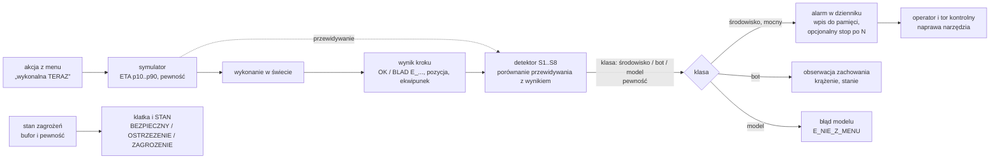
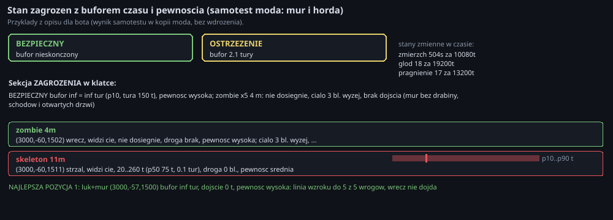
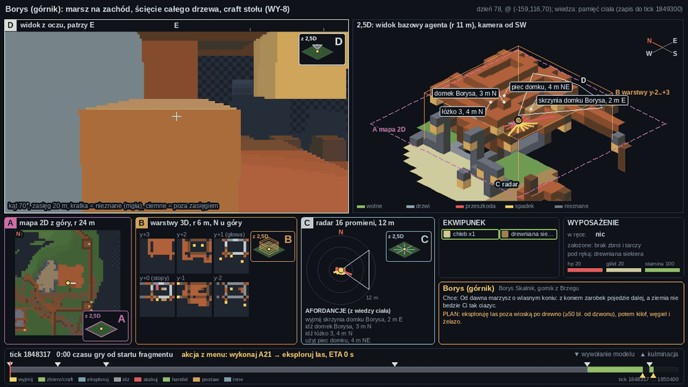
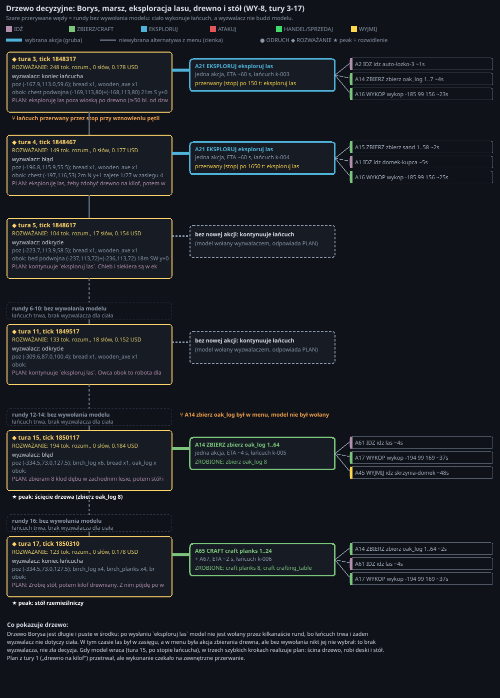
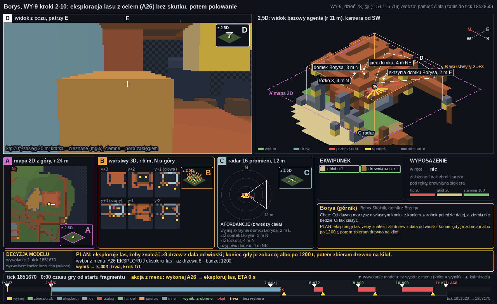
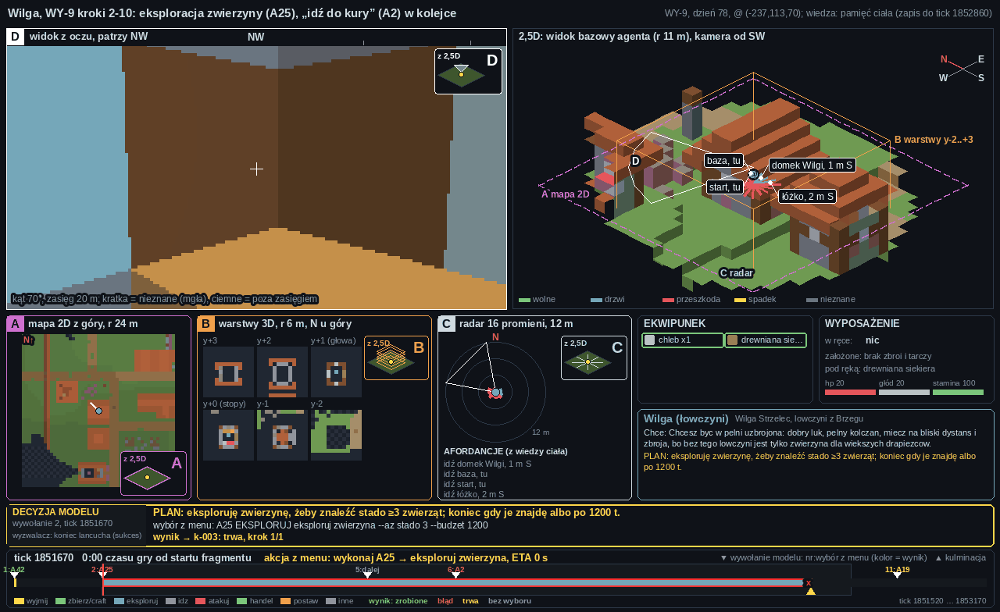

# 8. Metapoznanie: system o sobie i agent o systemie

> Poziom 1: środowisko wie, kiedy zawodzi i jak pewne są jego odpowiedzi. Poziom 2: czy agent bez objaśnienia rozumie interfejs.

[← 7. Projekcja 3D na 2D: prototyp](07-projekcja-3d-na-2d.md) · [indeks](../esej-indeks.md) · [9. Planowanie, metody obserwacji i kalibracja →](09-planowanie-i-kalibracja.md)

---

Wszystkie wcześniejsze audyty miały wspólny wzór: zawodziło środowisko (menu, symulator, drzwi, drabina), a model próbował dalej, aż wydał cały budżet. Z tego powstała druga linia prac, którą nazywam metapoznaniem. To nie jest jedno pojęcie, tylko co najmniej dwa poziomy, i oba są ważne:

- **Poziom 1, system o sobie:** środowisko wie, kiedy samo zawodzi i jak pewne są jego odpowiedzi, i mówi to modelowi i operatorowi (detektor błędów, tor kontrolny, ETA z przedziałem i pewnością, rozjazd „wykonalna TERAZ” z rzeczywistością, bufor zagrożeń ze statusem i pewnością, eksploracja, która zna własny warunek końca).
- **Poziom 2, agent o systemie:** czy agent bez objaśnienia sam rozumie działanie interfejsu, w tym klatek percepcji (mapa 3D, mapa 2D, trasa, ślad, legenda, skala), czyli czy czyta interfejs ze zrozumieniem, a nie tylko wykonuje instrukcję, jak go czytać.

Jest też trzeci poziom, bot o własnym działaniu: plan, refleksja nad nim i kryterium, kiedy cel jest osiągnięty (PLAN DNIA, kryterium sukcesu eksploracji). Opisuję go krótko w [rozdziale 9](09-planowanie-i-kalibracja.md), razem z metodami obserwacji i kalibracją.

Poziom 1 ma już kod, testy i pierwsze dane. Poziom 2 ma na razie tylko obserwacje i zaplanowany eksperyment.

## 8.1 Poziom 1: system o sobie

### 8.1.1 Detektor błędów środowiskowych

Detektor w harnessie porównuje to, co środowisko obiecało, z tym, co się stało, i klasyfikuje każdą anomalię jako winę środowiska, bota albo modelu, z pewnością:

| sygnał | co wykrywa |
|---|---|
| S1 powtórzony błąd | ta sama akcja i ten sam kod N razy z rzędu |
| S2 rozjazd symulacji | symulacja mówi „wykonalny”, a krok pada w pierwszym ticku |
| S3 stoi mimo łańcucha | łańcuch przyjęty, pozycja i ekwipunek bez zmian przez 3 obserwacje |
| S4 blok przeszkoda | co najmniej 3 zdarzenia ruchu (cel w bloku, brak drogi, utknięcie, przeplanowanie) w promieniu 3 m |
| S5 niszczenie po błędzie | po błędzie narzędzia ciało zbiera albo kopie element zabudowy |
| S6 krążenie | długa droga, małe przesunięcie netto, powroty do tej samej komórki (wina bota) |
| S7 niezgodność źródeł | `krok` mówi „trwa”, log moda mówi „przerwany” (sygnał pomocniczy) |
| S8 rozjazd pozycji | po kroku ciało jest ponad 4 m od pozycji z symulacji |

Wstecz, na zapisach WY-5, WY-6 i WY-7, detektor wykrył 10 z 10 znanych przypadków, a z 48 mocnych wpisów 38 potwierdził audyt albo log, 10 było wiarygodnych bez potwierdzenia, a pewnych fałszywych alarmów nie było. Gdyby stop po 3 mocnych wpisach był włączony, WY-6 zatrzymałby się po 8 rundach i 2,44 USD zamiast po 48 rundach i 8,97 USD. Do detektora dołączyłem tor kontrolny: 8 prób (drzwi, drabina, schody, luka, woda, skrzynia, stół, płot z furtką) do uruchomienia przed scenariuszem, żeby sprawdzić narzędzia, zanim zrobi to model za pieniądze.

Uczciwie: progi dobierałem na tych samych trzech przebiegach, a w trakcie strojenia poprawiłem dwa fałszywe alarmy (S5 w zwykłym lesie, S8 z cudzym łańcuchem we wspólnym świecie). Na nowych danych od razu pojawił się trzeci rodzaj.

Alarmy z WY-8 (S8 przy `eksploruj` z rozjazdem 27,8 m od pozycji z symulacji i S7) widać jako znaczniki pod pasami ciał na rysunku 5. Surowy zapis: [dziennik alarmów WY-8](../dodatki/klatki-surowe/odczyty/wy8-blad-srodowiska.log).

![Rys. 5. Oś ticków WY-8 w stylu przeglądarki przebiegów: w pasie każdego ciała prostokąty wykonywanych kroków łańcuchów od przyjęcia do końca (kolor wg kategorii akcji, obramowanie wg wyniku: zrobione, błąd, przerwane stopem), szare kreski bezczynności z liczbą ticków, nad pasem wywołania modelu z powodem, pod pasem zdarzenia (przejęcia łupu, odkrycia, alarmy detektora S7 i S8) i szmaragdy w czasie. Migawka do ticku 1850460; bez wykonywanego kroku Borys 13%, Wilga 43% czasu; jeden łańcuch Borysa `eksploruj las` trwał 1650 ticków, zanim przerwał go stop.](../figury/f5-os-czasu-wy8.svg)

*Rys. 5. Oś ticków WY-8 w stylu przeglądarki przebiegów: w pasie każdego ciała prostokąty wykonywanych kroków łańcuchów od przyjęcia do końca (kolor wg kategorii akcji, obramowanie wg wyniku: zrobione, błąd, przerwane stopem), szare kreski bezczynności z liczbą ticków, nad pasem wywołania modelu z powodem, pod pasem zdarzenia (przejęcia łupu, odkrycia, alarmy detektora S7 i S8) i szmaragdy w czasie. Migawka do ticku 1850460; bez wykonywanego kroku Borys 13%, Wilga 43% czasu; jeden łańcuch Borysa `eksploruj las` trwał 1650 ticków, zanim przerwał go stop. Źródło: WY-8, dzienniki ciał (wyniki kroków łańcuchów), `rundy.jsonl` (wywołania i powody), `blad-srodowiska.jsonl`, polecenia łańcuchów z klatek i menu tur. Figura wygenerowana skryptem figury.py (skrypt niepublikowany) z prawdziwego zapisu.*

To fałszywy alarm: dla `eksploruj` symulacja kończy się wcześnie (zna tylko pierwszy odcinek), a ciało idzie dalej, zgodnie z planem. Detektor ma rację co do liczb (27,8 m od przewidywania), a myli się co do znaczenia, bo przewidywanie było z założenia niepełne. Wniosek: detektor potrzebuje od środowiska nie tylko przewidywania, ale też informacji, jak pełne jest to przewidywanie.

### 8.1.2 Błędy narzędzi wywołują skłonności destrukcyjne

Najbardziej pouczający przypadek przyszedł w WY-7. Górnik nie mógł wyjść z domku: dojście do skrzyni kończyło się błędem „cel w bloku”, a drzwi prowadziły na półkę bez zejścia ([rozdz. 7](07-projekcja-3d-na-2d.md)). Menu pokazywało `zbierz oak_log`, „najbliższy 2 m”. Bot zaczął zbierać belki własnego domku. Narzędzie wprawdzie dopisało „to nie drzewo (słup pni)”, ale akcja była w menu jako wykonalna. W tym samym przebiegu łowczyni nie weszła po drabince.

Zapisałem z tego notatkę projektową: **błędy narzędzi potrafią wywołać u agenta skłonności destrukcyjne.** Gdy zwykła droga zawodzi, agent sięga po obejście, które niszczy świat. To nie wina modelu, tylko akcji wykonalnych „na papierze”, plus brak ochrony zabudowy po wyłączeniu ochrony strefy. Konsekwencje: najpierw usuwać przyczynę błędu narzędzia, zabudowę chronić niezależnie od flag stref (wykluczenie z `zbierz`, `wykop`, `atakuj` i z menu), a w audycie szukać sekwencji „błąd, potem niszczenie” jako osobnej miary. Detektor ma ją jako sygnał S5. Przebieg WY-7 krok po kroku pokazuje [drzewo 3 w rozdziale 7](07-projekcja-3d-na-2d.md).

### 8.1.3 Pewność odpowiedzi: ETA z przedziałem i „wykonalna TERAZ”

Środowisko, które mówi o sobie uczciwie, musi podawać nie tylko odpowiedź, ale też jej pewność. Część już działała: ETA z przedziałem p10..p90 i ryzykiem przerwania ([rozdz. 4.3](../czesc-1-wiedza-i-interfejs-akcji/04-interfejs-akcji.md)) oraz kolumna pewności w menu (`pewna`, `prawdopodobna`, `niepewna`). Ale etykieta „wykonalna TERAZ” była twierdzeniem bez pewności, a historia pokazała jej rozjazd z rzeczywistością w trzech miejscach: `pij` bez wody (WY-6), łańcuch „wykonalny” zakończony błędem w pierwszym kroku ([rozdz. 5.7](05-system-percepcji.md)), `eksploruj` z przewidywaniem pozycji, które z założenia nie może się spełnić ([rozdz. 8.1.1](08-metapoznanie.md)). Detektor zamienia ten rozjazd w sygnały S2 i S8, ale lepszą poprawką jest symulator, który mówi, czego nie wie.

### 8.1.4 Stan zagrożeń z buforem czasu

Przerwanie łańcucha przez zagrożenie działało po odległości: zombie 2 m za murem przerywał pracę, choć nie miał jak dojść. Operator opisał to tak: stojąc na murze nad hordą wie, że jest bezpieczny, bo zombie potrzebuje co najmniej 3 tur, żeby go zranić, a model nie powinien tego wnioskować. Nowy stan zagrożeń liczy dla każdego wroga drogę (planer ruchu wroga z własnymi regułami: skok 1, bez wspinaczki, wyważa drewniane drzwi, wchodzi po drabinie), czas do pierwszego możliwego zranienia (p10..p90), bufor w turach i status z pewnością.

*Rys. 8.1. Stan zagrożeń jako karta: status BEZPIECZNY albo OSTRZEŻENIE z buforem w turach, stany zmienne w czasie, wrogowie z czasem do zranienia (p10..p90) i najlepsza pozycja. Źródło: przykłady wyniku samotestu moda w kopii ze zmianą (scenariusz mur i horda), bez wdrożenia. Surowy zapis: [przykłady](../dodatki/klatki-surowe/odczyty/zagrozenia-samotest-przyklady.txt).*

Model czyta wprost: zombie 4 m od ciała nie jest zagrożeniem, szkielet 11 m jest, i to od razu. Pewność spada do „średniej”, gdy wróg jest tylko słyszany albo droga prowadzi przez nieznany teren. Tego jeszcze nie sprawdziłem w żywym przebiegu: zmiana jest w kopii, testy przechodzą (1198 testów, samotest scenariusza muru), ale wdrożenia nie było.

### 8.1.5 Eksploracja z celem: wiedza o własnym warunku końca

W WY-8 górnik w turze 11 stał przy lesie (77 pni, najbliższy 5 m, `zbierz oak_log` w menu), a łańcuch `eksploruj las` szedł dalej, ponad 1650 ticków i 150 m, aż do granicy obszaru gry. Operator zapytał krótko: „po co poszedł do lasu?”. `eksploruj` kończyło się tylko na nowym odkryciu, limicie czasu albo po 8 odcinkach, a znane wpisy z zasady nie były celem. Brakowało kryterium sukcesu.

Projekt (zadanie w przygotowaniu, bez kodu): `eksploruj las --az drzewa 8 --budzet 1200`, wynik `SUKCES` albo `NIE ZNALEZIONO`, najpierw sprawdzenie pamięci (`JUZ_ZNANE` z celem `idz`/`zbierz` i ETA, zamiast marszu w nieznane) i menu, które przy akcji EKSPLORUJ pokazuje cel, warunek końca, budżet i „co dalej”. To jest metapoznanie poziomu 1 po stronie akcji: akcja musi wiedzieć, po co jest uruchomiona, żeby wiedzieć, kiedy skończyła. Ten sam warunek końca, zapisany przez bota w planie, należy już do poziomu 3 ([rozdz. 9.2](09-planowanie-i-kalibracja.md)).

*Rys. 4a. Trajektoria Borysa w WY-8 z akcjami: wyjęcie zestawu w domku, potem długie marsze `eksploruj` na zachód, bez akcji zbierania przy lesie, który był w zasięgu. Białe etykiety: miejsca wioski. Źródło: WY-8, linie `stan` i wyniki kroków łańcucha w dzienniku ciała górnika. Figura wygenerowana skryptem figury.py (skrypt niepublikowany) z prawdziwego zapisu.*

Ten sam marsz w ruchu: 

*Film 3 (powtórzenie; pierwsze osadzenie: [rozdział 5.4](05-system-percepcji.md)). Na pasku czasu filmu widać rzadkie wywołania modelu (▼) i długie odcinki, w których ciało działa samo: odruch i łańcuch, a nie rozważanie. Las pojawia się w widoku z oczu, zanim łańcuch się kończy, i nic w środowisku nie mówi, że cel jest osiągnięty.*

To dlatego eksploracja potrzebuje kryterium sukcesu: krótkie wywołanie modelu przy pierwszym lesie w zasięgu skróciłoby marsz o setki ticków.
Te same rundy jako drzewo decyzji, z rundami bez wywołania modelu:

*Drzewo 2. Punkty decyzyjne Borysa, łańcuchy `eksploruj las` przerwane stopem po 150 i 1650 tickach, rundy bez wywołania (szare) i rozwidlenie w rundach 12-14: zbieranie drewna było w menu, ale model nie był wołany; peaki: ścięcie drzewa i stół. Źródło: WY-8, transkrypty tur 3-17 górnika, rundy przebiegu, dziennik ciała. Alternatywy pochodzą z zapisanych list `akcje` w transkryptach tur; jak czytać: [rozdział 9.4](09-planowanie-i-kalibracja.md).*

Drzewo pokazuje różnicę między odruchem a rozważaniem tylko tam, gdzie model jest wołany; najdroższa w czasie decyzja Borysa to ta, której nikt nie podjął, bo nie było wyzwalacza.

**WY-9: warunek końca w działaniu.** W przebiegu WY-9 (11 kroków po 150 ticków, model Sonnet, klatka środowiska z rzutem 2,5D w prompcie, menu w trybie ścisłym) eksploracja miała już cel w samej pozycji menu: u Borysa `A26 EKSPLORUJ eksploruj las --az drzewa 8 --budzet 1200`, u Wilgi `A25 EKSPLORUJ eksploruj zwierzyna --az stado 3 --budzet 1200`. Oba łańcuchy skończyły się porażką z kodem i powodem (`E_NIE_ZNALEZIONO`), a nie marszem do granicy obszaru. To jest zmiana, o którą chodziło: akcja wie, kiedy skończyła. Co bot zrobił z tą wiedzą, pokazują dwa filmy z nowym paskiem decyzji (PLAN, wybór z menu, wynik łańcucha) i osią decyzji całego przebiegu.

*Film 7. Borys w WY-9, kroki 2-10 (ticki 1851670..1853020). Wywołanie 2 wybiera z menu A26, łańcuch k-003: Borys idzie 97 m od domku i po 796 tickach dostaje `E_NIE_ZNALEZIONO` („brak dalszych granic w promieniu 96 m i 120 m od dzwonu”, 0 pni drzew poza zabudową w 24 m). Wywołanie 7 (wyzwalacz: odkrycie stad) nie zmienia wyboru, a od wywołania 8 plan dryfuje w polowanie: A72 kura, dwa razy A69 owca, wszystkie trzy łańcuchy ZROBIONE. Pod kafelkami pasek DECYZJA MODELU: `PLAN:` z odpowiedzi modelu, pozycja menu `A<n>` z listy `akcje` tej tury i stan łańcucha w bieżącym ticku; w chwili wywołania film zatrzymuje się na 1 s. Na dole oś decyzji całego WY-9: numer wywołania i wybrane `A<n>` w kolorze wyniku (zielony zrobione, czerwony błąd, żółty trwa, szary bez nowego wyboru), jaśniejsze pole to fragment z filmu. Źródło: dziennik i transkrypty tur WY-9, log moda i pamięć ciała, kopia świata sprzed przebiegu; generator filmy.py (skrypt niepublikowany), opis kadru w [README filmów](../dodatki/filmy/README.md).*

Porażka eksploracji nie wróciła do planu. W planie z wywołania 2 Borys sam zapisał warunek („koniec gdy je zobaczę albo po 1200 t, potem zbieram drewno na kilof”), ale po `E_NIE_ZNALEZIONO` wybiera najbliższą zwierzynę z menu („poluję na pobliską kurę, potem sprzedam w Brzegu i wrócę do szukania lasu albo rudy”), a w planach wywołań 9 do 11 drewna i kilofa już nie ma, są owce, kury i sprzedaż. Warunek końca działa po stronie akcji, a po stronie planu jeszcze nie.

*Film 8. Wilga w WY-9, kroki 2-10 (ticki 1851670..1852940). Wywołanie 2 wybiera A25, łańcuch k-003. W kroku 5 harness zgłasza błąd kroku `E_BRAK_DROGI`, a model odpisuje „kontynuuje łańcuch k-003”. W wywołaniu 6 (wyzwalacz: ten błąd) wybiera A2 `idz auto-stado-chicken-1` i pisze w planie, że „poprzednia eksploracja skończyła się E_BRAK_DROGI”, choć k-003 dalej trwał. Nowy łańcuch k-004 czeka w kolejce (pasek decyzji: „w kolejce za k-003”). Po 1201 tickach k-003 kończy się `E_NIE_ZNALEZIONO` (budżet wyczerpany, brak stada co najmniej 3 zwierząt w 24 m), a tick później k-004 kończy się `E_BRAK_CELU`: menu tury 6 proponowało to miejsce, ale w chwili wykonania nie było go w pamięci Wilgi. Polowania na kurę nie było. Źródło jak w Filmie 7.*

Film 8 pokazuje drugą stronę: błąd kroku w trakcie łańcucha (`E_BRAK_DROGI`) model odczytał jako koniec eksploracji, a wybrana akcja czekała w kolejce, aż eksploracja wyczerpie budżet. Klatka tej tury pokazywała k-003 jako trwający (linia TRASA), ale odpowiedź `wykonaj A2` podała tylko „ETA 7 s” i nie wspomniała, że łańcuch ruszy dopiero po k-003. To jest zadanie dla poziomu 1: stan kolejki łańcuchów powinien być w odpowiedzi `wykonaj` (i liczony do ETA), a nie tylko w klatce.

## 8.2 Poziom 2: agent o systemie

Pytanie poziomu 2 jest proste do zadania i trudne do zmierzenia: czy model rozumie klatkę, czy tylko wykonuje instrukcję, jak ją czytać? Odpowiedź ma praktyczne skutki. Jeżeli model rozumie interfejs, można go zmieniać (np. zamienić mapę 3D na przejezdność, [rozdz. 7](07-projekcja-3d-na-2d.md)) bez przepisywania wiedzy. Jeżeli tylko wykonuje instrukcję, każda zmiana formatu wymaga zmiany dokumentacji i ponownej kalibracji, a błąd w legendzie przenosi się prosto na decyzje.

**Co dziś wiadomo (obserwacje, nie pomiar).**

- W WY-8 nic nie było odkrywane samodzielnie. Legenda jest w samej klatce (linie `LEGENDA 3D` i `LEGENDA 2D`), nagłówek klatki odsyła do opisu w wiedzy, a plik `opis-klatki.md` jest dołączony do `CLAUDE.md` bota, czyli wczytywany w każdym wywołaniu.
- Klatka trafiła do kontekstu we wszystkich 17 wywołaniach ([rozdz. 6](06-klatka-srodowiska.md)), a zachowanie było spójne z mapą: łowczyni doszła do handlarza oznaczonego literą na mapie i sprzedała towar.
- W 46 tekstach odpowiedzi modelu w WY-8 (linie PLAN i komentarze) nie znalazłem ani jednego odwołania do klatki, mapy, legendy, trasy ani śladu. Model działa zgodnie z mapą, ale nie mówi, co z niej wyczytał. Z samego zachowania nie da się odróżnić zrozumienia od dopasowania do instrukcji.
- Pośrednio: w WY-6, gdy opis pragnienia był tylko w pliku, którego model nie czytał, model polegał na adnotacjach w menu (`ROLA: zakaz polowania`) bardziej niż na plikach ([rozdz. 5.9](05-system-percepcji.md)). To sugeruje, że model ufa temu, co ma przed oczami, ale nie mówi, czy rozumie format.

**Planowany eksperyment (protokół; jeszcze niezlecony, czeka na decyzję operatora).**

1. **Warunki klatki:** (A) klatka z legendą i z `opis-klatki.md` jak w WY-8 (punkt odniesienia); (B) klatka z legendą, bez dokumentacji; (C) klatka bez legendy i bez dokumentacji; (D) klatka z **zamienioną legendą** (np. `L` opisane jako woda, `@` jako skrzynia): test, czy model wierzy legendzie, czy temu, co widzi w układzie mapy i w skutkach akcji.
2. **Pytania kontrolne** na tych samych klatkach (zestaw jak 21 pytań z [rozdz. 7](07-projekcja-3d-na-2d.md): gdzie jestem, dokąd prowadzi łańcuch, co było w poprzedniej klatce, ile bloków ma jeden znak mapy 2D, czy dojdę do skrzyni), oceniane jak tam: tak, częściowo, nie.
3. **Odkrywanie przez działanie:** w warunkach C i D krótki przebieg z akcjami odczytu i ruchu; miara to liczba tur do poprawnej interpretacji znaków i skali (np. czy po kroku na wschód model zauważa, że `@` przesunął się w prawo) oraz czy model sam zapisuje swoją legendę w notatce.
4. **Porównanie modeli:** Haiku, Sonnet i Opus na tych samych klatkach i pytaniach, z kosztem na poprawną odpowiedź.
5. **Kryterium:** poziom 2 uznaję za obecny, gdy w warunku C model odpowiada na co najmniej połowę pytań tak dobrze jak w A, a w warunku D wykrywa sprzeczność legendy z układem mapy, zamiast ją ślepo stosować.

> **Wynik eksperymentu: do uzupełnienia.** Eksperyment nie był uruchomiony; ta sekcja zostanie wypełniona po decyzji operatora i przebiegu.

---

[← 7. Projekcja 3D na 2D: prototyp](07-projekcja-3d-na-2d.md) · [indeks](../esej-indeks.md) · [9. Planowanie, metody obserwacji i kalibracja →](09-planowanie-i-kalibracja.md)
