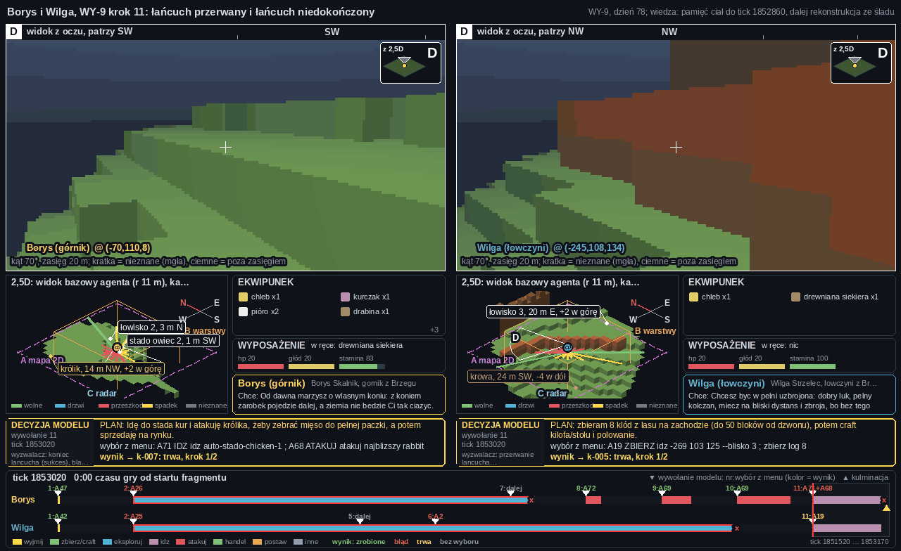
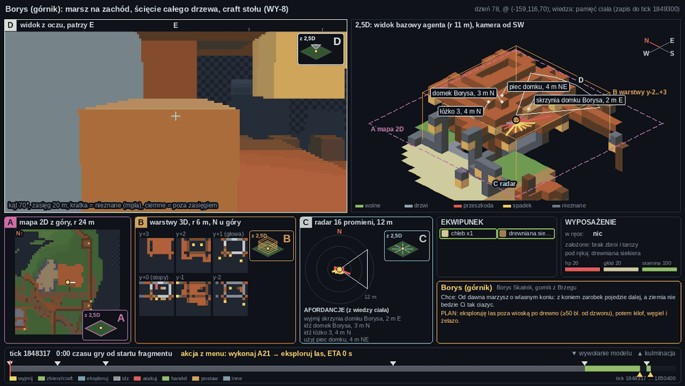

# 9. Planowanie, metody obserwacji i kalibracja

> Tryb tura po turze jako metoda, plan i refleksja bota (poziom 3) oraz równowaga eksploatacji i eksploracji.

[← 8. Metapoznanie: system o sobie i agent o systemie](08-metapoznanie.md) · [indeks](../esej-indeks.md) · [10. Pamięć: wspomnienia, epizody i sieć znaczeń →](10-pamiec-wspomnienia-siec-znaczen.md)

---

## 9.1 Tryb tura po turze jako metoda obserwacji

Przebieg WY-8 prowadziłem nietypowo: po jednym wywołaniu na pętlę, z wznowieniem i przeglądem po każdej turze. Kosztuje to czas operatora, ale dało znalezisko, którego audyt po fakcie by nie pokazał: harness na starcie każdej pętli i przy każdym wznowieniu wysyłał obu ciałom `stop wszystko`, czyli zrywał trwające łańcuchy. Przy pracy w długich pętlach działo się to rzadko, a przy wznowieniach co turę stało się widoczne. W dzienniku WY-8 pierwsze 4 pętle mają `OK stop wszystko`, następne 10 już `pominiety (--bez-stopu-na-starcie)`.

## 9.2 Poziom 3: plan i refleksja bota

Poziom 3 to metapoznanie bota o własnym działaniu. Wiedza dostała zasadę: przy nowym dniu gry albo po zakończeniu planu bot zapisuje w dzienniku jedną linię `PLAN DNIA: co chce zrobić, co chce uzyskać, co sprawdza nowego, kiedy zmienia plan`, na koniec dnia krótko, co się udało, a harness pokazuje mu w następnym wywołaniu ostatni plan. Plan zmienia się tylko przy zagrożeniu, błędzie środowiska (ten sam kod 2 razy) albo lepszej okazji. Do tego konsolidacja wiedzy co kilka tur (lekcje z wygasaniem, osobne zadanie) i podsumowanie rundy z liczbą negatywnych węzłów doświadczenia („czego unikać”).

W WY-8 boty pisały linię `PLAN` w każdym wywołaniu (15 razy w dzienniku), ale do chwili pisania żaden nie zapisał `PLAN DNIA`. Zasada istnieje, a nawyku jeszcze nie ma.

**Plan, uzasadnienie i wybór z menu (WY-9).** W WY-9 każde z 12 wywołań (Borys 7, Wilga 5) wygląda podobnie: model woła `akcje`, pisze jedno, dwa zdania i wybiera pozycję menu `wykonaj A<n>`, a na końcu linię `PLAN`. Uzasadnienia są krótkie i nie odwołują się do rysunku mapy z klatki; liczby, które się w nich pojawiają („cel 36 m SW”, współrzędne kury), pochodzą z tekstowych linii klatki (TRASA) i z odpowiedzi `wykonaj` (symulacja stanu po kroku). Film 9 pokazuje oba ciała w ostatnim kroku przebiegu, w którym uzasadnienie i wybór rozjeżdżają się u obu.

*Film 9. Krok 11 WY-9 (ticki 1853020..1853170), lewa połowa Borys, prawa Wilga; każde ciało ma widok z oczu, rzut 2,5D z nakładkami, kafelki i własny pasek decyzji, na dole wspólna oś decyzji całego przebiegu w dwóch pasach. Borys pisze „najbliższy rabbit nie ma skupu, więc idę po kurę i owcę”, a wybiera A71 `idz auto-stado-chicken-1` i A68 `atakuj najblizszy rabbit`; krok 1 (28 m) jest ZROBIONY, krok 2 kończy się `E_BRAK_CELU`, bo w wiedzy ciała nie ma królika (rzut z peaku w filmie: w afordancjach są stada kur i owiec, królika nie ma). Wilga pisze „idę na zachód, eksploruję w poszukiwaniu stada”, a wybiera A19 `idz -269 103 125 --blisko 3 ; zbierz log 8` i planuje „zbieram 8 kłód”; krok 1 jest ZROBIONY, krok 2 nie zaczyna się przed końcem danych, łańcuch zostaje NIEDOKOŃCZONY. Źródło: dziennik, transkrypty tur 11 i log moda obu ciał WY-9; generator filmy.py (skrypt niepublikowany).*

Wniosek jest skromny i nie dotyczy widoku 2,5D: filmy pokazują, co ciało mogło wiedzieć w chwili wyboru, obok tego, co model wybrał, ale nie pokazują, że rzut 2,5D w prompcie poprawił decyzje. W WY-9 decyzję niesie menu: model wybiera pozycję, a plan i uzasadnienie są do niej dopisane i nie zawsze się z nią zgadzają. Dlatego oś decyzji w filmach ma trzy pola na każde wywołanie (PLAN, wybrane `A<n>`, wynik łańcucha) i dopiero ich porównanie mówi, czy plan prowadzi działanie.

## 9.3 Kalibracja eksploatacji i eksploracji

Wszystkie powyższe elementy służą jednej równowadze, którą operator nazwał kluczową: bot ma umieć sprzedać i pracować na tym, co zna (eksploatacja), ale też ruszyć w nieznane po większą nagrodę (eksploracja), bez błądzenia i bez niszczenia. W WY-5 i WY-6 boty utknęły po stronie eksploatacji i pętli (`pij`, woreczki atramentu, brak sprzedaży), a eksploracja dawała głównie odkrycia bez wartości i błędy środowiska. W WY-8 pierwsza sprzedaż pokazała eksploatację, a marsz górnika przez las bez celu pokazał eksplorację bez kryterium.

Oś ticków WY-8 ([rys. 5 w rozdziale 8](08-metapoznanie.md)) pokazuje obie strony tej równowagi w jednym obrazie: Wilga ma krótkie, produktywne łańcuchy (polowanie, droga do handlarza, sprzedaż), ale 43% czasu bez żadnego wykonywanego kroku, a Borys prawie bez przerw, tylko że przez 1650 ticków w jednym łańcuchu `eksploruj las` bez kryterium końca. Bezczynność to sygnał dla harnessu (budzić model wcześniej), a długi łańcuch bez celu to sygnał dla interfejsu akcji (eksploracja z warunkiem sukcesu).

Plan i jego realizacja w ruchu, na przykładzie Borysa: 

*Film 3 (powtórzenie; pierwsze osadzenie: [rozdział 5.4](05-system-percepcji.md)). Kafelek ROLA pokazuje aktualny `PLAN:` modelu, a pasek czasu kolejne kroki: plan „drewno na kilof” realizuje się dopiero po długiej eksploracji, potem w trzech szybkich krokach (ścięcie, deski, stół).*

Realizacja planu jest szybka, gdy cel jest w menu; wolna, gdy cel trzeba najpierw znaleźć bez kryterium końca.

Metryka, którą wprowadzam do oceny przebiegów: oba bieguny mierzone osobno (sprzedaże i zarobek na turę; nowe regiony, pokrycie, wyprawy do nagród, koszt tur), plus odsetek tur na eksplorację i jej wynik. Samo krążenie nie jest nagradzane. Kalibrację trzeba sprawdzać osobno dla każdego modelu, bo Haiku, Sonnet i Opus różnie ważą ryzyko: w WY-6 Opus był najostrożniejszy i najdroższy, a tani Haiku w trybie swobodnym robił więcej, choć też nie sprzedawał.

## 9.4 Drzewa decyzyjne: jak czytać

Drzewa 1 do 3 (rozdziały [6](06-klatka-srodowiska.md), [7](07-projekcja-3d-na-2d.md) i [8](08-metapoznanie.md)) pokazują decyzje z filmów jako ciąg **punktów decyzyjnych**, czyli klatek decyzyjnych z jednej tury.

- **Węzeł** (karta po lewej) to punkt decyzyjny: tura, tick, ciało, **wyzwalacz** wywołania modelu, sytuacja z klatki (pozycja, ekwipunek, najbliższy obiekt) i ostatni **plan**. Ikona i kolor mówią, jak model użył klatki: **ODRUCH** (●, 0 tokenów rozumowania i mniej niż 25 słów przed akcją) albo **ROZWAŻANIE** (◆, tokeny rozumowania albo dłuższy tekst przed akcją); obok liczba tokenów rozumowania i koszt wywołania.
- **Gruba gałąź** to przyjęty łańcuch: identyfikator z menu, kategoria (kolor jak na osi ticków), polecenie, ETA i wynik (ZROBIONE, błąd z kodem, przerwany, w kolejce). Przerywana szara gałąź oznacza wywołanie bez nowej akcji („kontynuuje”).
- **Cienkie gałęzie** to 2 do 3 niewybrane pozycje z menu tej samej tury, wybrane tak, żeby pokazać inne kategorie; pochodzą z zapisanych list `akcje` w transkryptach tur.
- **Szare przerywane węzły** to rundy bez wywołania modelu: ciało wykonuje łańcuch, a żaden wyzwalacz go nie budzi.
- **★ peak** oznacza kulminację (sprzedaż, ścięcie drzewa, stół), a **⑂ rozwidlenie** miejsce, w którym inne wybranie albo inny wyzwalacz dałby inny przebieg.

Drzewa odpowiadają na trzy pytania z tego eseju: czy plan dryfuje (Wilga: nie), czy brakuje wyzwalacza (Borys w WY-8: tak, w rundach 12 do 14) i czy interfejs zastawia pułapkę (Borys w WY-7: tak, akcja wykonalna tylko na papierze).

---

[← 8. Metapoznanie: system o sobie i agent o systemie](08-metapoznanie.md) · [indeks](../esej-indeks.md) · [10. Pamięć: wspomnienia, epizody i sieć znaczeń →](10-pamiec-wspomnienia-siec-znaczen.md)
