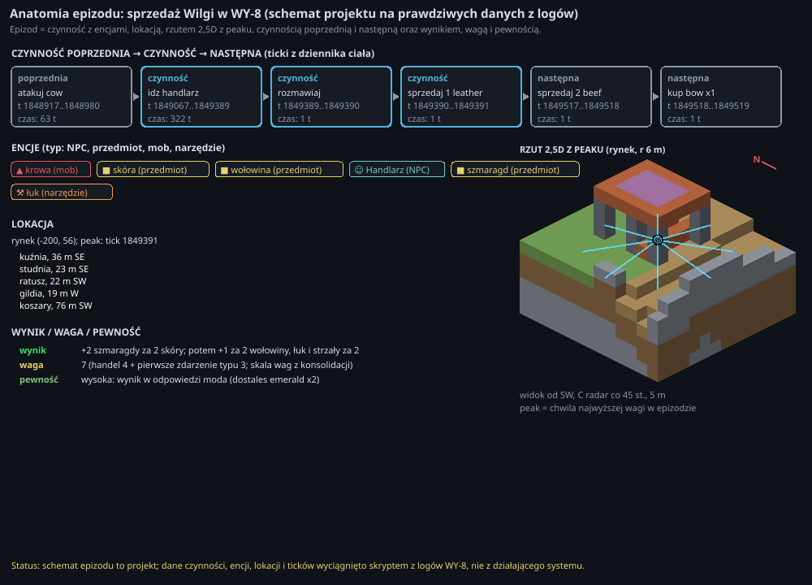
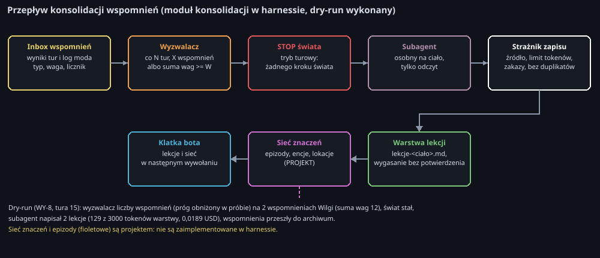
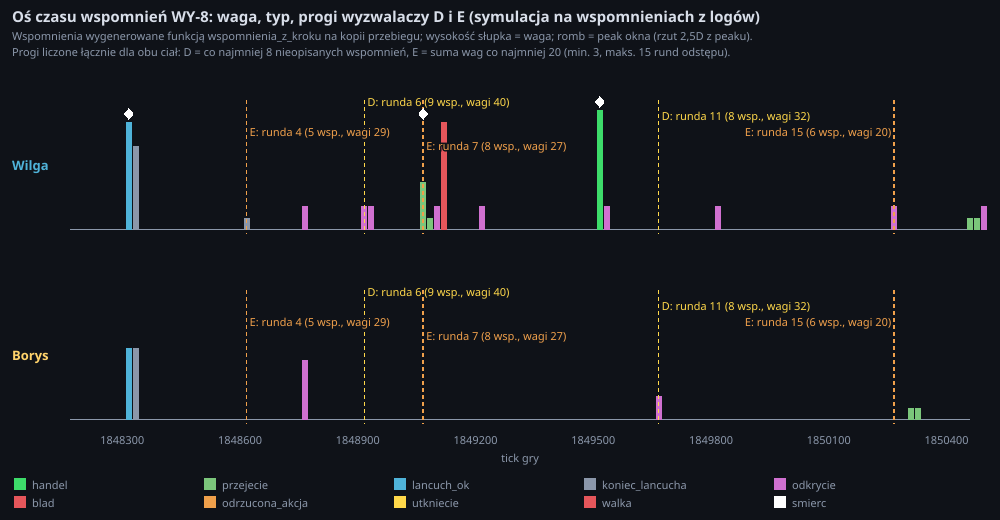
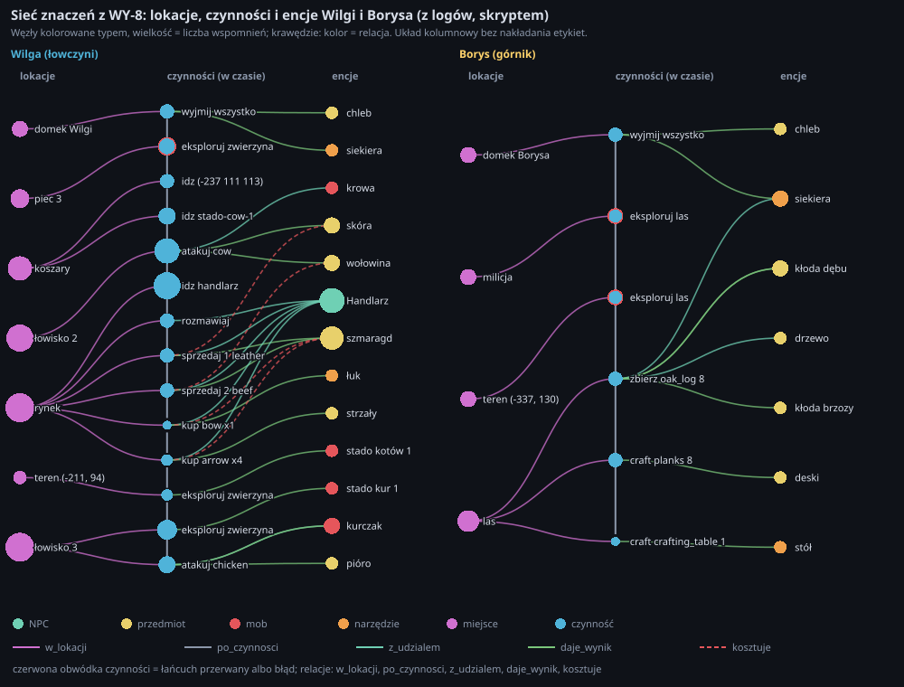
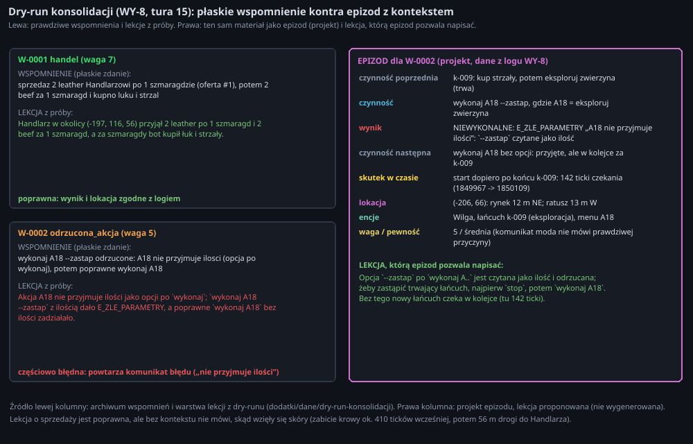

# 10. Pamięć: wspomnienia, epizody i sieć znaczeń

> Jak bot zamienia to, co się wydarzyło, w lekcje: inbox wspomnień, konsolidacja przy zatrzymanym świecie i projekt epizodu z encjami, lokacją, rzutem 2,5D z peaku i siecią znaczeń.

[← 9. Planowanie, metody obserwacji i kalibracja](09-planowanie-i-kalibracja.md) · [indeks](../esej-indeks.md)

---

Rozdziały 5 do 7 opisują, co ciało widzi teraz. Ten rozdział dotyczy tego, co z tego zostaje na później. Pamięć ciała z [rozdziału 5](05-system-percepcji.md) przechowuje miejsca, stada i złoża, ale nie przechowuje tego, co się *stało*: że sprzedaż skór udała się na rynku, że opcja w poleceniu została źle odczytana, że las obok był, a łańcuch poszedł dalej. Do tego służą wspomnienia i ich konsolidacja w lekcje.

## 10.1 Pojęcia

Pojęcia z tego rozdziału są stałe w całym eseju:

- **Wspomnienie**: zapis jednego zdarzenia z wyników tury albo dziennika ciała, z typem (handel, przejęcie, błąd, odrzucona akcja, odkrycie, koniec łańcucha, walka, śmierć), **wagą** (śmierć 10, handel 4, utknięcie 4, walka 3, odkrycie 2, błąd 2, przejęcie 1; pierwsze zdarzenie danego typu +3, nowy kod błędu +3, powtórzenie +1) i licznikiem powtórzeń.
- **Epizod** (projekt): wspomnienie z kontekstem. Składa się z **czynności** z czynnością **poprzednią i następną** (z tickami), **encji** (NPC, przedmiot, mob, narzędzie) z rolą w czynności, **lokacji** (nazwa, współrzędne i relacje do znanych miejsc, np. „kuźnia, 36 m SE”), **rzutu 2,5D z peaku** (mała izometria otoczenia w chwili najwyższej wagi, w tej samej konwencji co figury z rozdziału 7) oraz trójki **wynik, waga, pewność**.
- **Sieć znaczeń** (projekt): graf, którego węzłami są encje, miejsca i czynności, a krawędziami relacje `w_lokacji`, `po_czynnosci`, `z_udzialem`, `daje_wynik` i `kosztuje`.

*Rys. 10.1. Anatomia epizodu na przykładzie sprzedaży Wilgi w WY-8: czynność poprzednia (atak na krowę, przejęte 2 skóry i 2 wołowiny), czynność (droga do handlarza, rozmowa, sprzedaż 2 skór za 2 szmaragdy) i następne (sprzedaż wołowiny, kupno łuku), encje z typami, lokacja z relacjami do miejsc wioski, rzut 2,5D z peaku na rynku oraz wynik, waga i pewność. Źródło: dziennik ciała łowczyni w WY-8 (ticki 1848917..1849519), pamięć miejsc ciała, kopia świata. Schemat epizodu jest projektem; pola wypełnił skrypt z logów. Surowy zapis: [epizody](../dodatki/dane/wy8-epizody.json).*

Ten sam epizod w ruchu: 

*Film 4 (powtórzenie; pierwsze osadzenie: [rozdział 5.6](05-system-percepcji.md)). Film zatrzymuje się w kulminacjach (zabicie, sprzedaż, zakup) i pokazuje rzut z peaku: to te chwile, które epizod zapisuje jako peak i z których bierze swój rzut 2,5D.*

Dla czytelnika: peak sprzedaży jest na rynku (tick 1849391), a łup powstał 56 m dalej ok. 410 ticków wcześniej; płaskie wspomnienie gubi tę odległość w czasie i przestrzeni, epizod ją zachowuje.

## 10.2 Mechanika konsolidacji

Moduł konsolidacji w harnessie zapisuje wspomnienia w inboxie po każdej turze. Wyzwalacz (co N tur, co najmniej X nieopisanych wspomnień albo suma wag co najmniej W) zatrzymuje świat w trybie turowym. Osobny subagent na każde ciało, z narzędziami tylko do odczytu, opisuje wspomnienia jako lekcje. Strażnik zapisu sprawdza źródło, limit tokenów i zakazy, a do pliku trafia wyłącznie warstwa lekcji, która wygasa bez potwierdzenia. Lekcje wracają do bota w następnej klatce.

*Rys. 10.2. Przepływ konsolidacji: inbox, wyzwalacz, zatrzymanie świata, subagent tylko do odczytu, strażnik zapisu, warstwa lekcji i klatka bota; sieć znaczeń (fioletowa) jest projektem. Źródło: moduł konsolidacji i dziennik dry-runu. Surowy zapis: [dziennik konsolidacji](../dodatki/dane/dry-run-konsolidacji/dziennik-konsolidacji.txt).*

Na WY-8 skrypt figur odtworzył wspomnienia ze wszystkich kroków przebiegu tą samą funkcją, której używa harness, na kopii katalogu przebiegu: 24 wspomnienia obu ciał. Gdyby działały warianty wyzwalaczy z protokołu testu (D: co najmniej 8 wspomnień, E: suma wag co najmniej 20), konsolidacja wypadłaby w rundach 6 i 11 (D) albo 4, 7 i 15 (E).

*Rys. 10.3. Oś czasu wspomnień WY-8: słupek = wspomnienie (wysokość = waga, kolor = typ), pionowe linie = momenty konsolidacji w symulacji wariantów D i E, romby = peak okna, czyli moment, z którego epizod brałby rzut 2,5D. Źródło: wspomnienia odtworzone skryptem z logów WY-8. Surowy zapis: [wspomnienia](../dodatki/dane/wy8-wspomnienia.jsonl).*

## 10.3 Sieć znaczeń z WY-8

Z tych samych kroków skrypt zbudował sieć znaczeń obu ciał. Lokacje wyznaczył deterministycznie z pozycji ciała i pamięci miejsc, a encje z wyników kroków: przejęty łup, kupione i oddane przedmioty, cel ataku, rozmówca. Sieć Wilgi pokazuje pętlę zarobku: krowa, skóra i wołowina, Handlarz na rynku, szmaragd, łuk i strzały. Sieć Borysa pokazuje pętlę rzemiosła: las, drzewo, siekiera, kłody, deski i stół, poprzedzoną dwoma przerwanymi łańcuchami `eksploruj las`.

*Rys. 10.4. Sieć znaczeń z WY-8: kolumny lokacji, czynności (w czasie) i encji; węzły kolorowane typem, wielkość według liczby wspomnień, krawędzie kolorowane relacją (`kosztuje` przerywana). Źródło: dziennik ciał, pamięć miejsc ciał, wspomnienia odtworzone skryptem. Wizualizacja danych z logów, nie wynik działającego systemu. Surowy zapis: [epizody](../dodatki/dane/wy8-epizody.json).*

## 10.4 Co pokazała próba: płaskie wspomnienie kontra epizod

Dry-run konsolidacji wykonano na prawdziwych wspomnieniach Wilgi z WY-8 (tura 15, dwa wspomnienia, świat stał, koszt 0,0189 USD). Powstały dwie lekcje. Lekcja o sprzedaży jest poprawna. Lekcja o akcji A18 jest częściowo błędna: powtórzyła komunikat moda („A18 nie przyjmuje ilości”), choć prawdziwą przyczyną było to, że opcja `--zastap` po `wykonaj A18` została odczytana jako ilość. Płaskie wspomnienie nie miało czynności poprzedniej ani skutku w czasie, więc subagent nie miał z czego tego wywnioskować.

Epizod z kontekstem zawiera trwający łańcuch eksploracji, znaczenie A18 i 142 ticki czekania w kolejce. Z tego wynika inna, użyteczna lekcja: żeby zastąpić trwający łańcuch, najpierw `stop`, potem `wykonaj A18`.

*Rys. 10.5. Lewa kolumna: prawdziwe wspomnienia i lekcje z dry-runu (lekcja o A18 oznaczona jako częściowo błędna). Prawa: epizod dla tego samego wspomnienia z danych logu i lekcja, którą epizod pozwala napisać (proponowana, nie wygenerowana). Źródło: archiwum wspomnień i warstwa lekcji z dry-runu, dziennik ciała WY-8. Surowy zapis: [lekcje](../dodatki/dane/dry-run-konsolidacji/lekcje-lucznik.md), [wspomnienia](../dodatki/dane/dry-run-konsolidacji/wspomnienia-0015.jsonl).*

## 10.5 Status

- **Działa i jest sprawdzone dry-runem:** inbox wspomnień, wagi, wyzwalacze, zatrzymanie świata, subagent tylko do odczytu, strażnik zapisu i warstwa lekcji, na płaskich wspomnieniach.
- **Projekt, niezaimplementowany:** schemat epizodu (encje, lokacja, rzut 2,5D z peaku, czynność poprzednia i następna, wynik, waga, pewność) i sieć znaczeń.
- **Wizualizacje danych, nie wyniki systemu:** rysunki 10.1, 10.3 i 10.4 zbudował skrypt figur z logów WY-8, żeby pokazać, jak epizod i sieć wyglądałyby na prawdziwym przebiegu. Lekcja po prawej stronie rysunku 10.5 jest propozycją.

---

[← 9. Planowanie, metody obserwacji i kalibracja](09-planowanie-i-kalibracja.md) · [indeks](../esej-indeks.md)
