# Wiedza, menu akcji, percepcja i metapoznanie: co decyduje o skuteczności agenta LLM w świecie gry

*Esej inżynierski na podstawie historii zmian projektu agentów, które grają w Minecrafta przez tekstowy interfejs. Szkic, wersja 0.2, stan na 13 listopada 2026.*

> Uwaga: filmy (GIF) są animowane tylko w widoku repozytorium; w PDF albo wydruku widać pierwszą klatkę, a każdy film jest też linkiem do pliku.

## Streszczenie

W kilka dni, z zespołem agentów programujących, zbudowałem system, w którym modele językowe (Haiku, Sonnet, Opus) sterują dwiema postaciami w Minecrafcie: górnikiem Borysem i łowczynią Wilgą. Model nie widzi obrazu i nie naciska klawiszy. Dostaje tekst (stan ciała, mapy, pamięć, listę możliwych akcji) i wydaje polecenia celowe, które wykonuje mod serwerowy. Harness woła model, przesuwa czas świata i zapisuje każdą turę.

Esej opisuje cztery grupy technik i ich wpływ, pokazany na prawdziwych zapisach: wiedzę agentów (od przyrostowego dopisywania do jednej tabeli zasad i rdzenia krótszego o 46%), interfejs akcji (menu akcji, tryb ścisły, walidacja łańcucha przed wykonaniem, ETA z przedziałem), system percepcji (klatka, mapy 2D i 3D, pamięć ciała, gotowa klatka środowiska w każdym wywołaniu, prototyp projekcji 3D na 2D) oraz metapoznanie na dwóch poziomach: środowisko, które wie, kiedy samo zawodzi, i agent, który ma rozumieć interfejs bez objaśnienia.

Najwięcej uczą porażki. Gdy menu akcji nie miało drogi na rynek ani wyjęcia rzeczy ze skrzyni, nawet najdroższy model tylko trafnie opisywał luki, ale nie miał czym ich obejść. Gdy narzędzie zawiodło przy drzwiach, bot zaczął rozbierać własny dom. Pierwsza pełna pętla „zdobądź, idź, sprzedaj” udała się dopiero w przebiegu WY-8, z poprawionym menu i klatką środowiska w kontekście.

## Teza

O skuteczności agenta LLM w złożonym, zmiennym środowisku w dużej mierze decyduje to, co środowisko mu podaje i jak uczciwie mówi o sobie: wiedza w jednym miejscu, menu akcji zgodne z tym, co naprawdę da się wykonać, percepcja, która zamienia pamięć w decyzje, i środowisko, które zna własne błędy i pewność swoich odpowiedzi. Wybór modelu ma znaczenie, ale dopiero na tym fundamencie.

## Status i zakres

- **Z żywych przebiegów:** przebiegi obserwacyjne WY-1 do WY-6 (audyty tur, koszty, błędy), odczyty zatrzymanych ciał po WY-6 (rozdział 5), klatki, dziennik, trajektorie i alarmy detektora z WY-8 (rozdziały 6 i 8, rys. 1, 2, 4, 5). WY-8 trwał w chwili pisania; liczby z niego są stanem z 13 listopada rano.
- **Z analiz offline i prototypów:** przetworzenie wiedzy (rozdział 3), rozrzut ETA z logów (rozdział 4), prototyp projekcji 3D na 2D liczony z kopii świata z pełną wiedzą (rozdział 7, rys. 3), detektor błędów sprawdzony wstecz na zapisach WY-5 do WY-7, stan zagrożeń sprawdzony testami i samotestem bez wdrożenia (rozdział 8).
- **Pamięć (rozdział 10):** inbox wspomnień, wyzwalacze, zatrzymanie świata, subagent tylko do odczytu, strażnik zapisu i warstwa lekcji zostały sprawdzone dry-runem na prawdziwych, płaskich wspomnieniach z WY-8. Schemat epizodu (encje, lokacja, rzut 2,5D z peaku, czynność poprzednia i następna, wynik, waga, pewność) i sieć znaczeń są projektem, niezaimplementowanym. Rysunki 10.1, 10.3 i 10.4 to wizualizacje danych z logów WY-8 zbudowane skryptem figur, a nie wyniki działającego systemu.
- **Filmy:** kadry są liczone offline z pamięci ciała, logu moda i kopii świata (sprzed przebiegu), więc ścięte drzewo w filmie Borysa jeszcze stoi; kierunek patrzenia jest odtworzony z ruchu i pola `patrzy` klatki. GIF jest animowany tylko w widoku repozytorium.
- **Jeszcze nie zrobione:** eksperyment poziomu 2 (czy agent sam rozumie klatkę) ma tylko protokół; eksploracja z kryterium sukcesu jest projektem. Rozdziały oznaczają to w tekście.
- Esej jest rekonstrukcją z historii zmian, nie eksperymentem kontrolowanym: dwa ciała, jedna mapa, kilka przebiegów.

## 1. Pytanie badawcze i metoda

> Jakie pytanie stawia esej i z jakich zapisów historii zmian powstał.

**Pytanie:** które techniki inżynierskie wokół modelu (wiedza, interfejs akcji, percepcja i metapoznanie środowiska) mają wpływ na skuteczność i koszt agenta LLM działającego w złożonym, zmiennym świecie, i po której stronie (model czy środowisko) leży przyczyna jego błędów?

**Metoda.** Esej nie opisuje eksperymentu kontrolowanego, tylko rekonstrukcję z historii zmian. Źródła:

- karty zadań i przebiegów agentów programujących (każde zadanie ma cel, kryteria odbioru z dowodami i raport w stałym formacie),
- raporty audytów przebiegów (tabele tur, klasyfikacja wywołań, koszt z transkryptów),
- łatki (`*.patch`) i sekcje „Wersje” w README moda, bo kod nie był wersjonowany w git, tylko w kopiach roboczych z łatkami względem poprzedniej wersji,
- zapisy przebiegów obserwacyjnych (dzienniki tur, logi ciał, klatki percepcji),
- raport przetworzenia wiedzy (objętość, sprzeczności, luki z dowodami).

Każda liczba w tekście ma źródło (plik, zadanie albo przebieg) w prywatnym aneksie autora, który nie wchodzi do wersji publicznej; liczby niepewne są tam osobno oznaczone. Liczby do figur i tabel są w [dodatkach](dodatki/dane/).

**Zasada uczciwości:** część wyników to symulacje na kopiach logów albo testy na mocku. Zaznaczam to przy każdej liczbie, która nie pochodzi z przebiegu na żywym serwerze.

## 2. Środowisko: co zbudowano

> Z czego składa się system (model, harness, mod serwerowy, świat) i które decyzje projektowe zapadły przed pierwszą linią kodu.

System ma cztery warstwy. Model nie widzi obrazu, tylko tekst; nie steruje klawiaturą, tylko wydaje polecenia celowe („idź do miejsca”, „zbierz 4 kłody”, „atakuj najbliższą owcę”), które wykonuje kod moda.

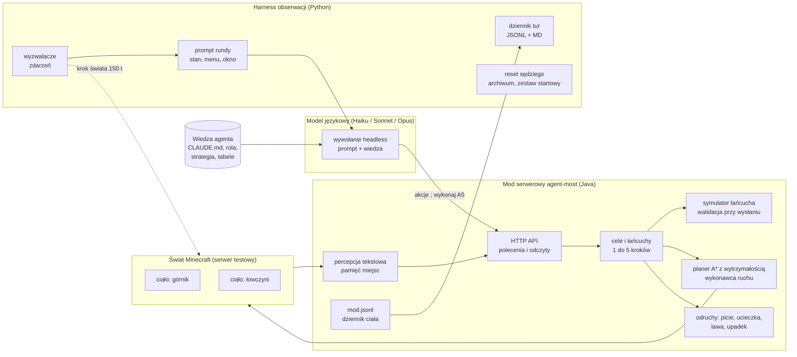

Kluczowe decyzje projektowe z planu (przed pierwszą linią kodu):

- **Percepcja tylko tekstowa.** Model dostaje macierz i opis sceny, bez zrzutów ekranu. Tanio i deterministycznie, ale model widzi tylko to, co kod uzna za warte opisania.
- **Tryb turowy jako domyślny.** Świat zamarza, gdy model myśli. To usuwa problem opóźnienia wywołania (setki ticków), ale sprawia, że bezczynność ciała zależy wyłącznie od tego, jak harness wykrywa koniec łańcucha.
- **Łańcuch jako lista kroków z przerwaniami.** Do 5 kroków, przerywany przez odruchy i zagrożenia (`--przerwij zagrozenie`).
- **Audyt od pierwszego kamienia milowego.** Jeden zapis tekstowy (JSONL), z którego deterministycznie generuje się widoki: oś czasu w Mermaid, wykresy, mapę trasy. Ta decyzja okazała się najcenniejsza, bo bez niej żaden z audytów opisanych dalej nie byłby możliwy.

Zakres pracy w liczbach: projekt ma 242 zadania (149 w głównym epiku agenta, 7 w epiku skracania cyklu) i 225 przebiegów agentów programujących, utworzonych między 9 a 12 listopada. Mod przeszedł od wersji 0.1.0 do 0.12.6-dev; ostatnie kopie przechodzą 1170 testów JUnit.

## 3. Wiedza agentów: budowa i przetwarzanie

> Jak przyrostowo rosła wiedza botów, skąd wzięły się sprzeczności i co dało skrócenie rdzenia o 46%.

### 3.1 Przyrostowe dopisywanie i jego koszt

Wiedza botów to katalog plików Markdown: `CLAUDE.md` wczytywany automatycznie w każdym wywołaniu, plik roli, `strategia.md`, a obok kilkanaście plików tematycznych (polecenia, handel, przetrwanie, rudy, okolica startu). Przez trzy dni wiedza rosła przyrostowo: każdy audyt i każda nowa funkcja moda dopisywały akapit. Po piątym przebiegu katalog miał ok. 284 tys. znaków, a rdzeń czytany w każdym wywołaniu (`CLAUDE.md` + `strategia.md`) 16 411 znaków.

Przyrost miał trzy skutki uboczne, które wyszły dopiero przy systematycznym przeglądzie:

1. **Sprzeczności.** Znalazłem 24 sprzeczne albo nieaktualne wpisy. Przykład z jednego pliku: w wierszu 17 „tu NIE wolno kopać”, w wierszu 19 „kopanie wolno wszystkim”. Inny przykład: wiedza opisywała ciągły dzień, a reset ustawiał płynącą dobę; boty planowały pracę w polu w nocy.
2. **Duplikaty.** Zasady strefy ochronnej były w 6 miejscach, ceny handlarza w 4, zasada nocy w 5. Każda zmiana reguły aktualizowała część kopii.
3. **Wiedza nieczytana.** Kluczowe zdanie „ciało pije samo przy pragnieniu < 7” leżało w pliku tematycznym, którego w przebiegu WY-6 nie otworzył żaden bot (0 wywołań odczytu pliku w transkryptach). Wiedza, której model nie czyta, nie istnieje.

### 3.2 Przetworzenie: jedna tabela zasad, krótszy rdzeń

Przetworzenie wiedzy zrobiłem jako osobne zadanie: audyt każdego pliku z dowodem z kodu albo logu (plik i wiersz, „przed”, „po”, dowód), nowa wersja w osobnym katalogu, stara nietknięta do porównania.

| plik | przed (znaki) | po (znaki) | zmiana |
|---|---:|---:|---:|
| `CLAUDE.md` (czytany co wywołanie) | 13 297 | 6 537 | -51% |
| `strategia.md` | 3 114 | 2 332 | -25% |
| **rdzeń co wywołanie** | **16 411** | **8 869** | **-46%** |
| rdzeń + rola górnika | 19 596 | 10 830 | -45% |
| handel i NPC | 11 691 | 3 758 | -68% |
| tabela błędów i napraw (nowa) | 0 | 4 183 | nowa |
| cały katalog bez archiwum | 283 733 | 250 822 | -12% |

Najważniejsze zmiany:

- **Jedno źródło zasad.** Zasady operatora scalone w jedną tabelę z rozróżnieniem „KOD” (egzekwuje mod) i „ZASADA” (umowa, którą bot ma przestrzegać sam). `CLAUDE.md` ma tylko skrót i odsyłacz.
- **Tabela błędów.** Nowy plik: kod błędu, co znaczy, jak naprawić, zebrany z logów pięciu przebiegów. Przykładowy wiersz: `E_BRAK_STOLU (craft wooden_pickaxe)`: stół musi stać w 4 blokach, nie leżeć w ekwipunku; naprawa: `craft crafting_table ; postaw crafting_table ~1 ~0 ~0`, a kilof w następnym łańcuchu.
- **Role bez zakazów i bez poleceń.** Obie role mają te same sekcje w tej samej kolejności (fach, czego nie lubisz, z czym przychodzisz, czego pragniesz, jak zarabiasz, poza fachem). Zero komend i ścieżek: rola mówi „kim jesteś i czego chcesz”, a nie „co wpisać”.
- **Rzeczy krytyczne w rdzeniu.** Prompt trybu zdarzeniowego nie kazał czytać `strategia.md`, więc realnie co wywołanie ładował się tylko `CLAUDE.md`. Cel, ocena, sprzedaż, noc i zasady trafiły tam.

### 3.3 Wpływ

Wpływ jest mieszany i trzeba to powiedzieć wprost. W przebiegu WY-6 (pierwszym na nowej wiedzy) Opus najlepiej ze wszystkich modeli trzymał się zasad (odległość od dzwonu, cudze skrzynie, przerwanie na zagrożenie w każdym łańcuchu). Ale zarobek nie wzrósł, bo menu akcji nie pozwalało wykonać tego, co wiedza zalecała: `CLAUDE.md` kazał wyjąć zestaw startowy ze skrzyni, a menu trybu ścisłego nie miało akcji „wyjmij”. Wiedza i interfejs akcji rozjechały się, a rozjazd wiedzy z interfejsem jest gorszy niż brak wiedzy, bo model traci wywołania na próby.

## 4. Interfejs akcji

> Menu akcji, tryb ścisły, walidacja łańcucha przy wysłaniu, ETA z przedziałem oraz luki generatora menu, które zablokowały zarobek.

### 4.1 Od poleceń swobodnych do menu

W pierwszych przebiegach model pisał polecenia „z głowy”. Research przerw w pokazach 3 i 4 (871 s gry) wykazał, że 35% czasu zjadły cele nieosiągalne (w powietrzu, w bloku, za urwiskiem), 19% decyzje o zmierzchu, 12% czytanie na starcie, a postęp misji to tylko 10% i 17% sesji. Przyczyną nie była słaba inteligencja modelu, tylko to, że model nie ma jak sprawdzić, czy cel jest osiągalny, zanim wyda polecenie.

Odpowiedzią była seria zmian w module ruchu (siatka osiągalności liczona tym samym A* co planer), a potem **menu akcji**: polecenie `akcje` zwraca listę tego, co ciało może zrobić TERAZ, z identyfikatorami, czasem, kosztem wytrzymałości, ryzykiem i pewnością:

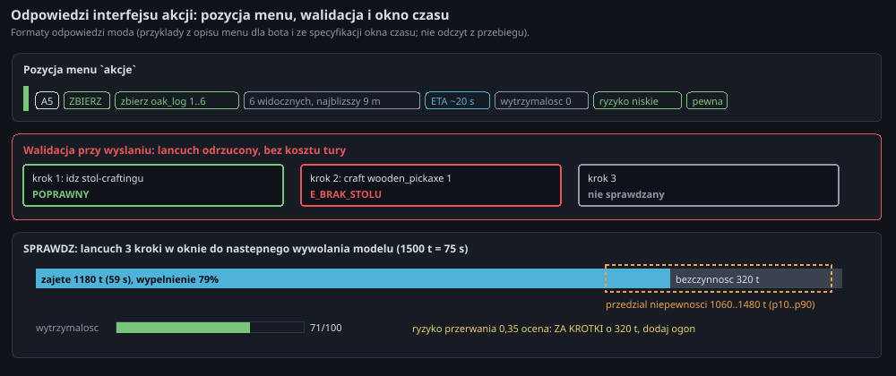

*Rys. 4.1. Trzy odpowiedzi interfejsu akcji jako karty: pozycja menu z kategorią, czasem, ryzykiem i pewnością, odrzucenie łańcucha przy wysłaniu z poprawnym prefiksem oraz zajęcie okna czasu z przedziałem niepewności. Źródło: formaty odpowiedzi z opisu menu dla bota i ze specyfikacji okna czasu (przykłady, nie odczyt z przebiegu). Surowy zapis: [opis menu dla bota](dodatki/glosariusz.md).*

Model odpowiada `wykonaj A5 3 ; wykonaj A9 || --przerwij zagrozenie`. W **trybie ścisłym** działa tylko `wykonaj <id>`, `stop`, `akcje` i odczyty; każde inne polecenie kończy się od razu błędem `E_NIE_Z_MENU` z podpowiedzią bliskich akcji, bez kosztu tury.

Rekord pozycji menu (fragment łatki):

```java
public record AkcjaMenu(String id, String kategoria, String polecenie, String opis,
        double sekundy, double stamina, String ryzyko, String pewnosc,
        int maxIlosc, String uwagaRoli) {
    /** Klucz stabilnosci: ta sama akcja w kolejnych generacjach dostaje ten sam identyfikator. */
    public String klucz() { return kategoria + "|" + polecenie; }
}
```

Stabilny identyfikator był ważny: jeśli akcja `A5` po zmianie stanu znaczy coś innego, model, który zapamiętał listę sprzed jednego kroku, wykona złą rzecz.

### 4.2 Walidacja łańcucha przy wysłaniu

Każdy łańcuch (także swobodny) przechodzi przez symulator, który idzie krok po kroku po **stanie po każdym kroku**: pozycja po `idz`, ekwipunek po `zbierz` i `craft`, stół i piec w zasięgu po przejściu. Wynik to albo `OK ... wykonalny`, albo:

Odrzucony łańcuch nie kosztuje ani ticka, ani tury, a model poprawia go w tej samej fazie planowania. To jest najtańsza możliwa pętla korekcji błędu: błąd wykryty przed wykonaniem zamiast po 150 tickach i kolejnym płatnym wywołaniu.

### 4.3 Klatka decyzyjna, ETA z przedziałem i okno czasu

Kolejna warstwa dotyczy czasu. W trybie zdarzeniowym model jest wołany tylko przy wyzwalaczu, a łańcuch ma „wypełnić okno” do następnego wywołania. Żeby to zaplanować, model musi wiedzieć, ile łańcuch potrwa. Z logów dwóch ciał wyciągnąłem rozrzut czasu marszu:

| podzbiór planów `idz` (zakończonych) | n | rzeczywisty / planowany: mediana | p10 | p90 |
|---|---:|---:|---:|---:|
| wszystkie | 627 | 0,98 | 0,92 | 1,40 |
| bez przeplanowania | 549 | 0,97 | 0,91 | 1,25 |
| z przeplanowaniem | 78 | 2,26 | 1,09 | 8,90 |

Z 804 planów 78% skończyło się sukcesem, 19% przerwaniem (głównie zagrożenia i odruchy), 2% utknięciem. Wniosek projektowy: pojedynczy marsz ma ok. 20% szans na przerwanie, więc ETA musi zawierać ryzyko, a nie tylko czas. Powstał rekord `Szacunek` (p50, przedział p10 do p90, wytrzymałość, ryzyko, pewność), zwracany przez `sprawdz`, menu i walidację, oraz linia okna w odpowiedzi:

Szczegół, który kosztował prawdziwe tury: modele czytały ticki jako sekundy. W WY-1 górnik źle ocenił czas do zmierzchu, został w polu i zginął od creepera, tracąc żelazny kilof zdobyty po ok. 10 minutach. Od tej pory każdy czas w interfejsie jest podawany w tickach **i** sekundach.

Projekt „klatki decyzyjnej” (jeden rekord JSON na decyzję: wyzwalacz, wejście, przebieg namysłu z listą odczytów, wyjście, walidacja, wykonanie do następnej klatki, konflikty z drugim ciałem) jest na razie tylko szkicem zadania. Opisuję go jako kierunek, nie wynik.

### 4.4 Wpływ i porażka interfejsu

Menu w trybie ścisłym zrobiło dokładnie to, co miało: wyeliminowało błędy składni i cele w powietrzu. Ale zawęziło przestrzeń działania do tego, co generator menu umiał zaproponować, a generator miał luki. Audyt WY-6:

- Menu proponowało `PIJ` zawsze przy pragnieniu < 20, a akcja `pij` piła tylko ze źródła wody w 4 blokach i odrzucała butelki. Symulator traktował brak wody jako uwagę, nie błąd, więc walidacja przepuszczała łańcuch. Skutek: 12 łańcuchów przerwanych w pierwszym kroku, ok. 2,5 USD.
- Menu proponowało atak na krowę w zagrodzie wioski, którą kod ataku chronił, i na owcę poza linią wzroku. 11 wywołań, ok. 2,3 USD.
- Menu nie miało akcji `wyjmij`, `postaw`, dalekiego `idz` (pokazywało tylko 8 najbliższych miejsc) ani sprzedaży. Łowczyni od rundy 19 miała towar na szmaragd i nigdy nie doszła na rynek, bo rynek był 165 m dalej, poza listą.

Fragment generatora, który wprowadził błąd (łatka menu):

```java
if (chce.test("PIJ") && st.pragnienie() >= 0 && st.pragnienie() < 20 && dobry(z, "pij")) {
    out.add(new AkcjaMenu("", "PIJ", "pij", "pragnienie " + st.pragnienie() + "/20",
            3, 0, "niskie", "prawdopodobna", 0, null));
}
```

Warunek sprawdza potrzebę, a nie możliwość. To jest ogólna lekcja: **menu akcji jest tak dobre, jak spójność trzech miejsc w kodzie: generatora, symulatora i wykonawcy.** Tu każde z nich miało inny zasięg wody (12 bloków w menu, 4 w akcji) i inną definicję „chronionego zwierzęcia”. Poprawki (akcje wyjmij, postaw, sprzedaj, stałe cele, picie z butelki, jedna funkcja ochrony) są w toku; ich wpływu jeszcze nie zmierzyłem.

## 5. System percepcji: jak ciało widzi świat

> Klatka i linia STAN, mapy 2D i 3D, eksploracja, warstwy pamięci, przejęcie dropu i menu, każde jako rysunek wygenerowany z prawdziwego odczytu tego, co zwraca ciało.

Menu akcji z rozdziału 4 jest tylko tak dobre, jak to, co ciało wie o świecie. Percepcja i pamięć powstawały równolegle z menu, od wersji 0.1.0 do 0.12.x, i to one wyznaczają granicę między tym, co model **widzi** (tekst w klatce i odpowiedzi na odczyty), a tym, co dostaje **przygotowane** (gotowe akcje, ETA, sugestie pozycji).

Wszystkie rysunki w tym rozdziale powstały z prawdziwych zapisów skryptem figury.py (skrypt niepublikowany). Część danych pochodzi z odczytów zatrzymanych ciał po przebiegu WY-6 (świat stał na ticku 1845807, wolno było używać tylko poleceń odczytu), część z transkryptów przebiegów WY-5 i WY-6 albo z dziennika ciała, gdy w trybie ścisłym polecenie odczytu było zablokowane. Źródło jest w podpisie każdego rysunku, a surowy tekst odczytu (dokładnie to, co dostał model) jest w [dodatkach](dodatki/klatki-surowe/odczyty/) z odnośnikiem „surowy zapis” pod rysunkiem.

### 5.1 Klatka percepcji i linia STAN

Podstawą jest tekstowa „klatka”: nagłówek (tick, dzień, pora, pozycja, kierunek patrzenia), linia `STAN`, `STRESZCZENIE` (tu, zagrożenia, zasoby, wyjścia, teren), `DALEKO`, paleta i `SIATKA` w warstwach, `BYTY` (z linią wzroku: widziane albo tylko słyszane) i `ZDARZENIA` od poprzedniej klatki. Renderer jest czystą funkcją „scena -> tekst”, więc da się go testować bez gry: pierwsza wersja w Javie była porównywana znak w znak z prototypem w Pythonie na trzech arenach (hala w nocy, jaskinia z lawą, otwarty teren). Każda klatka trafia do dziennika bajt w bajt z sumą sha256, a pierścień 20 ostatnich klatek pozwala odtworzyć dokładnie to, co model widział w danej chwili.

Dwie decyzje okazały się ważne dla jakości:

- **Brak rentgena.** Domyślny tryb wiedzy uznaje komórkę za widzianą, gdy jest osiągalna przez komórki przezroczyste i oświetlona (albo bliżej niż 3 bloki). Ruda w litej skale zostaje `?`. To uczciwe wobec gry, ale oznacza, że ciało nie „wie” o rudzie, dopóki jej nie odsłoni.
- **Koszt.** Kryterium pierwszego kamienia milowego to p95 kosztu klatki poniżej 2 ms. Zmierzone mediany p95 z trzech serii: 0,994 ms i 0,682 ms; na zimnym JIT p95 2,134 ms, czyli powyżej progu. Przegląd zapisał to jako zastrzeżenie, a nie sukces.

Linia `STAN` zmieniała się po każdym przebiegu. Po WY-1, gdzie górnik czytał ticki jako sekundy i zginął w nocy, dostała pola `do_zmierzchu` i `do_nocy` w obu jednostkach, liczone z zegara doby. Po dodaniu potrzeb ciała pojawiło się w niej pragnienie i temperatura.

Model czyta z tego pragnienie 9/20 i czas do zmierzchu w obu jednostkach. Nie dowie się, że ma w ekwipunku trzy butelki wody, ani że akcja `pij` ich nie obsługuje: `STAN` mówi o potrzebie, nie o sposobie jej zaspokojenia. Linia zawiera też metryki techniczne (`sr`, `p99`, `przekr`), które modelowi nic nie mówią i tylko zajmują kontekst.


*Rys. 5.1. Linia STAN Borysa po WY-6 i pełna klatka percepcji z promptu Borysa w WY-5 (tura 36) jako karty: paski potrzeb, pora, ekwipunek, linie PAMIEC, EKSPLORACJA, POZYCJE, AKCJE w kolorach kategorii, streszczenie i kompas z pniami i zwierzętami w oddali. Źródło: odczyt `stan` i `ekwipunek` zatrzymanego ciała po WY-6; prompt WY-5, tura 36 Borysa. Surowy zapis: [stan](dodatki/klatki-surowe/odczyty/po-wy6-kupiec-stan.txt), [klatka WY-5](dodatki/klatki-surowe/odczyty/wy5-t36-kupiec-klatka-percepcji.txt).*

To jest najpełniejszy obraz, jaki model dostaje bez pytania: pamięć (złoże węgla ze stanowiskiem), eksploracja, pozycje, menu i otoczenie. Model widzi węgiel 62 m dalej, ale nie widzi, że do wydobycia potrzebny jest kilof, którego nie ma; w tej samej sesji skończył na `E_BRAK_NARZEDZIA 'coal'`. Widać też granicę heurystyki: „niebo nie (pod dachem/ziemia)” w gęstym lesie, bo korony drzew zasłaniają niebo.

### 5.2 Percepcja 2D i 3D, pokrycie, regiony

Czytelną, kolorową wersję tych samych symboli (paleta przeglądarki przebiegów) pokazują rysunki 1a do 2b w rozdziale 6.

Nad „mapą znanych” (każda komórka, którą ciało kiedykolwiek widziało, z typem bloku i tickiem) powstała warstwa eksploracji (0.12.0-dev): `mapa2d`, `mapa3d`, `pokrycie` i `regiony`. W klatce percepcji pojawia się z tego tylko jedna linia `EKSPLORACJA: ...`; resztę model musi świadomie odczytać.

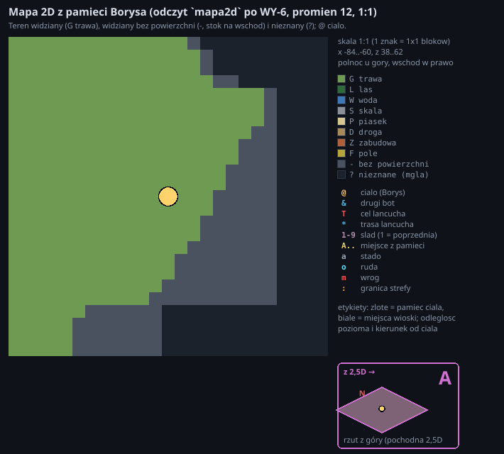

*Rys. 5.2. Mapa 2D z pamięci Borysa w promieniu 12 w skali 1:1: trawa widziana, stok widziany bez powierzchni (-) i nieznane (?), z legendą. Miniatura (A): rzut z góry podłoża widoku 2,5D. Źródło: odczyt `mapa2d` po WY-6. Surowy zapis: [mapa2d](dodatki/klatki-surowe/odczyty/po-wy6-kupiec-mapa2d.txt).*

Model czyta z mapy, że na zachód jest znana trawa, a na wschód teren widziany tylko z daleka (`-`) i nieznany (`?`). Mapa nie mówi, dlaczego wschód jest nieznany: pas `-` to zbocze opadające w stronę jaskini, co widać dopiero w przekroju.

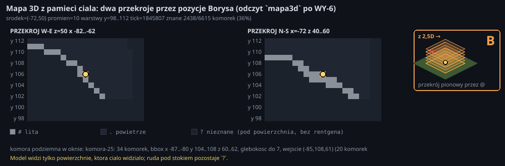

*Rys. 5.3. Dwa przekroje mapy 3D przez pozycję Borysa (W-E i N-S): powierzchnia stoku, powietrze i wszystko pod powierzchnią jako nieznane. Miniatura (B): przekrój pionowy przez ciało w widoku 2,5D. Źródło: odczyt `mapa3d` po WY-6. Surowy zapis: [mapa3d](dodatki/klatki-surowe/odczyty/po-wy6-kupiec-mapa3d.txt).*

Poniżej to samo miejsce w ruchu: Borys w domku na starcie WY-8, a kamera obraca się wokół niego, więc widać naraz wszystkie przekroje tego, co ciało wie. 
[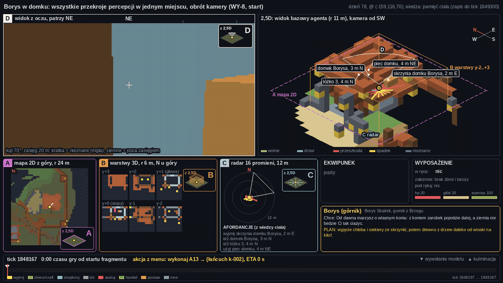](dodatki/filmy/wy8/borys-przekroje-domek.gif)

*Film 1. Borys w domku na starcie WY-8 (tick 1848167), pełny obrót kamery; widok z oczu i rzut 2,5D obracają się razem, a mapa 2D, warstwy 3D i radar pokazują ten sam stan. Widoki w kadrze: rzut 2,5D (widok bazowy, prawa góra) i jego pochodne z literami: A mapa 2D z góry, B warstwy 3D wokół stóp, C radar z listą afordancji, D widok z oczu (kratka = nieznane, jasna mgła = poza zasięgiem 20 m). Źródło: WY-8, Borys, tick 1848167 (pamięć ciała, log moda, klatki percepcji; bloki z kopii świata). Wersja MP4: [borys-przekroje-domek.mp4](dodatki/filmy/wy8/borys-przekroje-domek.mp4). Metoda: [README filmów](dodatki/filmy/README.md).*

Z filmu widać, czego ciało nie wie: wszystko za ścianami domku i pod podłogą jest kratką (mgłą), a mapa 3D i radar kończą się tam, gdzie kończy się wiedza ciała, a nie świat.

To samo miejsce rozłożone na kolejne widoki: najpierw mapa 2D z góry, potem rzut 2,5D, na końcu warstwy 3D. 
[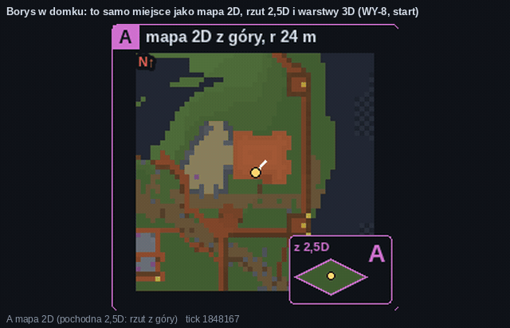](dodatki/filmy/wy8/klip-borys-2d-25d-3d.gif)

*Film 2. Krótki klip (9 s): domek Borysa kolejno w widoku A (mapa 2D), w rzucie 2,5D i w widoku B (warstwy 3D), w jednej chwili. Widoki w kadrze: rzut 2,5D (widok bazowy, prawa góra) i jego pochodne z literami: A mapa 2D z góry, B warstwy 3D wokół stóp, C radar z listą afordancji, D widok z oczu (kratka = nieznane, jasna mgła = poza zasięgiem 20 m). Źródło: WY-8, Borys, tick 1848167; klip z filmy.py (skrypt niepublikowany). Metoda: [README filmów](dodatki/filmy/README.md).*

Przejście pokazuje, że A i B są przekrojami tej samej bryły: mapa 2D gubi piętra domku na palach, a warstwy 3D gubią wszystko dalej niż 6 m.

Przekrój pokazuje, że ciało stoi na stoku opadającym na wschód, a wszystko pod powierzchnią jest `?`: bez rentgena ciało zna tylko powierzchnię, którą widziało. Model z tego nie wyczyta, czy pod stokiem jest ruda; dostaje jedynie komorę jaskini z wejściem.

Model dostaje gotowy ranking granic i ich związek ze znanymi miejscami (`przy:`). Brakuje w nim celu: granice są oceniane zainteresowaniem roli, a nie tym, czego ciało teraz potrzebuje (woda, rynek).

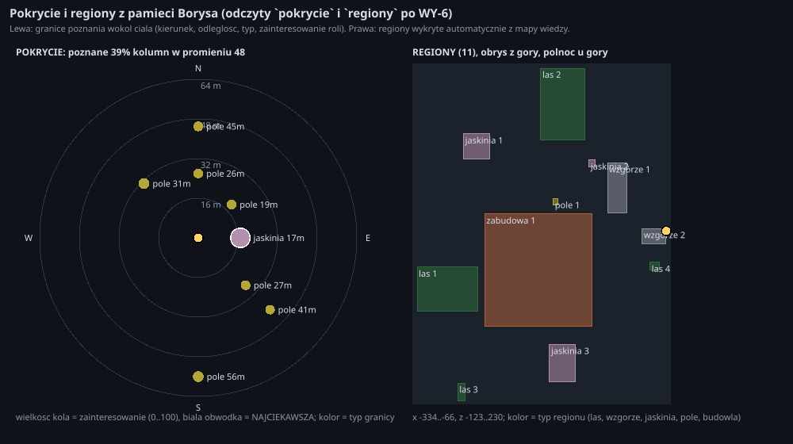

*Rys. 5.4. Pokrycie jako granice poznania wokół ciała (kierunek, odległość, typ, zainteresowanie) i regiony wykryte automatycznie jako obrysy na planie. Regiony podpisane po polsku (las, wzgórze, jaskinia, pole, zabudowa). Źródło: odczyty `pokrycie` i `regiony` po WY-6. Surowy zapis: [pokrycie](dodatki/klatki-surowe/odczyty/po-wy6-kupiec-pokrycie.txt), [regiony](dodatki/klatki-surowe/odczyty/po-wy6-kupiec-regiony.txt).*

Regiony są opisane faktami, bez interpretacji (opis sceny liczy kod, nie LLM). Model mógłby z tego wyczytać, że w lesie 38 m na południe stoi stół rzemieślniczy, czyli droga do kilofa bez stawiania własnego stołu. W WY-6 górnik nie wywołał `regiony` ani razu, a menu nie miało akcji „idź do stołu”.

### 5.3 Siatka osiągalności i punktowanie pozycji

Siatka osiągalności (0.12.1-dev) to ten sam A* co planer ruchu, uruchomiony z celem „nigdzie”: zwraca komórki osiągalne w budżecie czasu z kosztem (czas, wytrzymałość, rodzaj ruchu). Na niej działa ocena pozycji 0..100 według sytuacji (walka, zagrożenie, głód, zbieranie, spokój) i filtr celów w menu.

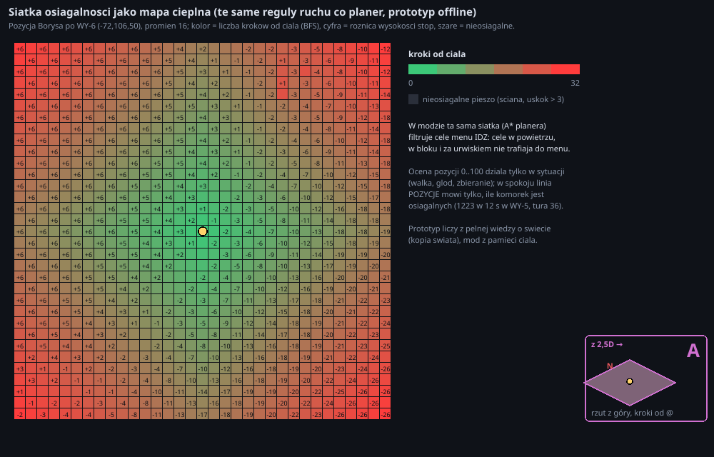

*Rys. 5.5. Siatka osiągalności wokół Borysa jako mapa cieplna liczby kroków (BFS z regułami planera) z różnicą wysokości stóp. Miniatura (A): rzut z góry, kolor = liczba kroków od @. Źródło: prototyp projekcji (te same reguły ruchu co planer) na kopii świata, pozycja z odczytu `stan` po WY-6; linia POZYCJE z WY-5, tura 36. Surowy zapis: [stan](dodatki/klatki-surowe/odczyty/po-wy6-kupiec-stan.txt), [menu](dodatki/klatki-surowe/odczyty/po-wy6-kupiec-akcje.txt).*

W spokoju ocena pozycji nic nie podpowiada; model widzi tylko liczbę osiągalnych komórek. Prawdziwa wartość siatki jest ukryta w menu: słowo `pieszo` i czas `~2s` pochodzą z niej, a cele nieosiągalne w ogóle się nie pojawiają. Model nie widzi natomiast, które ważne cele zostały odfiltrowane i dlaczego.

### 5.4 Eksploracja

`eksploruj <typ> [promien] [--do limit]` wybiera najlepszą granicę z `pokrycie` (wynik typu razy waga roli), idzie do niej zwykłym `idz` i kończy na nowym odkryciu, limicie czasu albo po 8 odcinkach. Zasada operatora: eksploracja przeszukuje nieznane; do znanych miejsc służy `idz`. Znane stada i złoża tylko korygują ocenę granic (np. +4 przy znanym złożu), a łowisko oznaczone jako wyczerpane jest omijane (-50).


*Rys. 5.6. Krok `eksploruj ruda` Borysa w WY-6: trasa ciała w czasie, cztery granice wybrane do przeszukania, odkryte złoże węgla i skrót raportu. Źródło: WY-6, dziennik ciała (raport kroku i linie `stan` w czasie łańcucha). Surowy zapis: [raport](dodatki/klatki-surowe/odczyty/wy6-kupiec-eksploruj-ruda-raport.txt), [pozycje](dodatki/klatki-surowe/odczyty/wy6-kupiec-eksploruj-ruda-pozycje.csv).*

Poniżej ten sam rodzaj czynności w ruchu: Borys idzie na zachód w poszukiwaniu lasu, ścina drzewo i robi stół. 
[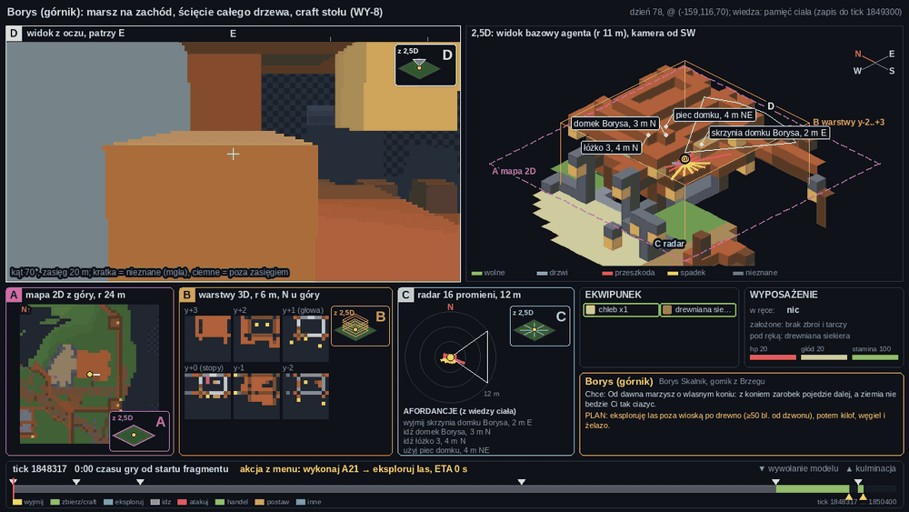](dodatki/filmy/wy8/borys-eksploracja-i-drzewo.gif)

*Film 3. Borys idzie z domku na zachód, schodzi 40 m w dół zbocza, ścina całe drzewo (11 pni) i robi z drewna stół rzemieślniczy; ticki 1848317..1850400. Za oknem pamięci (po ticku 1849300) wiedza ciała jest rekonstruowana ze śladu, a ścięte drzewo w kadrze jeszcze stoi, bo kopia świata jest sprzed przebiegu. Widoki w kadrze: rzut 2,5D (widok bazowy, prawa góra) i jego pochodne z literami: A mapa 2D z góry, B warstwy 3D wokół stóp, C radar z listą afordancji, D widok z oczu (kratka = nieznane, jasna mgła = poza zasięgiem 20 m). Źródło: WY-8, Borys, ticki 1848317..1850400, migawka danych do ticku 1850460. Wersja MP4: [borys-eksploracja-i-drzewo.mp4](dodatki/filmy/wy8/borys-eksploracja-i-drzewo.mp4). Metoda: [README filmów](dodatki/filmy/README.md).*

Widać długi marsz `eksploruj las` bez kryterium końca: las jest w zasięgu wzroku dużo wcześniej, niż łańcuch się kończy.

To była najlepiej działająca akcja w WY-6: z ośmiu wywołań produktywnych cztery to odkrycia z `eksploruj`. Raport jest uczciwy (pokazuje, że granic typu ruda nie było i wybrano „najlepszą ogólnie”), ale ma dwie słabości: „poznane 94% -> 33%” myli, bo zmienił się środek okna, a nie wiedza, i nie ma w nim następnego kroku. Odkryte złoże węgla było bezużyteczne bez kilofa.

### 5.5 Pamięć ciała

Pamięć rosła warstwami, każda z osobnym zadaniem i testami:

| warstwa pamięci                     | wersja          | co zapisuje                                                                                                                                | co widzi model                                                          |
| ----------------------------------- | --------------- | ------------------------------------------------------------------------------------------------------------------------------------------ | ----------------------------------------------------------------------- |
| miejsca i notatki                   | 0.1.0 (AM-19)   | nazwa -> pozycja, notatki tekstowe; trwałe po restarcie                                                                                    | `miejsca`, `idz <miejsce>`                                              |
| graf przejść i węzły doświadczenia  | AM-42, AM-54    | przebyte trasy, czynności z efektami, także negatywne (backtracking)                                                                       | polecenia `graf`, `doswiadczenia`                                       |
| auto-odkrycia                       | 0.10.6-dev      | skan co 40 ticków w 16 blokach: skrzynie, piece, stoły, łóżka, NPC, klastry rud, woda, jaskinie, grupy wrogów jako `auto-*`; budżet 0,5 ms | wpisy w `miejsca` z wiekiem                                             |
| brak zapamiętanego                  | 0.10.7-dev      | obiekt, którego nie ma tam, gdzie był: obserwacja `brak`, pewność x0,5, wpis zostaje                                                       | linia `PAMIEC: brak zapamietanego ...`                                  |
| opis sceny                          | 0.10.12-dev     | deterministyczny opis otoczenia w 20 blokach przy odkryciu, bez LLM; `opisz` dopisuje interpretację ciała                                  | `miejsca --scena`, `przypomnij`                                         |
| trwały ekwipunek i stan             | 0.12.1 (trwały) | 36 slotów, pancerz, głód, XP w pliku per ciało                                                                                             | stan po restarcie bez zmian                                             |
| stada, moby, złoża rud              | 0.12.2-dev      | `auto-stado-*` (wygasa po 15 min), `auto-moby-*` (5 min), `auto-ruda-*` ze stanowiskiem do kopania                                         | `zwierzeta`, `moby`, `rudy`, linia `PAMIEC: najblizsze znane stado ...` |
| pamięć zdarzeń miejsca              | 0.12.4-dev      | `auto-lowisko-N`, stan `wyczerpane` i `odnowione`, ruda wykopana, las wycięty                                                              | `lowiska`, `zdarzenia`, linia `PAMIEC`                                  |
| siatka osiągalności i ocena pozycji | 0.12.1-dev      | komórki osiągalne tym samym A* co `idz`, z czasem i wytrzymałością; ocena 0..100 wg sytuacji (walka, głód, zbieranie)                      | `osiagalne`, linia `POZYCJE ...; sugestia, nie polecenie`               |

Ważna zasada przyjęta w pamięci: **ciało zapisuje tylko to, co zobaczyło, z jawnym wiekiem obserwacji i wygasaniem.** Doniesienia spoza zasięgu wzroku (wieże, plotki NPC) mają źródło, promień niepewności i wiarygodność malejącą z czasem. Agent nie dostaje pozycji bytów bez źródła.

**Miejsca.**

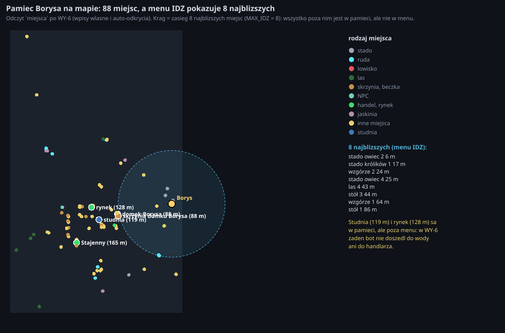

*Rys. 5.7. Pamięć Borysa na mapie: 88 miejsc według rodzaju i krąg 8 najbliższych, które jako jedyne trafiają do menu IDŹ; studnia i rynek leżą poza nim. Ważne miejsca podpisane po polsku (domek Borysa, skrzynia domku Borysa, rynek, studnia, Stajenny). Źródło: odczyt `miejsca` po WY-6. Surowy zapis: [miejsca](dodatki/klatki-surowe/odczyty/po-wy6-kupiec-miejsca.txt).*

Model może odczytać, gdzie jest studnia i rynek. Ale wpisów jest 88, z czego większość to auto-odkrycia bliżej ciała, a menu IDŹ pokazuje tylko 8 najbliższych. Studnia i rynek są w pamięci, a w menu ich nie ma; w WY-6 to wystarczyło, żeby żaden bot nie dotarł ani do wody, ani do handlarza.

**Notatki** (rys. 5.8). Notatki mieszają wpisy modelu (cennik handlarza) z automatycznymi (`auto:`). Model widzi tylko 10 ostatnich, więc stara, cenna notatka o cenie wypada z widoku szybciej niż kolejne powtórzenia „NPC widziany”.

**Stada** (rys. 5.8). Wiek i pewność są jawne, więc model może odróżnić świeżą obserwację od starej. Brakuje informacji kluczowej dla ataku: czy zwierzę jest widoczne z miejsca, w którym ciało stanie, i czy nie jest chronione (zagroda); stąd 11 nieudanych ataków w WY-6.

**Moby** (rys. 5.8). Pusta lista jest informacją („nic groźnego nie widziałem w ostatnich 5 minutach”), ale nie gwarancją bezpieczeństwa: model nie wie, czy ciało w ogóle patrzyło w stronę, z której przyjdzie zagrożenie. W wiosce bez spawnu wrogów to wystarczało; w polu nocą w WY-1 nie.

**Rudy** (rys. 5.8). Górnik wie o ośmiu złożach, w tym żelaza, ze stanowiskiem do kopania. Wszystkie są bezużyteczne, bo w ekwipunku nie ma kilofa, a pamięć rud nie łączy się z łańcuchem „drewno, deski, stół, kilof”. Wiedza jest kompletna, działanie zerowe.

**Łowiska i zdarzenia miejsca.** W trybie ścisłym polecenia `lowiska` i `zdarzenia` zostały odrzucone, choć są odczytami.

To jest błąd w liście dozwolonych odczytów trybu ścisłego. Ta sama pamięć jest dostępna przez `zwierzeta`.


*Rys. 5.8. Pozostałe warstwy pamięci: notatki (automatyczne i z rozmów), stada i złoża z wiekiem i pewnością, puste moby, łowiska Wilgi ze stanem oraz odczyt `zdarzenia` zablokowany w trybie ścisłym. Źródło: odczyty `miejsca`, `zwierzeta`, `rudy`, `moby`, `zdarzenia` po WY-6. Surowy zapis: [zwierzeta Wilgi](dodatki/klatki-surowe/odczyty/po-wy6-lucznik-zwierzeta.txt), [rudy](dodatki/klatki-surowe/odczyty/po-wy6-kupiec-rudy.txt), [zdarzenia](dodatki/klatki-surowe/odczyty/po-wy6-kupiec-zdarzenia.txt).*

Łowczyni wie, że łowisko obok jest wyczerpane, a dalekie odnowione. To jest dobra, zwięzła pamięć zdarzeń. Model nie dostaje jednak z niej wniosku „czas sprzedać to, co masz”; w WY-6 łowczyni dalej atakowała niewidoczne owce.

### 5.6 Przechwytywanie dropu i trwały ekwipunek

Do 0.12.0-dev łup z zabitego zwierzęcia albo wykopanego bloku spadał na ziemię i ciało musiało go podnieść. Zmiana „przejęcia dropów” kieruje przedmioty z bloku zniszczonego przez ciało i z moba zabitego przez ciało od razu do ekwipunku. Od wersji z trwałym stanem ekwipunek, głód i XP przeżywają restart serwera.

To przykład percepcji „przygotowanej”: model nie musi porównywać ekwipunku przed i po, bo skutek akcji jest w jej wyniku.

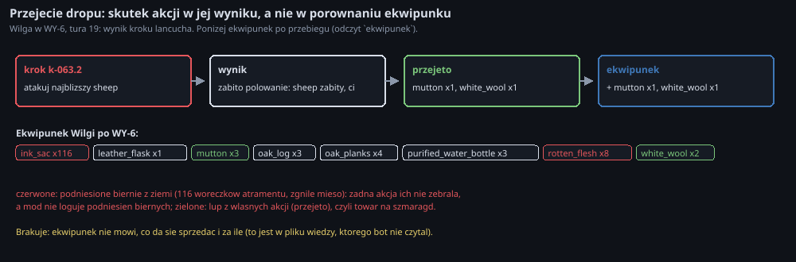

*Rys. 5.9. Przejęcie dropu jako przepływ: krok ataku, wynik, przejęty łup i ekwipunek; pod spodem ekwipunek Wilgi z łupem z własnych akcji i przedmiotami podniesionymi biernie. Źródło: WY-6, tura 19 łowczyni; odczyt `ekwipunek` po WY-6. Surowy zapis: [wynik kroku](dodatki/klatki-surowe/odczyty/wy6-t19-lucznik-wynik-kroku.txt), [ekwipunek](dodatki/klatki-surowe/odczyty/po-wy6-lucznik-ekwipunek.txt).*

Poniżej pętla zarobku w ruchu: Wilga zabija krowę, przejmuje łup, idzie na rynek i sprzedaje. 
[](dodatki/filmy/wy8/wilga-polowanie-i-sprzedaz.gif)

*Film 4. Wilga podchodzi do krowy, zabija ją dwoma ciosami (przejęte 2 skóry i 2 wołowiny), idzie 56 m na rynek i sprzedaje Handlarzowi skóry i wołowinę za szmaragdy, a za szmaragd kupuje łuk; ticki 1848500..1849520. W kulminacjach (zabicie, sprzedaż, zakup) film staje na 1,5 s i pokazuje rzut z peaku. Widoki w kadrze: rzut 2,5D (widok bazowy, prawa góra) i jego pochodne z literami: A mapa 2D z góry, B warstwy 3D wokół stóp, C radar z listą afordancji, D widok z oczu (kratka = nieznane, jasna mgła = poza zasięgiem 20 m). Źródło: WY-8, Wilga, ticki 1848500..1849520, migawka danych do ticku 1850460. Wersja MP4: [wilga-polowanie-i-sprzedaz.mp4](dodatki/filmy/wy8/wilga-polowanie-i-sprzedaz.mp4). Metoda: [README filmów](dodatki/filmy/README.md).*

W kafelku ekwipunku widać przejęcie w chwili zabicia (zielona ramka), a nie po porównaniu ekwipunku; rzut z peaku przy sprzedaży to ten sam moment, z którego epizod w rozdziale 10 bierze swój rzut 2,5D.

Model widzi towar na szmaragd (3 baraniny, 2 wełny) i 116 woreczków atramentu, których żadna akcja nie zebrała: przejęcie działa tylko dla łupu z własnych akcji, a podniesień biernych mod nie loguje. Ekwipunek nie mówi też, co z tego da się sprzedać ani za ile; to jest w pliku wiedzy, którego bot nie czytał.

### 5.7 Menu akcji: percepcja przetworzona w decyzje

Menu jest ostatnią warstwą percepcji: zamienia stan, pamięć i siatkę osiągalności w listę ruchów z czasem, ryzykiem i pewnością.

Na jednej karcie (rys. 5.10) widać trzy błędy opisane w rozdziale 4: `PIJ` jako „wykonalne TERAZ” przy braku wody, adnotacja `ROLA: zakaz polowania` mimo zniesienia zakazów oraz brak IDŹ do studni, rynku i stołu. Model dostaje gotowe akcje, ale nie dostaje tych, których potrzebuje.

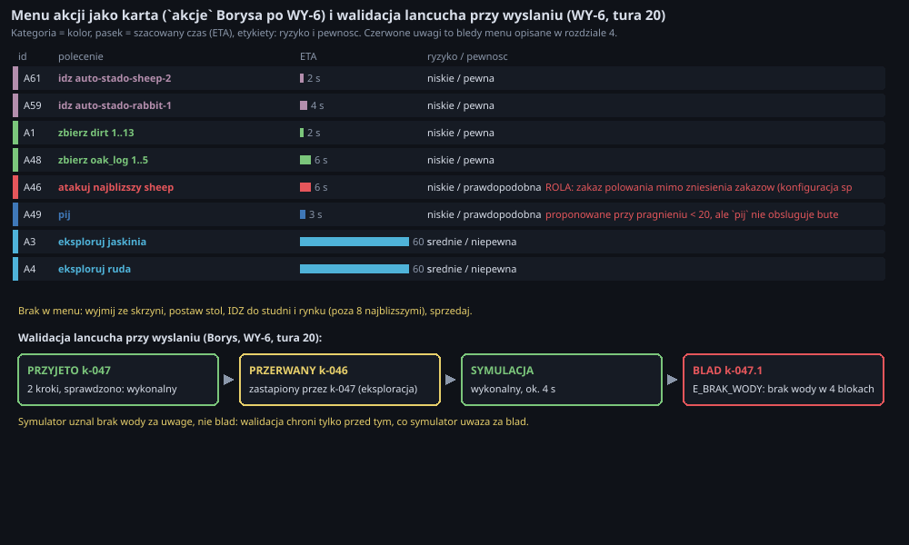

*Rys. 5.10. Menu akcji jako karta z kategoriami, czasem, ryzykiem i pewnością, z zaznaczonymi błędami menu, oraz walidacja łańcucha w WY-6: przyjęty jako wykonalny i przerwany błędem w pierwszym kroku. Źródło: odczyt `akcje` po WY-6; WY-6, tura 20 Borysa. Surowy zapis: [akcje](dodatki/klatki-surowe/odczyty/po-wy6-kupiec-akcje.txt), [walidacja](dodatki/klatki-surowe/odczyty/wy6-t20-kupiec-walidacja.txt).*

Symulator uznał łańcuch za wykonalny, zastąpił nim trwającą eksplorację, a pierwszy krok padł na braku wody. To najkrótszy możliwy dowód tezy z rozdziału 4: walidacja chroni tylko przed tym, co symulator uważa za błąd.

### 5.8 Co model widzi, a co dostaje przygotowane

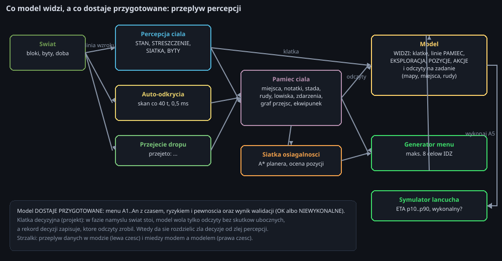

*Rys. 5.11. Przepływ percepcji: świat, ciało, auto-odkrycia, przejęcie dropu, pamięć, siatka osiągalności, generator menu, symulator i model, z podziałem na to, co model widzi, i to, co dostaje przygotowane. Źródło: schemat autora na podstawie kodu moda i harnessu. Surowy zapis: [opis klatki](dodatki/glosariusz.md).*

Poniżej to, co ciało naprawdę widzi, bez nakładek: sam widok z oczu Wilgi w drodze do krowy. 
[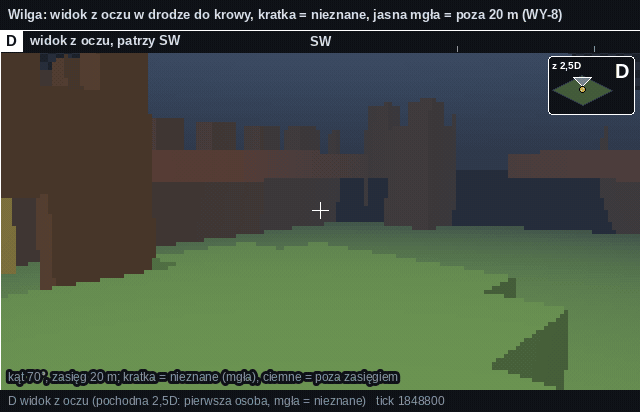](dodatki/filmy/wy8/klip-wilga-oczy-mgla.gif)

*Film 5. Krótki klip (8 s): widok D z oczu Wilgi, kąt 70 stopni, zasięg 20 m; kratka = komórki, których ciało nie zna, jasna mgła = poza zasięgiem; krowa z nazwą i odległością. Widoki w kadrze: rzut 2,5D (widok bazowy, prawa góra) i jego pochodne z literami: A mapa 2D z góry, B warstwy 3D wokół stóp, C radar z listą afordancji, D widok z oczu (kratka = nieznane, jasna mgła = poza zasięgiem 20 m). Źródło: WY-8, Wilga, ticki 1848800..1848990; klip z filmy.py (skrypt niepublikowany). Metoda: [README filmów](dodatki/filmy/README.md).*

Model nie dostaje tego obrazu, tylko jego tekstowy odpowiednik z klatki; film pokazuje, ile z tego, co tekst nazywa „widzianym”, jest w rzeczywistości mgłą.

Klatka decyzyjna (szkic, rozdz. 4.3) miała to uporządkować: w fazie namysłu świat stoi, a model może wołać tylko odczyty bez skutków ubocznych (`stan`, `percepcja`, `miejsca`, `mapa2d`, `rudy`, `akcje`, `sprawdz`), a rekord decyzji zapisuje, które odczyty zrobił. Dzięki temu dałoby się odpowiedzieć na pytanie, czy model podjął złą decyzję mimo dobrej percepcji, czy z jej powodu. Dziś ta odpowiedź wymaga ręcznego audytu.

### 5.9 Jak percepcja wpływała na jakość działania

Przykłady z historii, w których wiedza ciała była poprawna, a działanie i tak zawiodło:

- **Węgiel znaleziony, ale niewykopany.** W WY-6 `eksploruj ruda` znalazła złoże węgla (`auto-ruda-coal`), a górnik stał obok. Menu nie proponowało wykopania, bo `zbierz coal_ore` wymaga kilofa, kilof wymaga postawionego stołu, a akcji `postaw` w menu nie było. Opus napisał wprost: „w menu akcji nie ma opcji kopania rudy”. W WY-5 Haiku po 36 rundach skończył na `E_BRAK_NARZEDZIA 'coal'`. Percepcja zrobiła swoje; zabrakło ścieżki od wiedzy do akcji.
- **Studnia w pamięci, a nieobecna w menu IDŹ.** Pamięć górnika zawierała studnię 119 m na zachód, a rynek z handlarzem był 165 m dalej. Menu IDŹ pokazywało tylko 8 najbliższych miejsc (`MAX_IDZ = 8`), a pamięć była pełna auto-odkryć bliżej. Skutek: 12 łańcuchów z niewykonalnym `pij` i ani jednej sprzedaży. Bogatsza pamięć wypchnęła z menu miejsca najważniejsze dla celu.
- **Limit pamięci.** Ciało górnika miało na serwerze testowym 57 wpisów przy limicie 64, więc nowe stada i złoża mogły się nie zmieścić. Limit podniesiono do 96, ale problem priorytetu (co jest ważne dla celu, a co tylko blisko) został.
- **Utknięcia i przeplanowania.** 12% zakończonych marszów wymagało przeplanowania, a te trwały medianowo 2,26 raza dłużej niż plan (p90 8,9 raza). W pokazach 3 i 4, przed siatką osiągalności, 35% czasu zjadły cele nieosiągalne. Siatka liczona tym samym A* co planer usunęła cele w powietrzu i w bloku z menu, ale nie usunęła `E_UTKNAL` na zboczach (4 razy z rzędu w WY-5B).
- **Ochrona i widoczność.** Percepcja poprawnie pokazywała owcę 13 bloków wyżej na zboczu i krowę w zagrodzie. Menu brało każde zwierzę w 24 blokach bez sprawdzenia linii wzroku i ochrony, a kod ataku je odrzucał (`E_NIEWIDOCZNY`, `E_CEL_CHRONIONY`). Ta sama informacja o świecie była liczona w dwóch miejscach na dwa sposoby.

Co nie zadziałało w samej percepcji:

- **Podniesienia bierne nie są logowane.** Łowczyni zebrała 116 woreczków atramentu, idąc po ziemi w miejscu wcześniejszych walk. `przejeto:` obejmuje tylko łup z własnych akcji, a mod nie zapisuje podniesień biernych, więc audyt mógł to tylko wywnioskować. Przedmioty zaśmieciły ekwipunek i symulację.
- **`auto-*` to nie zgoda.** Auto-odkryta skrzynia w wiosce nie daje prawa do brania z niej (wymaga ręcznego nazwania). Opus, ostrożny wobec zasad, pomijał także skrzynie, z których mógł brać. Percepcja nie rozróżniała własności wystarczająco jasno.
- **Zimny start klatki** przekraczał próg 2 ms (p95 2,134 ms), a pomiar nie obejmował zapisu klatki i HTTP.
- **Model ufał adnotacjom bardziej niż plikom.** Linia `ROLA: zakaz polowania` w menu (ze starej konfiguracji) wygrała z plikiem roli, którego model nie czytał. To, co jest w klatce i menu, działa jak prawda; to, co trzeba odczytać, praktycznie nie istnieje.

Wniosek z tej części: **percepcja i pamięć ciała były najlepiej dopracowaną warstwą systemu, ale ich wartość zależała od tego, czy menu potrafi zamienić wiedzę na akcję.** Do przyszłych wersji: priorytet celów w menu IDŹ według potrzeby (woda, rynek, własna skrzynia) zamiast odległości i jedna funkcja widoczności i ochrony wspólna dla percepcji, menu i wykonawcy.

## 6. Klatka środowiska w kontekście bota

> Gotowa klatka w każdym wywołaniu modelu, koszt pamięci klatek wstecz i pierwsze obserwacje z żywego przebiegu WY-8.

Rozdział 5 pokazał, że ciało wie dużo, ale model tę wiedzę musi sam odczytać, a w trybie zdarzeniowym prawie tego nie robił (0 wywołań `regiony` w WY-6). Następny krok był prosty w pomyśle: zamiast czekać, aż model zapyta, harness wkłada do każdego wywołania gotową **klatkę środowiska**.

Nowe polecenie moda `klatka [promien3d] [promien2d] [--budzet] [--historia N]` (0.12.9-dev) składa w jeden tekst: linię `STAN`, mapę 3D w promieniu 8 bloków (6 warstw: od y+3 do y-2), mapę 2D w promieniu 64 ze skalą dobieraną do budżetu 5500 tokenów (w praktyce 1:2), litery miejsc z pamięci, rzeźbę terenu, granicę strefy, trasę trwającego łańcucha (`T` = cel, `*` = trasa z nawigacji) i ślad poprzednich klatek (cyfry `1..9` na mapie). Harness dostał flagę `--klatka-srodowiska`, która czyta klatkę, gdy świat stoi, i wkłada ją na początek promptu. Opis znaków dostał też bot, w osobnym pliku wiedzy.

Projekt pamięci klatek wstecz był osobną decyzją kosztową. Pełna klatka t-1 to druga cała mapa, więc starsze klatki są „zmniejszane”: w trybie `slad` t-1 jest pełna, a t-2..t-X to tylko cyfra na bieżącej mapie i linia stanu; w trybie `skale` starsze klatki dostają mapę 1:4. Pomiar przed wdrożeniem (szacunek znaki/3):

| klatki wstecz X | tryb | tokeny razem z klatką | Sonnet USD / wywołanie | Opus USD / wywołanie |
|---:|---|---:|---:|---:|
| 2 | slad-3d | 4 113 | 0,0082 | 0,0165 |
| 4 | slad (domyślny) | 6 279 | 0,0126 | 0,0251 |
| 4 | slad-3d | 4 394 | 0,0088 | 0,0176 |
| 8 | skale | 7 511 | 0,0150 | 0,0300 |

Około 85% kosztu pamięci to pełna klatka t-1, a linia śladu kosztuje ok. 90 tokenów. Przy koszcie wywołania Opusa 0,16 do 0,22 USD (audyt WY-6) klatka dokłada 8 do 15%.

Klatkę łowczyni z tury 14 w czytelnej postaci pokazują rysunki 1b (mapa 2D) i 2b (mapa 3D) niżej. Surowy zapis: [klatka WY-8, tura 14](dodatki/klatki-surowe/wy8-014-lucznik.txt).

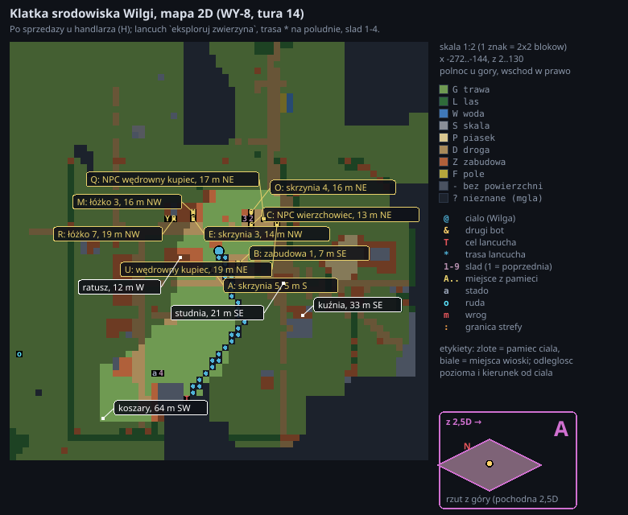

*Rys. 1b. Klatka środowiska Wilgi, mapa 2D: teren w kolorach przeglądarki przebiegów, @ ciało, * trasa łańcucha, cyfry ślad, litery miejsca z pamięci. Etykiety po polsku: złote to miejsca z pamięci ciała (litera, nazwa, odległość i kierunek z klatki), białe to miejsca wioski z konfiguracji (odległość pozioma i kierunek od ciała). Miniatura w rogu (A) pokazuje, że to rzut z góry podłoża widoku 2,5D. Źródło: WY-8, tura 14 łowczyni, `klatki/014-lucznik.txt` (surowy tekst klatki w dodatkach). Figura wygenerowana skryptem figury.py (skrypt niepublikowany) z prawdziwego zapisu.*


*Rys. 1a. Klatka środowiska Borysa, mapa 2D w chwili, gdy łańcuch `eksploruj las` prowadził go dalej mimo lasu obok (cel T 6 m SW). Etykiety po polsku: złote to miejsca z pamięci ciała (litera, nazwa, odległość i kierunek z klatki), białe to miejsca wioski z konfiguracji (odległość pozioma i kierunek od ciała). Miniatura w rogu (A) pokazuje, że to rzut z góry podłoża widoku 2,5D. Źródło: WY-8, tura 11 górnika, `klatki/011-kupiec.txt`. Figura wygenerowana skryptem figury.py (skrypt niepublikowany) z prawdziwego zapisu.*

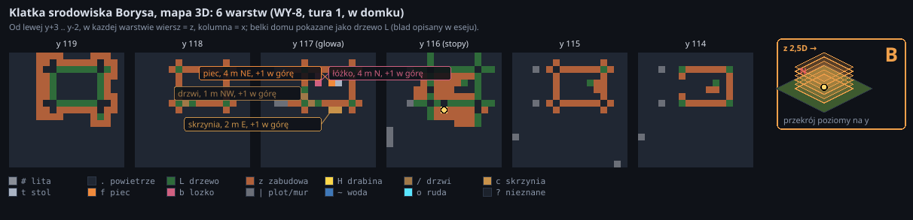

*Rys. 2a. Mapa 3D klatki Borysa jako 6 warstw (y+3 .. y-2) w domku: drzwi, łóżko, piec, stół, skrzynia; belki domu widać jako drzewo L, czyli błąd opisany w rozdziale 7. Przy obiektach etykieta względem ciała: kierunek, odległość pozioma w metrach i różnica wysokości warstwy. Miniatura (B) pokazuje, że warstwy to poziome przekroje widoku 2,5D. Źródło: WY-8, tura 1 górnika, `klatki/001-kupiec.txt`. Figura wygenerowana skryptem figury.py (skrypt niepublikowany) z prawdziwego zapisu.*

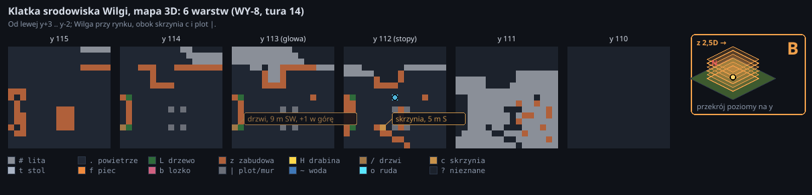

*Rys. 2b. Mapa 3D klatki Wilgi jako 6 warstw przy rynku. Przy obiektach etykieta względem ciała: kierunek, odległość pozioma w metrach i różnica wysokości warstwy. Miniatura (B) pokazuje, że warstwy to poziome przekroje widoku 2,5D. Źródło: WY-8, tura 14 łowczyni, `klatki/014-lucznik.txt`. Figura wygenerowana skryptem figury.py (skrypt niepublikowany) z prawdziwego zapisu.*

Model czyta z tego bez żadnego zapytania, gdzie jest (`@`), dokąd prowadzi łańcuch (`*` na południe), co zrobił w ostatnich czterech klatkach (zabicie krowy, dwie wymiany u handlarza) i że handlarz `H` jest 14 m dalej. Brakuje dostępności: na mapie 2D ściana, stopień i otwarte przejście wyglądają tak samo, a mapa 3D obejmuje tylko 8 bloków i 6 warstw.

Pierwsze obserwacje z WY-8 (przebieg w toku w chwili pisania, Sonnet, oba ciała): klatka trafiła do kontekstu we wszystkich 17 wywołaniach, miała 3302 do 3612 tokenów (mediana 3455) i budowała się w 62 do 1745 ms. Przy 14 wywołaniach koszt wyniósł 2,617 USD. Najważniejsze: łowczyni upolowała krowę, poszła do handlarza i sprzedała 2 skóry za **2 szmaragdy**. To pierwsze szmaragdy w tej historii zdobyte w pętli „zdobądź, idź, sprzedaj”, choć przebieg łączył więcej zmian naraz (klatka, poprawione menu produktywne z akcjami sprzedaży, nowa wiedza), więc nie da się przypisać efektu samej klatce.

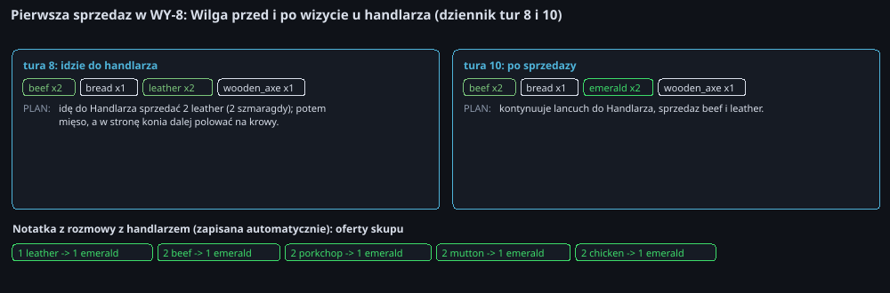

*Rys. 6.1. Pierwsza sprzedaż w WY-8: ekwipunek i plan Wilgi przed wizytą u handlarza i po niej oraz oferty skupu zapisane w notatce z rozmowy. Źródło: WY-8, dziennik tur 8 i 10 łowczyni. Surowy zapis: [dziennik](dodatki/klatki-surowe/odczyty/wy8-dziennik-lucznik-tury-8-10.txt).*

Cała pętla zarobku, która doprowadziła do tej sprzedaży, w ruchu:

[](dodatki/filmy/wy8/wilga-polowanie-i-sprzedaz.gif)

*Film 4 (powtórzenie; pierwsze osadzenie: rozdział 5.6). Klatka środowiska z tego rozdziału jest tekstem, który model dostał w każdej z tych tur; film pokazuje ten sam stan jako obraz: widok z oczu, rzut 2,5D i jego pochodne A do D.*

Między zabiciem krowy a sprzedażą model był wołany kilka razy, ale łańcuch drogi do handlarza trwał 322 ticki bez nowej decyzji: klatka z trasą T i * wystarczyła.

Te same tury jako drzewo decyzji, z tym, co Wilga mogła wybrać zamiast:

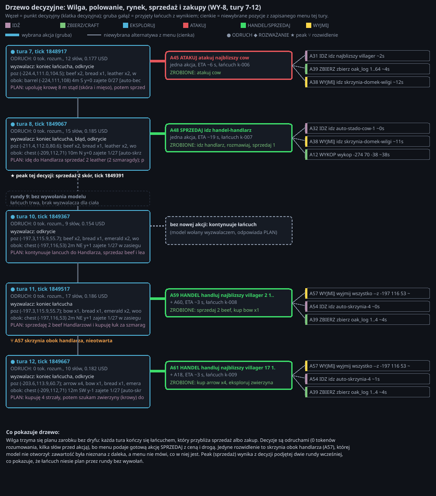

*Drzewo 1. Punkty decyzyjne Wilgi (tura, tick, wyzwalacz, sytuacja z klatki, tryb ODRUCH albo ROZWAŻANIE z liczbą tokenów rozumowania i kosztem), przyjęte łańcuchy z wynikiem i niewybrane pozycje menu; peak sprzedaży i nieotwarta skrzynia obok handlarza (A57). Źródło: WY-8, transkrypty tur 7-12 łowczyni, dziennik przebiegu, dziennik ciała. Alternatywy pochodzą z zapisanych list `akcje` w transkryptach tur; jak czytać: rozdział 9.4.*

Wszystkie decyzje Wilgi są odruchami, a mimo to plan zarobku jest spójny: menu podaje gotową akcję SPRZEDAJ z ceną i drogą, więc nie ma czego rozważać.

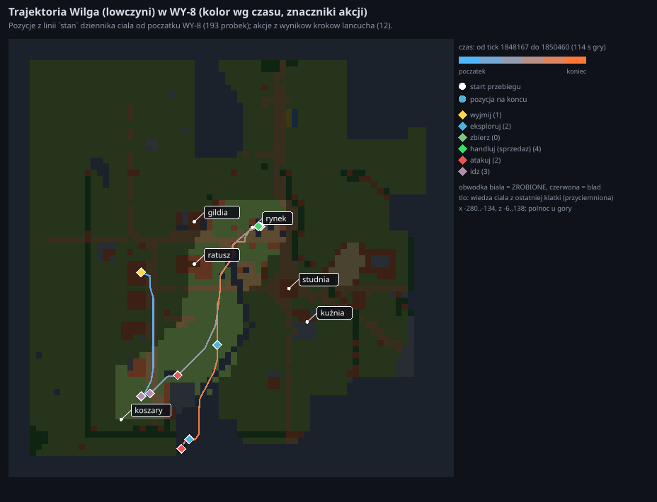

*Rys. 4b. Trajektoria Wilgi w WY-8: kolor linii od niebieskiego (początek) do pomarańczowego (koniec), romby to akcje (wyjmij, eksploruj, atakuj, handluj); widać drogę od polowania do handlarza i z powrotem w teren. Białe etykiety: miejsca wioski (rynek, studnia, kuźnia, koszary, ratusz, gildia). Źródło: WY-8, linie `stan` i wyniki kroków łańcucha w dzienniku ciała łowczyni od ticku startu przebiegu. Figura wygenerowana skryptem figury.py (skrypt niepublikowany) z prawdziwego zapisu.*

## 7. Projekcja 3D na 2D: prototyp

> Cztery rzuty tego samego świata i ich czytelność na 21 pytaniach kontrolnych przy różnym koszcie tokenów.

Klatka v1 ma znane wady: belki domów rysuje jako drzewo `L`, warstwy 3D gubią drzwi na innym poziomie, a mapa 2D nie mówi, co jest przejezdne. Zanim zmieniłem format w modzie, zbudowałem prototyp offline: parser plików świata (format 26.3 ma nową postać palety bloków), model ruchu 2,5D z regułami planera (krok, półpłytka, skok, wspinaczka, zejście do 3,5 bloku, drabina, drzwi drewniane przechodnie, żelazne nie) i cztery rzuty liczone z tego samego parsera co obecna klatka, na 7 miejscach świata i jednym syntetycznym scenariuszu (mur 3 bloki, 6 zombie pod murem).

Rzuty: (1) przejezdność 2,5D, jeden znak na kolumnę: wysokość względem stóp tylko dla kolumn, do których ciało dojdzie; (2) radar kątowy z listą **afordancji** (wyjście, skrzynia, wrogowie i czy dojdą, sektory N..NW); (3) zmienna rozdzielczość jak plamka żółta: 1:1 do 12 bloków, 1:2 do 24, 1:4 do 64; (4) kombinacja (1) w zmiennej rozdzielczości z listą afordancji.

Czytelność oceniłem bez wywołania modelu, na 21 pytaniach kontrolnych („jak wyjść z domku?”, „czy zombie dosięgną bota na murze?”): odpowiedź wynika wprost (1 punkt), wymaga składania warstw (0,5) albo jest niemożliwa (0).

| rzut | punkty z 21 | tokeny (ok.) |
|---|---:|---:|
| obecna klatka v1 | 11,5 | 3 050 |
| (1) przejezdność, promień 40 | 14,5 | 2 590 |
| (2) radar z afordancjami | 13 | 470 |
| (3) zmienna rozdzielczość, sam teren | 7,5 | 1 550 |
| (4) kombinacja | **16,5** | **1 550** |

![Rys. 3a. Te same cztery rzuty dla wnętrza domku Borysa: w przejezdności (b) widać, że drzwi prowadzą na półkę nad uskokiem, a radar (c) pokazuje szyby, piec i łóżko tuż obok. Panel (e) to rzut wizualny 2,5D (izometryczny, dach zdjęty nad głową) z tych samych bloków kopii świata: domek na palach, ganek nad ziemią z zaznaczoną wysokością, drzwi, skrzynie, stół, piec, łóżko, Borys (@) i droga wyjścia z listy afordancji (7 kroków przez drzwi). Panele (a) do (d) to rzuty danych dla modelu, (e) jest tylko dla czytelnika.](figury/f3a-projekcja-domek.svg)

*Rys. 3a. Te same cztery rzuty dla wnętrza domku Borysa: w przejezdności (b) widać, że drzwi prowadzą na półkę nad uskokiem, a radar (c) pokazuje szyby, piec i łóżko tuż obok. Panel (e) to rzut wizualny 2,5D (izometryczny, dach zdjęty nad głową) z tych samych bloków kopii świata: domek na palach, ganek nad ziemią z zaznaczoną wysokością, drzwi, skrzynie, stół, piec, łóżko, Borys (@) i droga wyjścia z listy afordancji (7 kroków przez drzwi). Panele (a) do (d) to rzuty danych dla modelu, (e) jest tylko dla czytelnika. Panel (e) jest widokiem bazowym: kamera od SW (róża kompasu zgodna z kamerą), osie z podziałką co 2 m od ciała (@ = 0), pierścienie 4, 8 i 12 m na podłożu, pasek skali, etykiety obiektów w formie „drzwi, 3 m SW” albo „piec, 1 m NE”, radar jako nakładka (16 promieni z ciała do pierwszej przeszkody: zielony wolne, niebieski drzwi, czerwony przeszkoda, żółty spadek, z odległością przy końcu, tak jak w liście afordancji) i kierunek patrzenia. Kolorowe nakładki z literami pokazują, skąd pochodzą pozostałe panele: A mapa 2D z góry (panele a, b, d), B warstwy i przekrój 3D, C radar (panel c), D widok z oczu. Źródło: prototyp projekcji, miejsce `domek-wnetrze` (kopia świata, pełna wiedza). Figura wygenerowana skryptem figury.py (skrypt niepublikowany) z prawdziwego zapisu.*

Ten sam domek w ruchu, z przekrojami obok siebie:

[](dodatki/filmy/wy8/borys-przekroje-domek.gif)

*Film 1 (powtórzenie; pierwsze osadzenie: rozdział 5.2). Obrót kamery pokazuje to, co panel (e) rysuje statycznie: domek na palach, drzwi nad uskokiem i to, że rzuty z góry chowają poziomy.*

Sam radar na podłożu rzutu 2,5D, przy obrocie kamery:

[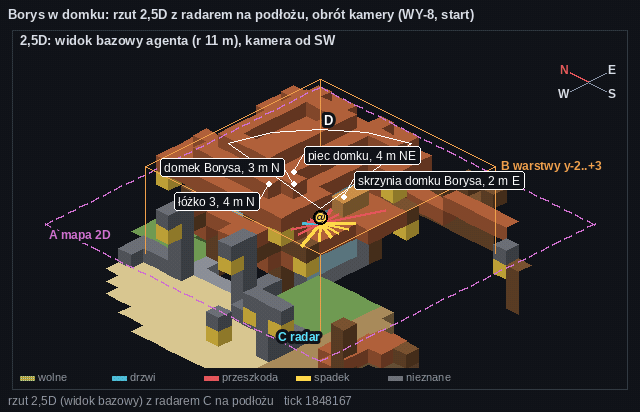](dodatki/filmy/wy8/klip-borys-radar-25d.gif)

*Film 6. Krótki klip (8 s): rzut 2,5D domku Borysa z promieniami radaru C na podłożu (wolne, drzwi, przeszkoda, spadek) i nakładkami A, B, D, kamera obraca się wokół ciała. Widoki w kadrze: rzut 2,5D (widok bazowy, prawa góra) i jego pochodne z literami: A mapa 2D z góry, B warstwy 3D wokół stóp, C radar z listą afordancji, D widok z oczu (kratka = nieznane, jasna mgła = poza zasięgiem 20 m). Źródło: WY-8, Borys, tick 1848167; klip z filmy.py (skrypt niepublikowany). Metoda: [README filmów](dodatki/filmy/README.md).*

Krótkie promienie kończą się na ścianach i szybach domku; warto porównać je z listą afordancji w panelu (c) rysunku 3a, gdzie wyjście prowadzi 7 kroków przez drzwi SW.

Ten sam domek w WY-7, zanim naprawiono dojście do kontenerów, jako drzewo decyzji:

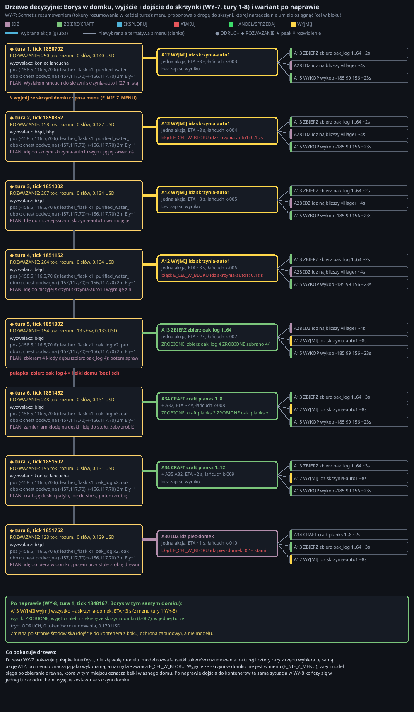

*Drzewo 3. WY-7: cztery razy A12 do skrzyni, której narzędzie nie osiąga (E_CEL_W_BLOKU), wyjęcie ze skrzyni domku spoza menu, zbieranie drewna, które jest belkami domu; na dole ta sama sytuacja w WY-8 po naprawie, rozwiązana w jednej turze akcją A13. Źródło: WY-7, transkrypty tur 1-8 górnika i dziennik przebiegu (log moda z WY-7 przepadł, wyniki z odpowiedzi w turach); WY-8, tura 1. Alternatywy pochodzą z zapisanych list `akcje` w transkryptach tur; jak czytać: rozdział 9.4.*

To drzewo jest graficzną wersją wniosku z rozdziału 8.1.2: błąd narzędzia przy akcji oznaczonej jako wykonalna zamienia rozważanie modelu w pętlę, a potem w niszczenie świata.

Listę afordancji dla muru z hordą pokazuje panel (c) rysunku 3b niżej. Surowy zapis: [radar i afordancje](dodatki/klatki-surowe/projekcja-mur-horda-p2.txt).

Mapę w zmiennej rozdzielczości dla tego scenariusza pokazuje panel (d) rysunku 3b. Surowy zapis: [mapa p4](dodatki/klatki-surowe/projekcja-mur-horda-p4.txt).


*Rys. 3b. Cztery rzuty dla scenariusza z murem i hordą: (a) obecna klatka 2D, (b) przejezdność 2,5D, (c) radar kątowy z listą afordancji, (d) kombinacja w zmiennej rozdzielczości z pierścieniami 12 i 24 bloków; (e) rzut wizualny 2,5D (izometryczny, bloki jako sześciany z cieniowaniem) z murem, zombie pod murem i ich drogą do bota (44 bloki przez drzwi i drabinę), czyli bufor bezpieczeństwa z listy afordancji. Panel (e) ma te same elementy co w rys. 3a (podziałka co 4 m, radar, nakładki A do D) oraz kierunek nadejścia hordy i drogę zombie do bota z buforem (44 bloki, ok. 11 s przy tempie marszu 5 ticków na blok, szacunek). Źródło: prototyp projekcji, miejsce `mur-horda` (scenariusz syntetyczny). Figura wygenerowana skryptem figury.py (skrypt niepublikowany) z prawdziwego zapisu.*

Z (2) model wprost czyta odpowiedź, której obecna klatka nie daje: zombie dojdą, ale dopiero drogą 44 bloków przez drzwi i drabinę. Z (4) widzi koronę muru (`.`), zejście 3 w dół (`c`), drzwi `/` i drabinę `H`. Czego brakuje: (4) nie pokazuje postaci i liter miejsc, więc pytania „gdzie handlarz?” przegrywa z obecną klatką.

Odkrycie poboczne z prototypu: **domek górnika stoi na palach**, a oboje drzwi prowadzą na półki 4,5 bloku nad ziemią, czyli dalej niż maksymalne zejście planera (3). Jedyne wejście to dziura w podłodze. To tłumaczy kłopoty z drzwiami w WY-7 (rozdz. 8.1.2): bot widział drzwi, ale za nimi nie było zejścia, a żadna warstwa klatki v1 tego nie pokazywała. Drugie odkrycie: zapamiętany punkt `rynek` leżał w pustej kieszeni 2 bloki pod powierzchnią rynku.

Ograniczenie, które trzeba powiedzieć wprost: prototyp liczy z pełnej wiedzy o świecie. W modzie trzeba liczyć z pamięci ciała (z mgłą `?`), inaczej bot dostanie rentgen. Rekomendacja to wdrażać po kolei: najpierw listę afordancji obok obecnej klatki (+80..150 tokenów) i test A/B, dopiero potem zamiana map.

## 8. Metapoznanie: system o sobie i agent o systemie

> Poziom 1: środowisko wie, kiedy zawodzi i jak pewne są jego odpowiedzi. Poziom 2: czy agent bez objaśnienia rozumie interfejs.

Wszystkie wcześniejsze audyty miały wspólny wzór: zawodziło środowisko (menu, symulator, drzwi, drabina), a model próbował dalej, aż wydał cały budżet. Z tego powstała druga linia prac, którą nazywam metapoznaniem. To nie jest jedno pojęcie, tylko co najmniej dwa poziomy, i oba są ważne:

- **Poziom 1, system o sobie:** środowisko wie, kiedy samo zawodzi i jak pewne są jego odpowiedzi, i mówi to modelowi i operatorowi (detektor błędów, tor kontrolny, ETA z przedziałem i pewnością, rozjazd „wykonalna TERAZ” z rzeczywistością, bufor zagrożeń ze statusem i pewnością, eksploracja, która zna własny warunek końca).
- **Poziom 2, agent o systemie:** czy agent bez objaśnienia sam rozumie działanie interfejsu, w tym klatek percepcji (mapa 3D, mapa 2D, trasa, ślad, legenda, skala), czyli czy czyta interfejs ze zrozumieniem, a nie tylko wykonuje instrukcję, jak go czytać.

Jest też trzeci poziom, bot o własnym działaniu: plan, refleksja nad nim i kryterium, kiedy cel jest osiągnięty (PLAN DNIA, kryterium sukcesu eksploracji). Opisuję go krótko w rozdziale 9, razem z metodami obserwacji i kalibracją.

Poziom 1 ma już kod, testy i pierwsze dane. Poziom 2 ma na razie tylko obserwacje i zaplanowany eksperyment.

### 8.1 Poziom 1: system o sobie

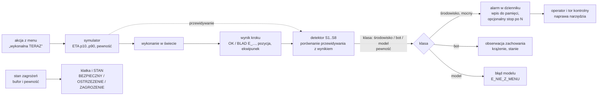

#### 8.1.1 Detektor błędów środowiskowych

Detektor w harnessie porównuje to, co środowisko obiecało, z tym, co się stało, i klasyfikuje każdą anomalię jako winę środowiska, bota albo modelu, z pewnością:

| sygnał | co wykrywa |
|---|---|
| S1 powtórzony błąd | ta sama akcja i ten sam kod N razy z rzędu |
| S2 rozjazd symulacji | symulacja mówi „wykonalny”, a krok pada w pierwszym ticku |
| S3 stoi mimo łańcucha | łańcuch przyjęty, pozycja i ekwipunek bez zmian przez 3 obserwacje |
| S4 blok przeszkoda | co najmniej 3 zdarzenia ruchu (cel w bloku, brak drogi, utknięcie, przeplanowanie) w promieniu 3 m |
| S5 niszczenie po błędzie | po błędzie narzędzia ciało zbiera albo kopie element zabudowy |
| S6 krążenie | długa droga, małe przesunięcie netto, powroty do tej samej komórki (wina bota) |
| S7 niezgodność źródeł | `krok` mówi „trwa”, log moda mówi „przerwany” (sygnał pomocniczy) |
| S8 rozjazd pozycji | po kroku ciało jest ponad 4 m od pozycji z symulacji |

Wstecz, na zapisach WY-5, WY-6 i WY-7, detektor wykrył 10 z 10 znanych przypadków, a z 48 mocnych wpisów 38 potwierdził audyt albo log, 10 było wiarygodnych bez potwierdzenia, a pewnych fałszywych alarmów nie było. Gdyby stop po 3 mocnych wpisach był włączony, WY-6 zatrzymałby się po 8 rundach i 2,44 USD zamiast po 48 rundach i 8,97 USD. Do detektora dołączyłem tor kontrolny: 8 prób (drzwi, drabina, schody, luka, woda, skrzynia, stół, płot z furtką) do uruchomienia przed scenariuszem, żeby sprawdzić narzędzia, zanim zrobi to model za pieniądze.

Uczciwie: progi dobierałem na tych samych trzech przebiegach, a w trakcie strojenia poprawiłem dwa fałszywe alarmy (S5 w zwykłym lesie, S8 z cudzym łańcuchem we wspólnym świecie). Na nowych danych od razu pojawił się trzeci rodzaj.

Alarmy z WY-8 (S8 przy `eksploruj` z rozjazdem 27,8 m od pozycji z symulacji i S7) widać jako znaczniki pod pasami ciał na rysunku 5. Surowy zapis: [dziennik alarmów WY-8](dodatki/klatki-surowe/odczyty/wy8-blad-srodowiska.log).

![Rys. 5. Oś ticków WY-8 w stylu przeglądarki przebiegów: w pasie każdego ciała prostokąty wykonywanych kroków łańcuchów od przyjęcia do końca (kolor wg kategorii akcji, obramowanie wg wyniku: zrobione, błąd, przerwane stopem), szare kreski bezczynności z liczbą ticków, nad pasem wywołania modelu z powodem, pod pasem zdarzenia (przejęcia łupu, odkrycia, alarmy detektora S7 i S8) i szmaragdy w czasie. Migawka do ticku 1850460; bez wykonywanego kroku Borys 13%, Wilga 43% czasu; jeden łańcuch Borysa `eksploruj las` trwał 1650 ticków, zanim przerwał go stop.](figury/f5-os-czasu-wy8.svg)

*Rys. 5. Oś ticków WY-8 w stylu przeglądarki przebiegów: w pasie każdego ciała prostokąty wykonywanych kroków łańcuchów od przyjęcia do końca (kolor wg kategorii akcji, obramowanie wg wyniku: zrobione, błąd, przerwane stopem), szare kreski bezczynności z liczbą ticków, nad pasem wywołania modelu z powodem, pod pasem zdarzenia (przejęcia łupu, odkrycia, alarmy detektora S7 i S8) i szmaragdy w czasie. Migawka do ticku 1850460; bez wykonywanego kroku Borys 13%, Wilga 43% czasu; jeden łańcuch Borysa `eksploruj las` trwał 1650 ticków, zanim przerwał go stop. Źródło: WY-8, dzienniki ciał (wyniki kroków łańcuchów), `rundy.jsonl` (wywołania i powody), `blad-srodowiska.jsonl`, polecenia łańcuchów z klatek i menu tur. Figura wygenerowana skryptem figury.py (skrypt niepublikowany) z prawdziwego zapisu.*

To fałszywy alarm: dla `eksploruj` symulacja kończy się wcześnie (zna tylko pierwszy odcinek), a ciało idzie dalej, zgodnie z planem. Detektor ma rację co do liczb (27,8 m od przewidywania), a myli się co do znaczenia, bo przewidywanie było z założenia niepełne. Wniosek: detektor potrzebuje od środowiska nie tylko przewidywania, ale też informacji, jak pełne jest to przewidywanie.

#### 8.1.2 Błędy narzędzi wywołują skłonności destrukcyjne

Najbardziej pouczający przypadek przyszedł w WY-7. Górnik nie mógł wyjść z domku: dojście do skrzyni kończyło się błędem „cel w bloku”, a drzwi prowadziły na półkę bez zejścia (rozdz. 7). Menu pokazywało `zbierz oak_log`, „najbliższy 2 m”. Bot zaczął zbierać belki własnego domku. Narzędzie wprawdzie dopisało „to nie drzewo (słup pni)”, ale akcja była w menu jako wykonalna. W tym samym przebiegu łowczyni nie weszła po drabince.

Zapisałem z tego notatkę projektową: **błędy narzędzi potrafią wywołać u agenta skłonności destrukcyjne.** Gdy zwykła droga zawodzi, agent sięga po obejście, które niszczy świat. To nie wina modelu, tylko akcji wykonalnych „na papierze”, plus brak ochrony zabudowy po wyłączeniu ochrony strefy. Konsekwencje: najpierw usuwać przyczynę błędu narzędzia, zabudowę chronić niezależnie od flag stref (wykluczenie z `zbierz`, `wykop`, `atakuj` i z menu), a w audycie szukać sekwencji „błąd, potem niszczenie” jako osobnej miary. Detektor ma ją jako sygnał S5. Przebieg WY-7 krok po kroku pokazuje drzewo 3 w rozdziale 7.

#### 8.1.3 Pewność odpowiedzi: ETA z przedziałem i „wykonalna TERAZ”

Środowisko, które mówi o sobie uczciwie, musi podawać nie tylko odpowiedź, ale też jej pewność. Część już działała: ETA z przedziałem p10..p90 i ryzykiem przerwania (rozdz. 4.3) oraz kolumna pewności w menu (`pewna`, `prawdopodobna`, `niepewna`). Ale etykieta „wykonalna TERAZ” była twierdzeniem bez pewności, a historia pokazała jej rozjazd z rzeczywistością w trzech miejscach: `pij` bez wody (WY-6), łańcuch „wykonalny” zakończony błędem w pierwszym kroku (rozdz. 5.7), `eksploruj` z przewidywaniem pozycji, które z założenia nie może się spełnić (rozdz. 8.1.1). Detektor zamienia ten rozjazd w sygnały S2 i S8, ale lepszą poprawką jest symulator, który mówi, czego nie wie.

#### 8.1.4 Stan zagrożeń z buforem czasu

Przerwanie łańcucha przez zagrożenie działało po odległości: zombie 2 m za murem przerywał pracę, choć nie miał jak dojść. Operator opisał to tak: stojąc na murze nad hordą wie, że jest bezpieczny, bo zombie potrzebuje co najmniej 3 tur, żeby go zranić, a model nie powinien tego wnioskować. Nowy stan zagrożeń liczy dla każdego wroga drogę (planer ruchu wroga z własnymi regułami: skok 1, bez wspinaczki, wyważa drewniane drzwi, wchodzi po drabinie), czas do pierwszego możliwego zranienia (p10..p90), bufor w turach i status z pewnością.

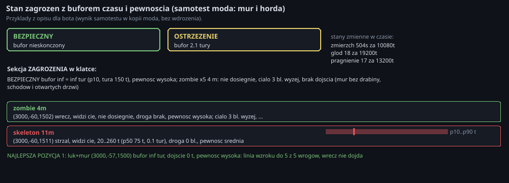

*Rys. 8.1. Stan zagrożeń jako karta: status BEZPIECZNY albo OSTRZEŻENIE z buforem w turach, stany zmienne w czasie, wrogowie z czasem do zranienia (p10..p90) i najlepsza pozycja. Źródło: przykłady wyniku samotestu moda w kopii ze zmianą (scenariusz mur i horda), bez wdrożenia. Surowy zapis: [przykłady](dodatki/klatki-surowe/odczyty/zagrozenia-samotest-przyklady.txt).*

Model czyta wprost: zombie 4 m od ciała nie jest zagrożeniem, szkielet 11 m jest, i to od razu. Pewność spada do „średniej”, gdy wróg jest tylko słyszany albo droga prowadzi przez nieznany teren. Tego jeszcze nie sprawdziłem w żywym przebiegu: zmiana jest w kopii, testy przechodzą (1198 testów, samotest scenariusza muru), ale wdrożenia nie było.

#### 8.1.5 Eksploracja z celem: wiedza o własnym warunku końca

W WY-8 górnik w turze 11 stał przy lesie (77 pni, najbliższy 5 m, `zbierz oak_log` w menu), a łańcuch `eksploruj las` szedł dalej, ponad 1650 ticków i 150 m, aż do granicy obszaru gry. Operator zapytał krótko: „po co poszedł do lasu?”. `eksploruj` kończyło się tylko na nowym odkryciu, limicie czasu albo po 8 odcinkach, a znane wpisy z zasady nie były celem. Brakowało kryterium sukcesu.

Projekt (zadanie w przygotowaniu, bez kodu): `eksploruj las --az drzewa 8 --budzet 1200`, wynik `SUKCES` albo `NIE ZNALEZIONO`, najpierw sprawdzenie pamięci (`JUZ_ZNANE` z celem `idz`/`zbierz` i ETA, zamiast marszu w nieznane) i menu, które przy akcji EKSPLORUJ pokazuje cel, warunek końca, budżet i „co dalej”. To jest metapoznanie poziomu 1 po stronie akcji: akcja musi wiedzieć, po co jest uruchomiona, żeby wiedzieć, kiedy skończyła. Ten sam warunek końca, zapisany przez bota w planie, należy już do poziomu 3 (rozdz. 9.2).


*Rys. 4a. Trajektoria Borysa w WY-8 z akcjami: wyjęcie zestawu w domku, potem długie marsze `eksploruj` na zachód, bez akcji zbierania przy lesie, który był w zasięgu. Białe etykiety: miejsca wioski. Źródło: WY-8, linie `stan` i wyniki kroków łańcucha w dzienniku ciała górnika. Figura wygenerowana skryptem figury.py (skrypt niepublikowany) z prawdziwego zapisu.*

Ten sam marsz w ruchu: 
[](dodatki/filmy/wy8/borys-eksploracja-i-drzewo.gif)

*Film 3 (powtórzenie; pierwsze osadzenie: rozdział 5.4). Na pasku czasu filmu widać rzadkie wywołania modelu (▼) i długie odcinki, w których ciało działa samo: odruch i łańcuch, a nie rozważanie. Las pojawia się w widoku z oczu, zanim łańcuch się kończy, i nic w środowisku nie mówi, że cel jest osiągnięty.*

To dlatego eksploracja potrzebuje kryterium sukcesu: krótkie wywołanie modelu przy pierwszym lesie w zasięgu skróciłoby marsz o setki ticków.
Te same rundy jako drzewo decyzji, z rundami bez wywołania modelu:

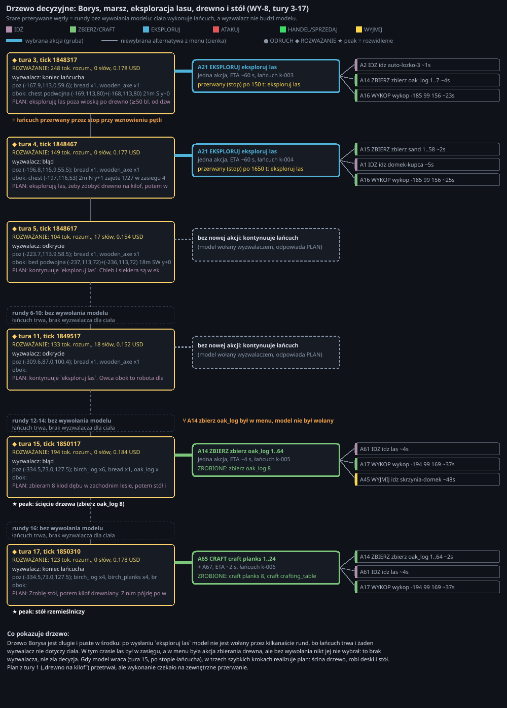

*Drzewo 2. Punkty decyzyjne Borysa, łańcuchy `eksploruj las` przerwane stopem po 150 i 1650 tickach, rundy bez wywołania (szare) i rozwidlenie w rundach 12-14: zbieranie drewna było w menu, ale model nie był wołany; peaki: ścięcie drzewa i stół. Źródło: WY-8, transkrypty tur 3-17 górnika, rundy przebiegu, dziennik ciała. Alternatywy pochodzą z zapisanych list `akcje` w transkryptach tur; jak czytać: rozdział 9.4.*

Drzewo pokazuje różnicę między odruchem a rozważaniem tylko tam, gdzie model jest wołany; najdroższa w czasie decyzja Borysa to ta, której nikt nie podjął, bo nie było wyzwalacza.

**WY-9: warunek końca w działaniu.** W przebiegu WY-9 (11 kroków po 150 ticków, model Sonnet, klatka środowiska z rzutem 2,5D w prompcie, menu w trybie ścisłym) eksploracja miała już cel w samej pozycji menu: u Borysa `A26 EKSPLORUJ eksploruj las --az drzewa 8 --budzet 1200`, u Wilgi `A25 EKSPLORUJ eksploruj zwierzyna --az stado 3 --budzet 1200`. Oba łańcuchy skończyły się porażką z kodem i powodem (`E_NIE_ZNALEZIONO`), a nie marszem do granicy obszaru. To jest zmiana, o którą chodziło: akcja wie, kiedy skończyła. Co bot zrobił z tą wiedzą, pokazują dwa filmy z nowym paskiem decyzji (PLAN, wybór z menu, wynik łańcucha) i osią decyzji całego przebiegu.

[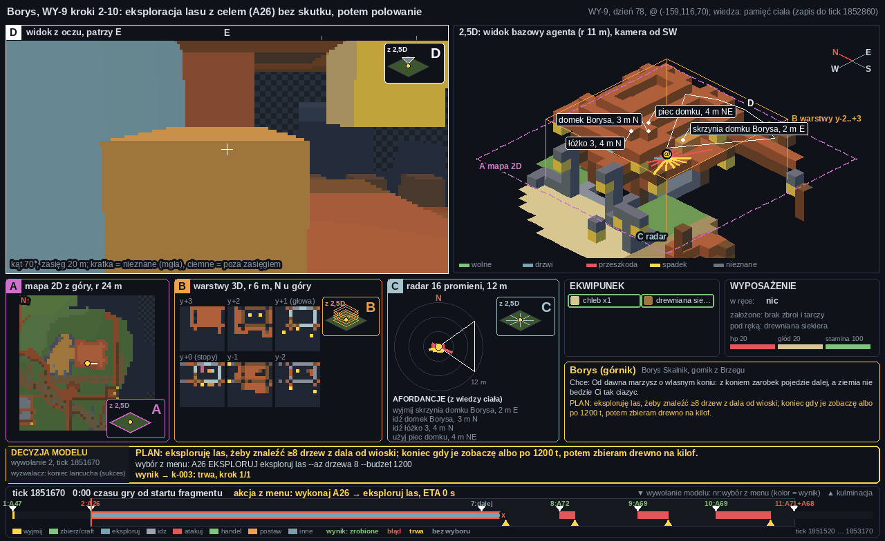](dodatki/filmy/wy9-borys-eksploracja-i-polowanie.gif)

*Film 7. Borys w WY-9, kroki 2-10 (ticki 1851670..1853020). Wywołanie 2 wybiera z menu A26, łańcuch k-003: Borys idzie 97 m od domku i po 796 tickach dostaje `E_NIE_ZNALEZIONO` („brak dalszych granic w promieniu 96 m i 120 m od dzwonu”, 0 pni drzew poza zabudową w 24 m). Wywołanie 7 (wyzwalacz: odkrycie stad) nie zmienia wyboru, a od wywołania 8 plan dryfuje w polowanie: A72 kura, dwa razy A69 owca, wszystkie trzy łańcuchy ZROBIONE. Pod kafelkami pasek DECYZJA MODELU: `PLAN:` z odpowiedzi modelu, pozycja menu `A<n>` z listy `akcje` tej tury i stan łańcucha w bieżącym ticku; w chwili wywołania film zatrzymuje się na 1 s. Na dole oś decyzji całego WY-9: numer wywołania i wybrane `A<n>` w kolorze wyniku (zielony zrobione, czerwony błąd, żółty trwa, szary bez nowego wyboru), jaśniejsze pole to fragment z filmu. Źródło: dziennik i transkrypty tur WY-9, log moda i pamięć ciała, kopia świata sprzed przebiegu; generator filmy.py (skrypt niepublikowany), opis kadru w [README filmów](dodatki/filmy/README.md).*

Porażka eksploracji nie wróciła do planu. W planie z wywołania 2 Borys sam zapisał warunek („koniec gdy je zobaczę albo po 1200 t, potem zbieram drewno na kilof”), ale po `E_NIE_ZNALEZIONO` wybiera najbliższą zwierzynę z menu („poluję na pobliską kurę, potem sprzedam w Brzegu i wrócę do szukania lasu albo rudy”), a w planach wywołań 9 do 11 drewna i kilofa już nie ma, są owce, kury i sprzedaż. Warunek końca działa po stronie akcji, a po stronie planu jeszcze nie.

[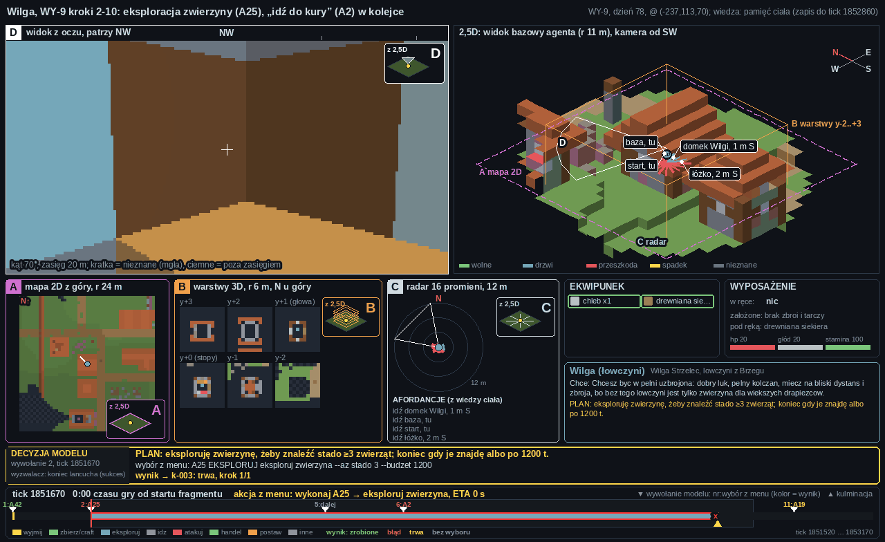](dodatki/filmy/wy9-wilga-eksploracja-zwierzyny.gif)

*Film 8. Wilga w WY-9, kroki 2-10 (ticki 1851670..1852940). Wywołanie 2 wybiera A25, łańcuch k-003. W kroku 5 harness zgłasza błąd kroku `E_BRAK_DROGI`, a model odpisuje „kontynuuje łańcuch k-003”. W wywołaniu 6 (wyzwalacz: ten błąd) wybiera A2 `idz auto-stado-chicken-1` i pisze w planie, że „poprzednia eksploracja skończyła się E_BRAK_DROGI”, choć k-003 dalej trwał. Nowy łańcuch k-004 czeka w kolejce (pasek decyzji: „w kolejce za k-003”). Po 1201 tickach k-003 kończy się `E_NIE_ZNALEZIONO` (budżet wyczerpany, brak stada co najmniej 3 zwierząt w 24 m), a tick później k-004 kończy się `E_BRAK_CELU`: menu tury 6 proponowało to miejsce, ale w chwili wykonania nie było go w pamięci Wilgi. Polowania na kurę nie było. Źródło jak w Filmie 7.*

Film 8 pokazuje drugą stronę: błąd kroku w trakcie łańcucha (`E_BRAK_DROGI`) model odczytał jako koniec eksploracji, a wybrana akcja czekała w kolejce, aż eksploracja wyczerpie budżet. Klatka tej tury pokazywała k-003 jako trwający (linia TRASA), ale odpowiedź `wykonaj A2` podała tylko „ETA 7 s” i nie wspomniała, że łańcuch ruszy dopiero po k-003. To jest zadanie dla poziomu 1: stan kolejki łańcuchów powinien być w odpowiedzi `wykonaj` (i liczony do ETA), a nie tylko w klatce.

### 8.2 Poziom 2: agent o systemie

Pytanie poziomu 2 jest proste do zadania i trudne do zmierzenia: czy model rozumie klatkę, czy tylko wykonuje instrukcję, jak ją czytać? Odpowiedź ma praktyczne skutki. Jeżeli model rozumie interfejs, można go zmieniać (np. zamienić mapę 3D na przejezdność, rozdz. 7) bez przepisywania wiedzy. Jeżeli tylko wykonuje instrukcję, każda zmiana formatu wymaga zmiany dokumentacji i ponownej kalibracji, a błąd w legendzie przenosi się prosto na decyzje.

**Co dziś wiadomo (obserwacje, nie pomiar).**

- W WY-8 nic nie było odkrywane samodzielnie. Legenda jest w samej klatce (linie `LEGENDA 3D` i `LEGENDA 2D`), nagłówek klatki odsyła do opisu w wiedzy, a plik `opis-klatki.md` jest dołączony do `CLAUDE.md` bota, czyli wczytywany w każdym wywołaniu.
- Klatka trafiła do kontekstu we wszystkich 17 wywołaniach (rozdz. 6), a zachowanie było spójne z mapą: łowczyni doszła do handlarza oznaczonego literą na mapie i sprzedała towar.
- W 46 tekstach odpowiedzi modelu w WY-8 (linie PLAN i komentarze) nie znalazłem ani jednego odwołania do klatki, mapy, legendy, trasy ani śladu. Model działa zgodnie z mapą, ale nie mówi, co z niej wyczytał. Z samego zachowania nie da się odróżnić zrozumienia od dopasowania do instrukcji.
- Pośrednio: w WY-6, gdy opis pragnienia był tylko w pliku, którego model nie czytał, model polegał na adnotacjach w menu (`ROLA: zakaz polowania`) bardziej niż na plikach (rozdz. 5.9). To sugeruje, że model ufa temu, co ma przed oczami, ale nie mówi, czy rozumie format.

**Planowany eksperyment (protokół; jeszcze niezlecony, czeka na decyzję operatora).**

1. **Warunki klatki:** (A) klatka z legendą i z `opis-klatki.md` jak w WY-8 (punkt odniesienia); (B) klatka z legendą, bez dokumentacji; (C) klatka bez legendy i bez dokumentacji; (D) klatka z **zamienioną legendą** (np. `L` opisane jako woda, `@` jako skrzynia): test, czy model wierzy legendzie, czy temu, co widzi w układzie mapy i w skutkach akcji.
2. **Pytania kontrolne** na tych samych klatkach (zestaw jak 21 pytań z rozdz. 7: gdzie jestem, dokąd prowadzi łańcuch, co było w poprzedniej klatce, ile bloków ma jeden znak mapy 2D, czy dojdę do skrzyni), oceniane jak tam: tak, częściowo, nie.
3. **Odkrywanie przez działanie:** w warunkach C i D krótki przebieg z akcjami odczytu i ruchu; miara to liczba tur do poprawnej interpretacji znaków i skali (np. czy po kroku na wschód model zauważa, że `@` przesunął się w prawo) oraz czy model sam zapisuje swoją legendę w notatce.
4. **Porównanie modeli:** Haiku, Sonnet i Opus na tych samych klatkach i pytaniach, z kosztem na poprawną odpowiedź.
5. **Kryterium:** poziom 2 uznaję za obecny, gdy w warunku C model odpowiada na co najmniej połowę pytań tak dobrze jak w A, a w warunku D wykrywa sprzeczność legendy z układem mapy, zamiast ją ślepo stosować.

> **Wynik eksperymentu: do uzupełnienia.** Eksperyment nie był uruchomiony; ta sekcja zostanie wypełniona po decyzji operatora i przebiegu.

## 9. Planowanie, metody obserwacji i kalibracja

> Tryb tura po turze jako metoda, plan i refleksja bota (poziom 3) oraz równowaga eksploatacji i eksploracji.

### 9.1 Tryb tura po turze jako metoda obserwacji

Przebieg WY-8 prowadziłem nietypowo: po jednym wywołaniu na pętlę, z wznowieniem i przeglądem po każdej turze. Kosztuje to czas operatora, ale dało znalezisko, którego audyt po fakcie by nie pokazał: harness na starcie każdej pętli i przy każdym wznowieniu wysyłał obu ciałom `stop wszystko`, czyli zrywał trwające łańcuchy. Przy pracy w długich pętlach działo się to rzadko, a przy wznowieniach co turę stało się widoczne. W dzienniku WY-8 pierwsze 4 pętle mają `OK stop wszystko`, następne 10 już `pominiety (--bez-stopu-na-starcie)`.

### 9.2 Poziom 3: plan i refleksja bota

Poziom 3 to metapoznanie bota o własnym działaniu. Wiedza dostała zasadę: przy nowym dniu gry albo po zakończeniu planu bot zapisuje w dzienniku jedną linię `PLAN DNIA: co chce zrobić, co chce uzyskać, co sprawdza nowego, kiedy zmienia plan`, na koniec dnia krótko, co się udało, a harness pokazuje mu w następnym wywołaniu ostatni plan. Plan zmienia się tylko przy zagrożeniu, błędzie środowiska (ten sam kod 2 razy) albo lepszej okazji. Do tego konsolidacja wiedzy co kilka tur (lekcje z wygasaniem, osobne zadanie) i podsumowanie rundy z liczbą negatywnych węzłów doświadczenia („czego unikać”).

W WY-8 boty pisały linię `PLAN` w każdym wywołaniu (15 razy w dzienniku), ale do chwili pisania żaden nie zapisał `PLAN DNIA`. Zasada istnieje, a nawyku jeszcze nie ma.

**Plan, uzasadnienie i wybór z menu (WY-9).** W WY-9 każde z 12 wywołań (Borys 7, Wilga 5) wygląda podobnie: model woła `akcje`, pisze jedno, dwa zdania i wybiera pozycję menu `wykonaj A<n>`, a na końcu linię `PLAN`. Uzasadnienia są krótkie i nie odwołują się do rysunku mapy z klatki; liczby, które się w nich pojawiają („cel 36 m SW”, współrzędne kury), pochodzą z tekstowych linii klatki (TRASA) i z odpowiedzi `wykonaj` (symulacja stanu po kroku). Film 9 pokazuje oba ciała w ostatnim kroku przebiegu, w którym uzasadnienie i wybór rozjeżdżają się u obu.

[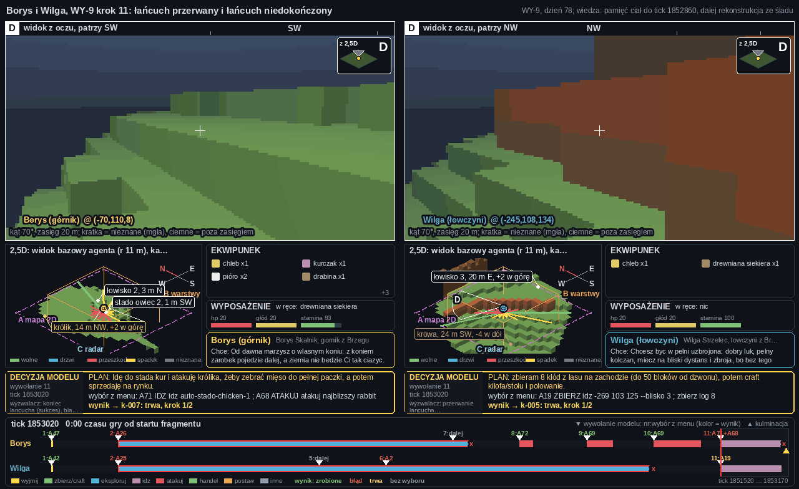](dodatki/filmy/wy9-para-krok-11.gif)

*Film 9. Krok 11 WY-9 (ticki 1853020..1853170), lewa połowa Borys, prawa Wilga; każde ciało ma widok z oczu, rzut 2,5D z nakładkami, kafelki i własny pasek decyzji, na dole wspólna oś decyzji całego przebiegu w dwóch pasach. Borys pisze „najbliższy rabbit nie ma skupu, więc idę po kurę i owcę”, a wybiera A71 `idz auto-stado-chicken-1` i A68 `atakuj najblizszy rabbit`; krok 1 (28 m) jest ZROBIONY, krok 2 kończy się `E_BRAK_CELU`, bo w wiedzy ciała nie ma królika (rzut z peaku w filmie: w afordancjach są stada kur i owiec, królika nie ma). Wilga pisze „idę na zachód, eksploruję w poszukiwaniu stada”, a wybiera A19 `idz -269 103 125 --blisko 3 ; zbierz log 8` i planuje „zbieram 8 kłód”; krok 1 jest ZROBIONY, krok 2 nie zaczyna się przed końcem danych, łańcuch zostaje NIEDOKOŃCZONY. Źródło: dziennik, transkrypty tur 11 i log moda obu ciał WY-9; generator filmy.py (skrypt niepublikowany).*

Wniosek jest skromny i nie dotyczy widoku 2,5D: filmy pokazują, co ciało mogło wiedzieć w chwili wyboru, obok tego, co model wybrał, ale nie pokazują, że rzut 2,5D w prompcie poprawił decyzje. W WY-9 decyzję niesie menu: model wybiera pozycję, a plan i uzasadnienie są do niej dopisane i nie zawsze się z nią zgadzają. Dlatego oś decyzji w filmach ma trzy pola na każde wywołanie (PLAN, wybrane `A<n>`, wynik łańcucha) i dopiero ich porównanie mówi, czy plan prowadzi działanie.

### 9.3 Kalibracja eksploatacji i eksploracji

Wszystkie powyższe elementy służą jednej równowadze, którą operator nazwał kluczową: bot ma umieć sprzedać i pracować na tym, co zna (eksploatacja), ale też ruszyć w nieznane po większą nagrodę (eksploracja), bez błądzenia i bez niszczenia. W WY-5 i WY-6 boty utknęły po stronie eksploatacji i pętli (`pij`, woreczki atramentu, brak sprzedaży), a eksploracja dawała głównie odkrycia bez wartości i błędy środowiska. W WY-8 pierwsza sprzedaż pokazała eksploatację, a marsz górnika przez las bez celu pokazał eksplorację bez kryterium.

Oś ticków WY-8 (rys. 5 w rozdziale 8) pokazuje obie strony tej równowagi w jednym obrazie: Wilga ma krótkie, produktywne łańcuchy (polowanie, droga do handlarza, sprzedaż), ale 43% czasu bez żadnego wykonywanego kroku, a Borys prawie bez przerw, tylko że przez 1650 ticków w jednym łańcuchu `eksploruj las` bez kryterium końca. Bezczynność to sygnał dla harnessu (budzić model wcześniej), a długi łańcuch bez celu to sygnał dla interfejsu akcji (eksploracja z warunkiem sukcesu).

Plan i jego realizacja w ruchu, na przykładzie Borysa: 
[](dodatki/filmy/wy8/borys-eksploracja-i-drzewo.gif)

*Film 3 (powtórzenie; pierwsze osadzenie: rozdział 5.4). Kafelek ROLA pokazuje aktualny `PLAN:` modelu, a pasek czasu kolejne kroki: plan „drewno na kilof” realizuje się dopiero po długiej eksploracji, potem w trzech szybkich krokach (ścięcie, deski, stół).*

Realizacja planu jest szybka, gdy cel jest w menu; wolna, gdy cel trzeba najpierw znaleźć bez kryterium końca.

Metryka, którą wprowadzam do oceny przebiegów: oba bieguny mierzone osobno (sprzedaże i zarobek na turę; nowe regiony, pokrycie, wyprawy do nagród, koszt tur), plus odsetek tur na eksplorację i jej wynik. Samo krążenie nie jest nagradzane. Kalibrację trzeba sprawdzać osobno dla każdego modelu, bo Haiku, Sonnet i Opus różnie ważą ryzyko: w WY-6 Opus był najostrożniejszy i najdroższy, a tani Haiku w trybie swobodnym robił więcej, choć też nie sprzedawał.

### 9.4 Drzewa decyzyjne: jak czytać

Drzewa 1 do 3 (rozdziały 6, 7 i 8) pokazują decyzje z filmów jako ciąg **punktów decyzyjnych**, czyli klatek decyzyjnych z jednej tury.

- **Węzeł** (karta po lewej) to punkt decyzyjny: tura, tick, ciało, **wyzwalacz** wywołania modelu, sytuacja z klatki (pozycja, ekwipunek, najbliższy obiekt) i ostatni **plan**. Ikona i kolor mówią, jak model użył klatki: **ODRUCH** (●, 0 tokenów rozumowania i mniej niż 25 słów przed akcją) albo **ROZWAŻANIE** (◆, tokeny rozumowania albo dłuższy tekst przed akcją); obok liczba tokenów rozumowania i koszt wywołania.
- **Gruba gałąź** to przyjęty łańcuch: identyfikator z menu, kategoria (kolor jak na osi ticków), polecenie, ETA i wynik (ZROBIONE, błąd z kodem, przerwany, w kolejce). Przerywana szara gałąź oznacza wywołanie bez nowej akcji („kontynuuje”).
- **Cienkie gałęzie** to 2 do 3 niewybrane pozycje z menu tej samej tury, wybrane tak, żeby pokazać inne kategorie; pochodzą z zapisanych list `akcje` w transkryptach tur.
- **Szare przerywane węzły** to rundy bez wywołania modelu: ciało wykonuje łańcuch, a żaden wyzwalacz go nie budzi.
- **★ peak** oznacza kulminację (sprzedaż, ścięcie drzewa, stół), a **⑂ rozwidlenie** miejsce, w którym inne wybranie albo inny wyzwalacz dałby inny przebieg.

Drzewa odpowiadają na trzy pytania z tego eseju: czy plan dryfuje (Wilga: nie), czy brakuje wyzwalacza (Borys w WY-8: tak, w rundach 12 do 14) i czy interfejs zastawia pułapkę (Borys w WY-7: tak, akcja wykonalna tylko na papierze).

## 10. Pamięć: wspomnienia, epizody i sieć znaczeń

> Jak bot zamienia to, co się wydarzyło, w lekcje: inbox wspomnień, konsolidacja przy zatrzymanym świecie i projekt epizodu z encjami, lokacją, rzutem 2,5D z peaku i siecią znaczeń.

Rozdziały 5 do 7 opisują, co ciało widzi teraz. Ten rozdział dotyczy tego, co z tego zostaje na później. Pamięć ciała z rozdziału 5 przechowuje miejsca, stada i złoża, ale nie przechowuje tego, co się *stało*: że sprzedaż skór udała się na rynku, że opcja w poleceniu została źle odczytana, że las obok był, a łańcuch poszedł dalej. Do tego służą wspomnienia i ich konsolidacja w lekcje.

### 10.1 Pojęcia

Pojęcia z tego rozdziału są stałe w całym eseju:

- **Wspomnienie**: zapis jednego zdarzenia z wyników tury albo dziennika ciała, z typem (handel, przejęcie, błąd, odrzucona akcja, odkrycie, koniec łańcucha, walka, śmierć), **wagą** (śmierć 10, handel 4, utknięcie 4, walka 3, odkrycie 2, błąd 2, przejęcie 1; pierwsze zdarzenie danego typu +3, nowy kod błędu +3, powtórzenie +1) i licznikiem powtórzeń.
- **Epizod** (projekt): wspomnienie z kontekstem. Składa się z **czynności** z czynnością **poprzednią i następną** (z tickami), **encji** (NPC, przedmiot, mob, narzędzie) z rolą w czynności, **lokacji** (nazwa, współrzędne i relacje do znanych miejsc, np. „kuźnia, 36 m SE”), **rzutu 2,5D z peaku** (mała izometria otoczenia w chwili najwyższej wagi, w tej samej konwencji co figury z rozdziału 7) oraz trójki **wynik, waga, pewność**.
- **Sieć znaczeń** (projekt): graf, którego węzłami są encje, miejsca i czynności, a krawędziami relacje `w_lokacji`, `po_czynnosci`, `z_udzialem`, `daje_wynik` i `kosztuje`.

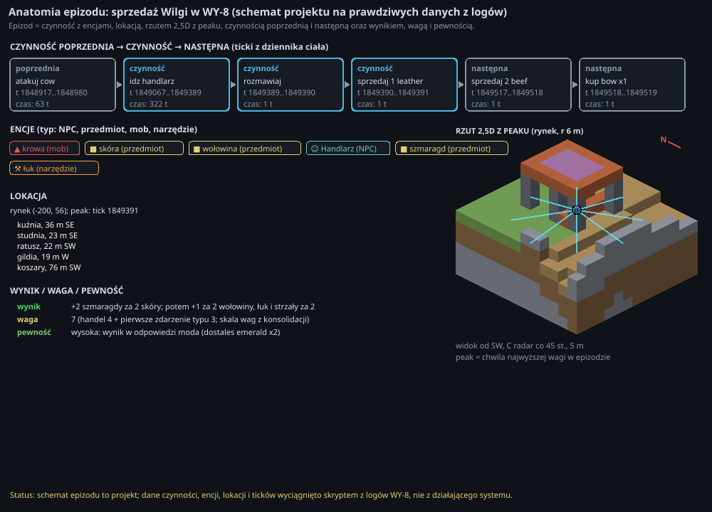

*Rys. 10.1. Anatomia epizodu na przykładzie sprzedaży Wilgi w WY-8: czynność poprzednia (atak na krowę, przejęte 2 skóry i 2 wołowiny), czynność (droga do handlarza, rozmowa, sprzedaż 2 skór za 2 szmaragdy) i następne (sprzedaż wołowiny, kupno łuku), encje z typami, lokacja z relacjami do miejsc wioski, rzut 2,5D z peaku na rynku oraz wynik, waga i pewność. Źródło: dziennik ciała łowczyni w WY-8 (ticki 1848917..1849519), pamięć miejsc ciała, kopia świata. Schemat epizodu jest projektem; pola wypełnił skrypt z logów. Surowy zapis: [epizody](dodatki/dane/wy8-epizody.json).*

Ten sam epizod w ruchu: 
[](dodatki/filmy/wy8/wilga-polowanie-i-sprzedaz.gif)

*Film 4 (powtórzenie; pierwsze osadzenie: rozdział 5.6). Film zatrzymuje się w kulminacjach (zabicie, sprzedaż, zakup) i pokazuje rzut z peaku: to te chwile, które epizod zapisuje jako peak i z których bierze swój rzut 2,5D.*

Dla czytelnika: peak sprzedaży jest na rynku (tick 1849391), a łup powstał 56 m dalej ok. 410 ticków wcześniej; płaskie wspomnienie gubi tę odległość w czasie i przestrzeni, epizod ją zachowuje.

### 10.2 Mechanika konsolidacji

Moduł konsolidacji w harnessie zapisuje wspomnienia w inboxie po każdej turze. Wyzwalacz (co N tur, co najmniej X nieopisanych wspomnień albo suma wag co najmniej W) zatrzymuje świat w trybie turowym. Osobny subagent na każde ciało, z narzędziami tylko do odczytu, opisuje wspomnienia jako lekcje. Strażnik zapisu sprawdza źródło, limit tokenów i zakazy, a do pliku trafia wyłącznie warstwa lekcji, która wygasa bez potwierdzenia. Lekcje wracają do bota w następnej klatce.

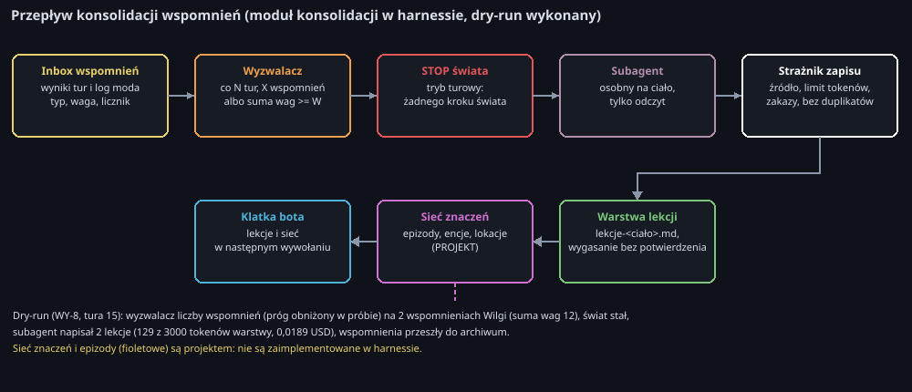

*Rys. 10.2. Przepływ konsolidacji: inbox, wyzwalacz, zatrzymanie świata, subagent tylko do odczytu, strażnik zapisu, warstwa lekcji i klatka bota; sieć znaczeń (fioletowa) jest projektem. Źródło: moduł konsolidacji i dziennik dry-runu. Surowy zapis: [dziennik konsolidacji](dodatki/dane/dry-run-konsolidacji/dziennik-konsolidacji.txt).*

Na WY-8 skrypt figur odtworzył wspomnienia ze wszystkich kroków przebiegu tą samą funkcją, której używa harness, na kopii katalogu przebiegu: 24 wspomnienia obu ciał. Gdyby działały warianty wyzwalaczy z protokołu testu (D: co najmniej 8 wspomnień, E: suma wag co najmniej 20), konsolidacja wypadłaby w rundach 6 i 11 (D) albo 4, 7 i 15 (E).

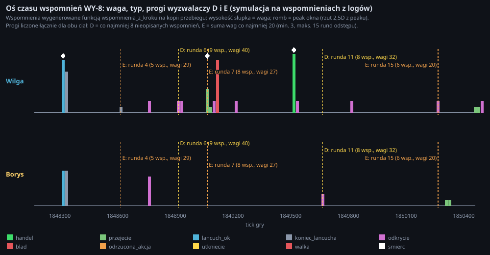

*Rys. 10.3. Oś czasu wspomnień WY-8: słupek = wspomnienie (wysokość = waga, kolor = typ), pionowe linie = momenty konsolidacji w symulacji wariantów D i E, romby = peak okna, czyli moment, z którego epizod brałby rzut 2,5D. Źródło: wspomnienia odtworzone skryptem z logów WY-8. Surowy zapis: [wspomnienia](dodatki/dane/wy8-wspomnienia.jsonl).*

### 10.3 Sieć znaczeń z WY-8

Z tych samych kroków skrypt zbudował sieć znaczeń obu ciał. Lokacje wyznaczył deterministycznie z pozycji ciała i pamięci miejsc, a encje z wyników kroków: przejęty łup, kupione i oddane przedmioty, cel ataku, rozmówca. Sieć Wilgi pokazuje pętlę zarobku: krowa, skóra i wołowina, Handlarz na rynku, szmaragd, łuk i strzały. Sieć Borysa pokazuje pętlę rzemiosła: las, drzewo, siekiera, kłody, deski i stół, poprzedzoną dwoma przerwanymi łańcuchami `eksploruj las`.

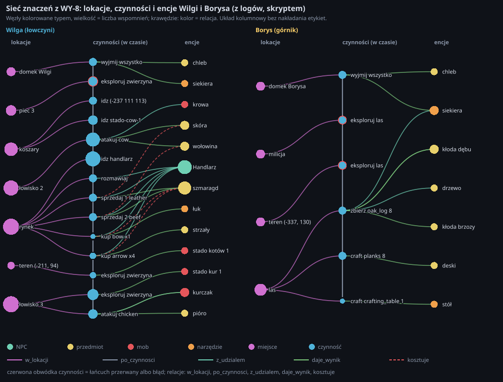

*Rys. 10.4. Sieć znaczeń z WY-8: kolumny lokacji, czynności (w czasie) i encji; węzły kolorowane typem, wielkość według liczby wspomnień, krawędzie kolorowane relacją (`kosztuje` przerywana). Źródło: dziennik ciał, pamięć miejsc ciał, wspomnienia odtworzone skryptem. Wizualizacja danych z logów, nie wynik działającego systemu. Surowy zapis: [epizody](dodatki/dane/wy8-epizody.json).*

### 10.4 Co pokazała próba: płaskie wspomnienie kontra epizod

Dry-run konsolidacji wykonano na prawdziwych wspomnieniach Wilgi z WY-8 (tura 15, dwa wspomnienia, świat stał, koszt 0,0189 USD). Powstały dwie lekcje. Lekcja o sprzedaży jest poprawna. Lekcja o akcji A18 jest częściowo błędna: powtórzyła komunikat moda („A18 nie przyjmuje ilości”), choć prawdziwą przyczyną było to, że opcja `--zastap` po `wykonaj A18` została odczytana jako ilość. Płaskie wspomnienie nie miało czynności poprzedniej ani skutku w czasie, więc subagent nie miał z czego tego wywnioskować.

Epizod z kontekstem zawiera trwający łańcuch eksploracji, znaczenie A18 i 142 ticki czekania w kolejce. Z tego wynika inna, użyteczna lekcja: żeby zastąpić trwający łańcuch, najpierw `stop`, potem `wykonaj A18`.

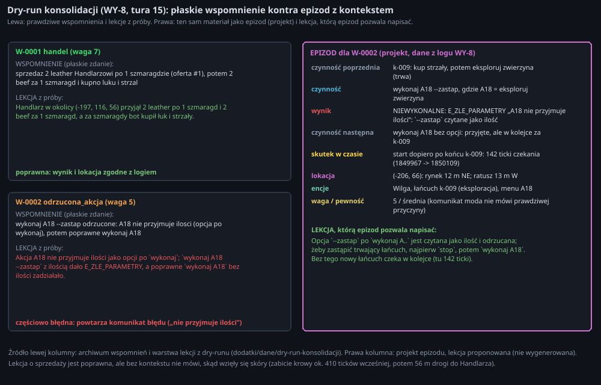

*Rys. 10.5. Lewa kolumna: prawdziwe wspomnienia i lekcje z dry-runu (lekcja o A18 oznaczona jako częściowo błędna). Prawa: epizod dla tego samego wspomnienia z danych logu i lekcja, którą epizod pozwala napisać (proponowana, nie wygenerowana). Źródło: archiwum wspomnień i warstwa lekcji z dry-runu, dziennik ciała WY-8. Surowy zapis: [lekcje](dodatki/dane/dry-run-konsolidacji/lekcje-lucznik.md), [wspomnienia](dodatki/dane/dry-run-konsolidacji/wspomnienia-0015.jsonl).*

### 10.5 Status

- **Działa i jest sprawdzone dry-runem:** inbox wspomnień, wagi, wyzwalacze, zatrzymanie świata, subagent tylko do odczytu, strażnik zapisu i warstwa lekcji, na płaskich wspomnieniach.
- **Projekt, niezaimplementowany:** schemat epizodu (encje, lokacja, rzut 2,5D z peaku, czynność poprzednia i następna, wynik, waga, pewność) i sieć znaczeń.
- **Wizualizacje danych, nie wyniki systemu:** rysunki 10.1, 10.3 i 10.4 zbudował skrypt figur z logów WY-8, żeby pokazać, jak epizod i sieć wyglądałyby na prawdziwym przebiegu. Lekcja po prawej stronie rysunku 10.5 jest propozycją.

## Aneks: glosariusz: pojęcia i symbole klatki

### Pojęcia

- **Ciało:** postać sterowana przez agenta (bot-NPC na serwerze), z ekwipunkiem, wytrzymałością, pragnieniem.
- **Łańcuch:** lista do 5 kroków poleceń wykonywana przez mod bez wołania modelu.
- **Tick (t):** jednostka czasu gry, 20 t = 1 s.
- **Tryb ścisły:** model może wykonać tylko akcje z menu (`wykonaj A<n>`).
- **Tryb zdarzeniowy:** świat idzie krokami po 150 t, model jest wołany tylko przy wyzwalaczu.
- **Wywołanie produktywne:** wywołanie modelu, po którym w świecie przybyło przedmiotu, craftu albo odkrycia.
- **Harness:** skrypt, który woła model, przesuwa świat, czyta logi i zapisuje dziennik przebiegu.
- **Klatka percepcji:** tekst, który ciało zwraca na `percepcja` (STAN, STRESZCZENIE, SIATKA, BYTY, ZDARZENIA), opisany w [rozdziale 5](czesc-2-percepcja-i-metapoznanie/05-system-percepcji.md).
- **Klatka środowiska:** gotowy tekst wkładany przez harness do każdego wywołania (STAN, mapa 3D, mapa 2D, miejsca, trasa, ślad), opisany w [rozdziale 6](czesc-2-percepcja-i-metapoznanie/06-klatka-srodowiska.md).
- **Afordancja:** to, co ciało może zrobić z danym miejscem albo obiektem (wejdziesz, zejdziesz, otworzysz, dojdą), opisana wprost w tekście.
- **Metapoznanie, poziom 1, 2, 3:** system o sobie, agent o systemie, bot o własnym planie ([rozdział 8](czesc-2-percepcja-i-metapoznanie/08-metapoznanie.md)).

### Mapa 3D klatki (warstwy y+3 .. y-2)

| znak | znaczenie | znak | znaczenie |
|---|---|---|---|
| `#` | lity blok | `.` | powietrze albo roślina |
| `~` | woda | `^` | lawa |
| `o` | ruda | `L` | drzewo (pień, liście) |
| `z` | zabudowa | `H` | drabina |
| `/` | drzwi | `c` | skrzynia albo beczka |
| `t` | stół rzemieślniczy | `f` | piec |
| `b` | łóżko | `\|` | płot, mur, krata |
| `?` | nieznane | `@` / `&` | ciało / drugi bot |

### Mapa 2D klatki (widok z góry)

Teren: `G` trawa, `L` las, `W` woda, `S` skała, `P` piasek, `D` droga, `Z` zabudowa, `F` pole, `N` śnieg, `V` lawa, `X` inne, `?` nieznane (mgła), `-` widziane bez pewnej powierzchni. Wielka litera = widziane w ostatnich 60 s, mała = starsze.

Znaczniki: `@` ciało, `&` drugi bot, `T` cel łańcucha, `*` trasa łańcucha, `1`..`9` ślad poprzednich klatek, `A B C E H I J K M O Q R U Y` miejsca z pamięci, `a` stado, `o` złoże rudy, `m` wrogie moby, `:` granica strefy wioski, `!` granica obszaru gry.

### Prototyp projekcji: przejezdność 2,5D

`@` ty, `.` Twój poziom, `1`..`9` wyżej o tyle bloków (1 = skok, 2 = wspinaczka), `a`..`i` niżej o 1..9 (do `c` zejdziesz), `/` drzwi drewniane, `=` furtka, `H` drabina, `~` woda, `K` skrzynia. Nieprzejezdne: `#` ściana albo uskok > 2, `|` płot lub mur 1,5, `v` spadek >= 4, `^` lawa lub ogień, `I` żelazne drzwi, `x` odcięte, `m` wróg.

### Prototyp projekcji: radar kątowy

32 promienie co 11,25 stopnia (0 = N), komórka = typ i odległość w metrach: `z` ściana, `#` skała, `L` pień, `l` liście, `g` szyba, `|` płot, `/` drzwi, `=` furtka, `H` drabina, `K` skrzynia, `f` piec, `t` stół, `b` łóżko, `~` woda, `^` lawa, `!` ogień; `.` nic do 32 m.

### Kolory figur

Figury używają palety przeglądarki przebiegów: teren jak `EKKOL` (trawa `#6f9a52`, las `#2f6b3a`, woda `#3f78b8`, skała `#8a8f98`, piasek `#d8c690`, droga `#a88a5a`, zabudowa `#b0603a`, pole `#b5a63c`), Borys `#ffd36b`, Wilga `#4fb3d9`, trasa `#4fb3d9`, cel `#e5565b`, ślad `#b48ead`, miejsca `#e8d06b`; tło `#0f1218`.

### Konwencja figur i skąd pochodzą widoki

- **Widok 2,5D jako układ odniesienia.** Rzut izometryczny od SW (N w górę w lewo, E w górę w prawo) jest widokiem bazowym; pozostałe widoki są jego pochodnymi.
- **Litery źródeł:** A mapa 2D z góry (także przejezdność i zmienna rozdzielczość), B warstwy i przekroje 3D, C radar (promienie od @), D widok z oczu (pierwsza osoba). Ta sama litera i kolor w nakładce 2,5D, w miniaturze w rogu innych figur i w legendzie; ten sam schemat stosują filmy.
- **Odległość i kierunek:** poziomo w metrach (1 blok = 1 m) od ciała (@ = 0), kierunek jeden z 8, wysokość osobno („+2 w górę”). Przykład etykiety: „kuźnia, 33 m SE”, „drzwi, 3 m SW”.
- **Radar w 2,5D:** zielony wolne, niebieski drzwi lub przejście, czerwony przeszkoda, żółty spadek; liczba przy końcu promienia to odległość w metrach.
- **Nazwy miejsc:** polskie odpowiedniki nazw technicznych (domek Borysa, domek Wilgi, skrzynia domku, Handlarz, Stajenny, Strażnik Bramy, kuźnia, studnia, rynek, koszary, ratusz, gildia); złote z pamięci ciała, białe z konfiguracji wioski.

### Pamięć: wspomnienia, epizody i sieć znaczeń

- **Wspomnienie:** zapis jednego zdarzenia z wyników tury albo dziennika ciała (typ, waga, licznik powtórzeń, tura, tick, pozycja, krótki kontekst).
- **Waga:** liczba porządkująca wspomnienia do konsolidacji (śmierć 10, handel 4, utknięcie 4, walka 3, odkrycie 2, błąd 2, przejęcie 1; pierwsze zdarzenie typu +3, nowy kod błędu +3, powtórzenie +1).
- **Pewność:** jak bardzo wynik wspomnienia jest potwierdzony (wysoka: wynik w odpowiedzi moda; średnia: komunikat może nie mówić prawdziwej przyczyny).
- **Wynik:** co czynność zmieniła w świecie albo ekwipunku.
- **Encje:** uczestnicy czynności z typem: NPC, przedmiot, mob, narzędzie.
- **Lokacja:** nazwane miejsce czynności ze współrzędnymi i relacjami do znanych miejsc („kuźnia, 36 m SE”).
- **Rzut 2,5D z peaku:** mała izometria otoczenia w chwili najwyższej wagi epizodu, w konwencji figur (widok od SW, litery A do D).
- **Czynność poprzednia i następna:** sąsiednie kroki łańcuchów tego samego ciała w czasie, z tickami.
- **Epizod:** wspomnienie z encjami, lokacją, rzutem 2,5D z peaku, czynnością poprzednią i następną oraz wynikiem, wagą i pewnością (projekt).
- **Sieć znaczeń:** graf, węzły: encje, miejsca, czynności; krawędzie: `w_lokacji`, `po_czynnosci`, `z_udzialem`, `daje_wynik`, `kosztuje` (projekt).
- **Konsolidacja:** zamiana wspomnień w lekcje przy zatrzymanym świecie przez subagenta tylko do odczytu, ze strażnikiem zapisu.
- **Wyzwalacze D i E:** D = co najmniej 8 nieopisanych wspomnień, E = suma wag co najmniej 20 (min. 3, maks. 15 tur odstępu).

### Drzewa decyzyjne

- **Punkt decyzyjny:** klatka decyzyjna jednej tury: tura, tick, ciało, wyzwalacz, sytuacja z klatki, plan.
- **Wyzwalacz:** powód wywołania modelu (koniec łańcucha, błąd, odkrycie, zagrożenie, watchdog); jego brak oznacza rundę bez wywołania.
- **Odruch:** decyzja bez rozumowania (0 tokenów rozumowania i mniej niż 25 słów przed akcją).
- **Rozważanie:** decyzja z tokenami rozumowania albo z dłuższym tekstem przed akcją.
- **Plan:** linia `PLAN:` modelu, przenoszona między turami przez łańcuch i dziennik.
- **Gałąź wybrana / alternatywa:** przyjęty łańcuch (gruba gałąź, kolor kategorii) i niewybrane pozycje menu z tej samej tury (cienkie, szare).
- **Peak (★) i rozwidlenie (⑂):** kulminacja przebiegu i miejsce, w którym inna decyzja albo inny wyzwalacz dałby inny przebieg.